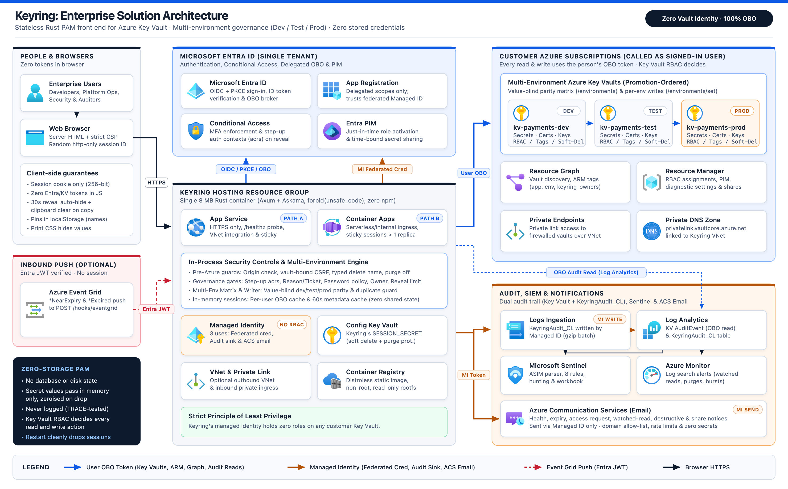
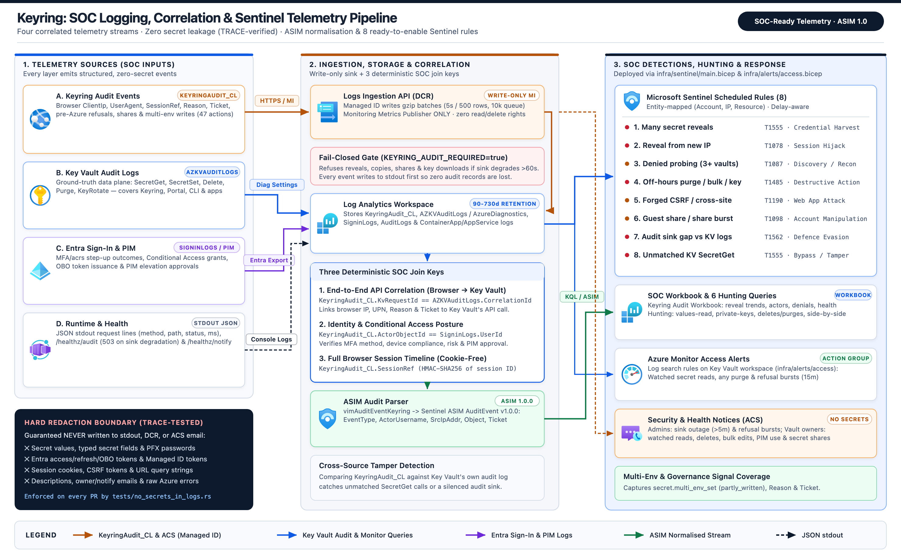

# Design

The solution design document is the formal design record for Keyring, written for review by architecture, security and operations staff. It covers the solution overview, logical architecture, components, data, integrations, identity and access, security, deployment, operations, risks and decisions, and appendices with every setting.

- [Keyring design document (PDF)](Keyring-Design-Document.pdf) / [Word](Keyring-Design-Document.docx)
- [Security architecture and controls (PDF)](Keyring-Security.pdf) / [Word](Keyring-Security.docx)
- [Enterprise comparison and migration guide (PDF)](Keyring-Enterprise-Comparison.pdf) / [Word](Keyring-Enterprise-Comparison.docx)
- [Deployment guide (PDF)](Keyring-Deployment-Guide.pdf) / [Word](Keyring-Deployment-Guide.docx)
- [Developer guide (PDF)](Keyring-Developer-Guide.pdf) / [Word](Keyring-Developer-Guide.docx)

The document is built from source in the repository's `docs/design/` folder. That source isn't rendered on this site; read the PDF or the Word file.

## Diagrams

The other diagrams (logical architecture, identity and token flows, network and data flows, notification flows, deployment and security controls) are in the design document.

## Related

- [Architecture](architecture.md): how the code is laid out, how sign-in and tokens work, and the threat model in engineering detail.
- [Threat model](threat-model.md): trust boundaries, the threat model diagram and every STRIDE threat.
- [Walkthrough guides (PDF)](Keyring-Walkthrough-Guides.pdf) and [administrator SOPs (PDF)](Keyring-Admin-SOPs.pdf), the same content as the [Walkthroughs](guides/00-about.md) and [Administer](admin/admin-sops.md) sections, for printing.
