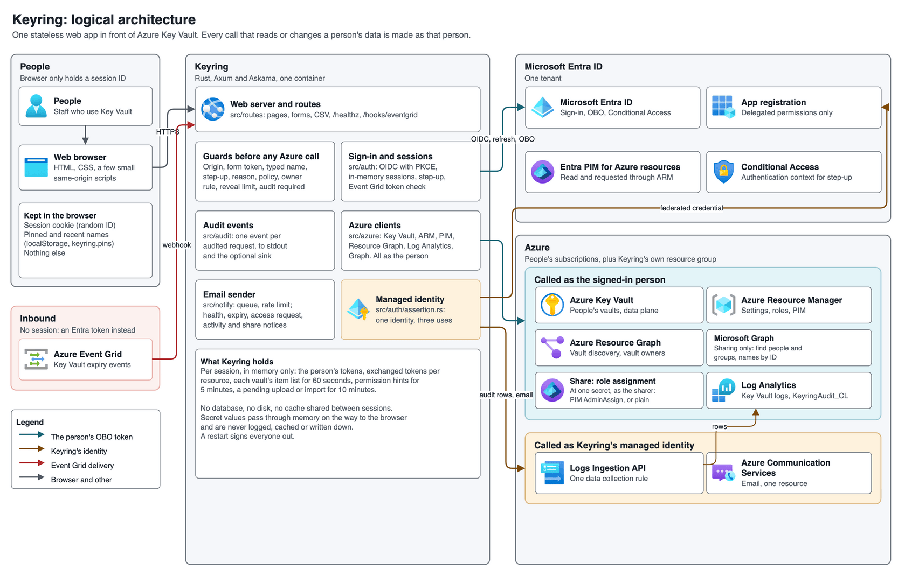

# Logical architecture

Keyring is one stateless web app between people's browsers and Azure. Figure 2, on the next page, shows every internal component and every call. The browser talks only to Keyring; Keyring calls Entra ID and Azure (and, with sharing on, Microsoft Graph) as the person; its managed identity is used only for the federated credential, audit rows and email; and Event Grid is the one caller that arrives without a session.

::: wide

:::

## Components

| Component | Where | Job |
|---|---|---|
| Browser | People's devices | Renders server-built HTML. Holds only a random session ID in an http-only cookie, and the pinned and recent lists in `localStorage` |
| Web server | `src/serve.rs`, `src/lib.rs`, `src/routes/` | Axum on Tokio. Routes for vaults, secrets, certificates, keys, expiry and age, search, generator, audit, access and the access review, PIM, request access, sharing, health and the Event Grid webhook. Security headers, limits and the origin check on every response and request |
| Pages | `templates/`, `static/` | Askama templates compiled into the binary. Hand-written CSS and four small scripts, embedded with `include_str!` so nothing is read from disk at run time |
| Sign-in and sessions | `src/auth/` | OIDC authorisation code flow with PKCE, in-memory sessions, sealed short-lived cookies, step-up, the Event Grid token check, the managed identity token source |
| Azure clients | `src/azure/` | The OBO token broker and thin REST clients for Key Vault, ARM, Resource Graph, Log Analytics, PIM, the access review query, share role assignments and Microsoft Graph |
| Audit | `src/audit/` | Keyring's own audit events, one per audited request, written to standard output and, when on, the audit sink |
| Email | `src/notify/` | The sender, the rate limit, health, expiry, access request, activity and share notices |
| Microsoft Entra ID | Microsoft cloud | Sign-in, token refresh, OBO exchange, Conditional Access, the federated credential |
| Key Vault, ARM, Resource Graph, Log Analytics | Microsoft cloud | People's data and its settings, always reached with the person's token |
| Microsoft Graph | Microsoft cloud | With `KEYRING_SHARING=true` only: finding people and security groups for a share, and naming who a secret is shared with, with the person's token |
| Logs Ingestion API, Communication Services | Keyring's own resources | Audit rows and email, reached with Keyring's managed identity |
| Event Grid | Microsoft cloud | Pushes Key Vault expiry events to `/hooks/eventgrid` with an Entra token |

## Request flow

1. The browser opens Keyring. Without a session, a GET is sent to sign-in with the path remembered; a form post is refused and sent to sign-in with a message that nothing was saved.
2. Sign-in uses the authorisation code flow with PKCE (S256), a random state and nonce, sealed in a 10 minute AES-256-GCM cookie. Entra returns a code, Keyring exchanges it and verifies the ID token (signature, issuer, audience, expiry, nonce). The person's access token for Keyring's own API and the refresh token stay in server memory. The browser gets only a random 256-bit session ID.
3. Each later request passes, in order: the header and body limits, the 90 second time limit, the audit layer (which holds a draft event for the request), the origin check on any non-GET, and the session check. Audited form posts then go through the form token check, step-up where needed, and the reason gate, all before any Azure call.
4. For each Azure call the token broker swaps the person's access token, through OBO, for a token scoped to Key Vault, ARM (and Resource Graph), Log Analytics or, for sharing only, Microsoft Graph. Exchanged tokens are cached per session per resource until five minutes before they expire. Concurrent requests share one refresh and one exchange.
5. The REST client attaches the token, sends a new `x-ms-client-request-id`, and on a 401 drops the cached token and tries once more. Azure's errors keep the status and error code, which the page maps to plain English. Azure's own message is shown only for a 400 on a write, cut to 500 characters and escaped, and is never logged.
6. When the request ends, the audit layer writes exactly one event if the route is audited, whatever path it took, including Keyring's own refusals and a request the browser abandoned.

## Where each decision is made

| Decision | Made by | Where | Keyring's part |
|---|---|---|---|
| Who the person is | Entra ID | Sign-in, Conditional Access | Checks the ID token, keeps the session |
| Whether they may read or change an item | Key Vault | Each data-plane call | Sends the person's token; maps 403 to the role to ask for |
| Which vaults they can see | Resource Graph and ARM | The vault query | Shows what comes back |
| Whether a PIM role turns on | PIM | `roleAssignmentScheduleRequests` | Sends the request as the person, shows the result |
| Whether a secret may be shared | ARM, as the sharer (role assignment rights on the secret) and PIM's settings | `roleAssignmentScheduleRequests` `AdminAssign`, or `roleAssignments` | Refuses first when sharing is off, the date is out of range, the vault uses access policies, the secret has a reveal limit, the recipient isn't a user or security group Graph finds, or it is the sharer |
| Whether someone gets access after a request | The vault's owners, in Azure | Outside Keyring | Emails the request; grants nothing |
| Whether a button is enabled | Keyring (hint only) | `src/routes/hints.rs` | Reads the person's permissions; fails open |
| Whether a delete or purge may be sent | Keyring | Typed name, `KEYRING_ALLOW_PURGE` | Refuses before Key Vault |
| Whether a sensitive action needs step-up | Keyring, from Entra's claims | `routes::step_up::require` | Reads `acrs` and `auth_time` from the ID token |
| Whether a reason is needed | Keyring | `routes::reason::gate` | `KEYRING_REQUIRE_REASON` |
| Whether a typed password is good enough | Keyring | `src/password_policy.rs` | `KEYRING_PASSWORD_POLICY` |
| Whether an item needs an owner | Keyring | `src/owner.rs` | `KEYRING_REQUIRE_OWNER` |
| Whether a value may be shown or copied | Keyring | `src/reveal_limit.rs`, `src/routes/reveal_limit.rs` | The item's `keyring-reveal` tag |
| Whether an email may go to an address | Keyring | `src/notify/` | Allow-list and rate limit |
| Whether an Event Grid delivery is genuine | Entra ID and Keyring | `src/auth/eventgrid.rs`, `src/notify/expiry.rs` | Checks the token, the topic and, when set, `KEYRING_EVENTGRID_SUBSCRIPTIONS` |

Keyring's own decisions are refusals only: they can stop an action that Key Vault would allow, never allow one Key Vault would refuse.
