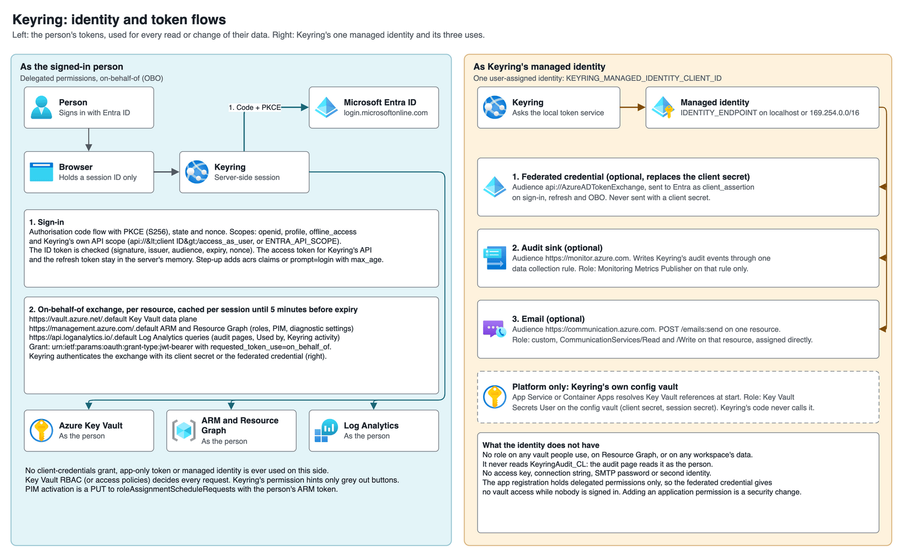

# Identity and access design

Two kinds of identity make Keyring's calls, and they never mix. The signed-in person's tokens are used for every read or change of their data. Keyring's one managed identity is used for three things only: the federated credential, audit rows and email. Figure 3, on the next page, shows both, colour coded as in every diagram: teal for the person, amber for Keyring's identity.

::: wide

:::

## People

People sign in to Keyring with their own Entra ID account. Keyring holds no accounts, roles or groups of its own. What a person can do is exactly what their Azure roles allow (section 7.4). Conditional Access policies on Keyring's app registration, and on Key Vault itself, apply as for any other app.

## The app registration

One single-tenant app registration acts as both the app people sign in to and the API whose token Keyring exchanges.

| Setting | Value |
|---|---|
| Supported account types | This organisational directory only |
| Redirect URIs (Web) | `https://keyring.example.com/auth/callback` and `https://keyring.example.com/auth/signed-out` |
| Application ID URI | `api://<client ID>` |
| Exposed scope | `access_as_user` (or `ENTRA_API_SCOPE` for another name) |
| Delegated permissions | Azure Key Vault `user_impersonation`; Azure Service Management `user_impersonation`; Log Analytics API `Data.Read`; Microsoft Graph `openid`, `profile`, `offline_access`. With `KEYRING_SHARING=true` only, also Microsoft Graph `User.ReadBasic.All` and `GroupMember.Read.All` (I-28). Admin consent granted |
| Application permissions | **None.** Adding one is a security change (threat T3) |
| Credential | Option A: a client secret (`ENTRA_CLIENT_SECRET`), for local use. Option B: a federated credential trusting Keyring's managed identity, so there is no secret. Setting both stops Keyring starting |
| App role, for the webhook only | `AzureEventGridSecureWebhookSubscriber`, assigned to Event Grid's service principal (`docs/alerts.md`) |

## Keyring's managed identity

Keyring has one user-assigned managed identity (`<name>-id` in the templates) for everything it does as itself, set by `KEYRING_MANAGED_IDENTITY_CLIENT_ID`. `KEYRING_FEDERATED_IDENTITY_CLIENT_ID` is a deprecated alias read for one release; Keyring refuses to start if both are set to different values. No future feature may add a second identity or a client secret for Keyring's own calls.

**What it holds, exactly:**

| Grant | Scope | Given by | Used for | When |
|---|---|---|---|---|
| A **federated credential** on Keyring's app registration: issuer `https://login.microsoftonline.com/<tenant ID>/v2.0`, subject the identity's principal ID, audience `api://AzureADTokenExchange` | The app registration | The identity administrator (`az ad app federated-credential create`) | Proving to Entra that it is Keyring (I-08), in place of a client secret | `useFederatedCredential` |
| **Monitoring Metrics Publisher** (`3913510d-42f4-4e42-8a64-420c390055eb`) | One data collection rule, the audit sink's | `infra/modules/audit-sink.bicep` | Writing rows to `KeyringAudit_CL` (I-24). It can't read, change or delete any row | `auditWorkspaceId` |
| A **custom role**, "Keyring email sender (`<name>`)", with exactly `Microsoft.Communication/CommunicationServices/Read` and `Microsoft.Communication/CommunicationServices/Write`, no data actions, no `ListKeys` or `RegenerateKey`, no Email Service permission, no wildcard. **Assigned directly to the identity**, not through a group (group assignments don't work for managed identities with ACS) | One Communication Services resource, `<name>-acs`, in Keyring's own resource group | `infra/modules/notify.bicep` | Sending email (I-25). Azure has no "send email" action, so Read and Write is the narrowest role that can send | `notifyDomain` |
| **Key Vault Secrets User** | Keyring's own config vault only | `infra/modules/config-vault.bicep` | The platform resolving the Key Vault references for the client secret and session secret at start. Keyring's code never calls the config vault | Always, with the templates |

**What it does not have.** No role on any vault people use, no access to any Log Analytics workspace's data, no Resource Graph or ARM read role, no Graph permission, no right to create role assignments, no access key, connection string or SMTP password. It has no vault access, and it makes no share: a share's role assignment is made with the sharer's own token.

**Why the federated credential is safe today.** It lets the identity act as the Keyring app registration. The registration holds only delegated permissions, and the OBO exchange needs a signed-in person's token, so the identity cannot reach any vault while nobody is signed in. That holds only while the app registration has **no application permissions** (threat T3).

## Key Vault roles people need

Keyring has no access of its own. Each person needs Azure roles, the same as in the portal. Azure RBAC is recommended; vaults on access policies work too, with the matching permissions.

::: compact
| To do this in Keyring | Role | Scope |
|---|---|---|
| See vaults in the vault list | Reader | Subscription, resource group or vault |
| List secrets and see their details | Key Vault Secrets User (or Key Vault Reader for names and dates only) | Vault |
| Expiry dashboard, age view and search across vaults | Key Vault Reader on each vault, and Reader to see the vault | Vault |
| Show and copy a secret's value | Key Vault Secrets User | Vault |
| Add secrets, set new values, edit details, enable or disable, roll back | Key Vault Secrets Officer | Vault |
| Copy to another vault | Key Vault Secrets User on the source, Key Vault Secrets Officer on the target | Both vaults |
| Delete, see deleted secrets, recover, purge (when `KEYRING_ALLOW_PURGE=true`) | Key Vault Secrets Officer | Vault |
| List and view certificates, download `.cer` | Key Vault Reader | Vault |
| Download a certificate with its private key | Key Vault Certificate User (can also read secret values at vault scope) | Vault, or just that certificate |
| Upload, create, enable or disable, delete and recover certificates; list issuers | Key Vault Certificates Officer | Vault |
| List and view keys, copy public keys | Key Vault Reader (or Key Vault Crypto User) | Vault |
| Create, rotate, enable or disable, edit rotation policy, delete and recover keys | Key Vault Crypto Officer | Vault |
| See where a vault sends its logs; vault health settings checks | Reader | Vault or resource group |
| Vault health counts of expiry, renewal and rotation, expiring soon and not cycled | Key Vault Reader | Vault |
| Defender alerts, and vault health's Defender for Key Vault check | Security Reader (or Reader) | Subscription |
| Read Key Vault's audit events, reports, Used by | Log Analytics Reader | The workspace the vault logs to |
| Read Keyring activity | Log Analytics Reader | The workspace holding `KeyringAudit_CL` |
| Turn on an eligible Key Vault role, My access, turn it off | An eligible PIM assignment (Entra ID P2 or Governance), Reader to see role names | Vault, or above it |
| Request access | Reader to see the vault (Resource Graph). Keyring grants nothing: the vault's owners decide in Azure | Vault |
| Access review | As the Access page (Reader on the vault), Key Vault Reader for the lists, Log Analytics Reader for "used by". What can't be read is marked "Not known" | Vault and its workspace |
| Share a secret, revoke a share (`KEYRING_SHARING=true`) | A role that can create role assignments on the secret: Owner, User Access Administrator, or Key Vault Data Access Administrator (which can be limited by a condition to Key Vault Secrets User). Graph consent for I-28. PIM (Entra ID P2) gives the share an end date | The secret, or above it |
:::

**Key Vault Certificate User and Key Vault Secrets User can both read secret values.** Where that matters, assign Certificate User on the one certificate rather than the vault.

**Permission hints** read the person's permissions at the vault or item scope (I-17) and grey out buttons their roles don't allow, with the role named beside them. They are kept five minutes, fail open, and are never read by a handler: Key Vault still decides.

## PIM activation

Where a person is eligible for a built-in Key Vault role through Privileged Identity Management for Azure resources, a Key Vault `ForbiddenByRbac` 403 page offers **Activate**. Keyring reads the eligibility and the role's PIM settings again (I-18, I-19), asks for a duration within PIM's maximum (never above 24 hours), a justification and a ticket if PIM wants them, and sends a `SelfActivate` request as the person (I-20). It chooses the eligible scope nearest the vault. PIM decides: it may turn the role on, wait for approval, or ask for a stronger sign-in, which Keyring passes through step-up. Keyring keeps no request state. Only the built-in Key Vault roles its 403 pages name can be turned on or off from Keyring; Owner, Contributor and other roles are refused before any call. Each activation or deactivation is a `role.activate` or `role.deactivate` audit event.

**Request access when PIM has nothing to offer.** With email and `access-requests` on, a `ForbiddenByRbac` 403 page with no PIM offer, and My access for each Key Vault role the person neither holds nor is eligible for, offer **Request access**. The form takes the role (a GUID from Keyring's fixed list), the scope (the vault or the item), a reason and an optional ticket, and emails the vault's owners (section 6.3). Keyring keeps no request and grants nothing: the email links to the vault's Access control page in the portal. One request per person, vault and role an hour, and at most 10 live per person; over that is `refused` with `rate_limited`.

::: unconfirmed
PIM activation is built and tested against a mock ARM only. Microsoft doesn't document the body of `RoleAssignmentRequestAcrsValidationFailed` for Azure resource roles; Keyring parses the shape seen in the field and refuses anything else.
:::

## Sharing a secret

With `KEYRING_SHARING=true` (off by default), a secret's page offers **Share**. A share is a real Azure role assignment, **Key Vault Secrets User** on that one secret, made **with the sharer's own token**. Keyring's managed identity makes no assignment and needs no new role; Azure refuses anyone without the right to assign roles on the secret.

- **With PIM** (Entra ID P2): a PIM `AdminAssign` request with an end date (I-29). Azure removes the access at the end of that day.
- **Without a PIM licence** (`AadPremiumLicenseRequired`): a plain role assignment (I-30). Azure has no end date for it. Keyring says so when it is made and marks it Overdue after its date, with Revoke; it doesn't remove it on its own.
- **When a PIM setting refuses the request** (multifactor sign-in, a shorter duration, a ticket): the share is refused and the page names the setting. There is no fallback to a plain assignment, which would step round the setting. Only a missing PIM licence falls back.
- **Before any assignment** Keyring runs, in order: the reason gate, the form token, `KEYRING_AUDIT_REQUIRED`, step-up, then its own refusals: the end date (today to `KEYRING_SHARE_MAX_DAYS`, default 30, at most 365), an RBAC vault, a secret that isn't a certificate's and has no `keyring-reveal` tag on any version, a recipient Graph confirms as a user or security group in the tenant, and not the sharer.
- **Keyring knows its own shares only from Azure**, by the fixed text in the assignment's `description` or the PIM request's `justification`. Revoke is offered only for those, at exactly the secret's scope, after a typed-name confirmation.

This is the one place Keyring calls Microsoft Graph. It needs two more delegated permissions, `User.ReadBasic.All` and `GroupMember.Read.All`, with admin consent. That reverses, for this one feature, the earlier design of object IDs only (constraint K6 and decision D24).

::: unconfirmed
Sharing is built and tested against mock ARM and Graph servers only: PIM `AdminAssign` with an end date at a secret's scope, the plain fallback and its exact error code, Graph search with and without consent, and the share emails. `docs/real-vault-checklist.md` has rows for each.
:::

## Step-up and reasons

- **Step-up** (`KEYRING_STEP_UP_AUTH_CONTEXT`, `KEYRING_STEP_UP_MAX_AGE`). One guard runs before a reveal, a private key download, a rollback, a copy to another vault, a purge, a PIM activation, loosening a reveal limit, and (with sharing on) a share or a revoke. If the session's `acrs` lacks the configured Conditional Access authentication context (`c1` to `c99`), or `auth_time` is older than the maximum age, the action stops before any Azure call and the page links to sign-in with the claims or `prompt=login` and `max_age` added. What is asked for comes from settings, never the request, and a step-up that comes back without it is refused rather than looped.
- **Reasons** (`KEYRING_REQUIRE_REASON` = `off`, `reveal` or `all`; `KEYRING_REASON_TICKET_PATTERN`). One gate before every audited handler. A reason of 5 to 200 characters, cleaned of control and invisible characters, and a ticket matching the anchored pattern go on the audit event. Key Vault doesn't know about it: it is for audit, not a hard control.

Both are Keyring controls. A Conditional Access policy on Key Vault itself is what applies everywhere, including the CLI and portal.

::: unconfirmed
Step-up has not been confirmed against a real tenant: whether Entra returns `acrs` in the ID token, the access token or both, and the AADSTS codes for a policy that can't be met, are taken from Microsoft's documentation. The real-tenant checklist has rows for each.
:::
