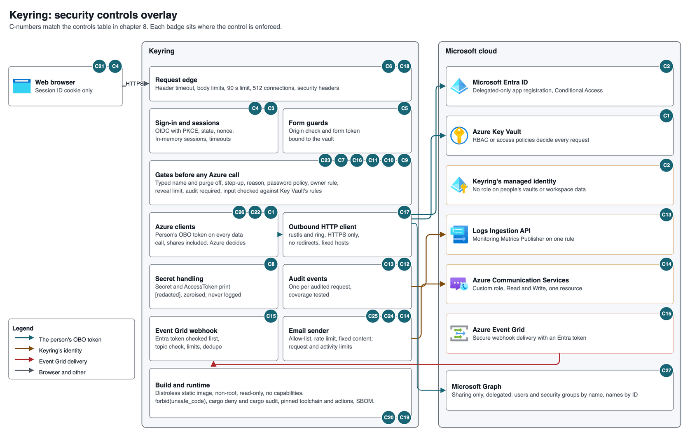

# Security design

Keyring's security rests on its first principle: it acts as the person, so it can never reach more than they can. This chapter lists the controls that protect what Keyring does hold (section 8.1), its trust boundaries (8.2), a STRIDE threat model (8.3) and its known limits (8.4).

## Security controls

::: {.compact .landscape}
Each control has a stable number, used in the overlay diagram (Figure 4) and the threat model (section 8.3). New controls are added at the end.

| ID | Control | Where | How |
|---|---|---|---|
| C1 | Act as the person | `src/azure/token.rs`, `src/azure/client.rs`; Key Vault, ARM, Log Analytics | Every data call carries the person's OBO token. No app-only path exists. Key Vault RBAC or access policies decide |
| C2 | Least-privilege identities | Entra ID, `infra/modules/` | Delegated-only app registration. One managed identity with only a federated credential, Monitoring Metrics Publisher on one rule and the two-action ACS role on one resource (section 7.3) |
| C3 | Strong sign-in | `src/auth/oidc.rs` | Authorisation code flow with PKCE (S256), state and nonce; ID token signature, issuer, audience, expiry and nonce checked; key rollover handled |
| C4 | Session protection | `src/auth/session.rs`, cookies | Random 256-bit ID, http-only, `SameSite=Lax`, `Secure` and `__Host-` over HTTPS; one hour idle, 12 hours absolute; tokens never leave the server; sealed cookies time-limited on the server |
| C5 | Forged request defence | `src/routes/origin.rs`, form tokens | Per-session form token checked in constant time and bound to the vault in the address, plus an origin check on every non-GET. The only exemption is exactly `/hooks/eventgrid` |
| C6 | Output and browser hardening | `src/routes/headers.rs`, templates, scripts | Askama escaping; CSP `default-src 'none'` with same-origin scripts, styles and fonts, no inline code or `eval`; `frame-ancestors 'none'`, `X-Frame-Options: DENY`; no `innerHTML`; `no-store` on every page, reveal, download and CSV |
| C7 | Input checked before use | Vault, item and version name checks; KQL builders | Names checked against Key Vault's own rules before any URL; `nextLink` and backing secret URLs only followed on the same host; audit filters only as escaped KQL `let` literals; CSV formula guarding |
| C8 | Secret handling | `src/secret.rs`, `src/azure/token.rs`, `src/telemetry.rs` | `Secret` and `AccessToken` print `[redacted]` and are zeroised; values, tokens, bodies, headers, query strings and Azure messages never logged (tested at TRACE); the panic hook logs only a location |
| C9 | Safe destructive actions | `src/routes/confirm.rs`, `src/routes/lifecycle.rs` | Typed name checked on the server; purge refused unless `KEYRING_ALLOW_PURGE=true`; no bulk delete or purge; managed items refused |
| C10 | Step-up | `src/routes/step_up.rs` | Optional authentication context or maximum sign-in age before a reveal, private key download, rollback, copy, purge, PIM activation, loosening a reveal limit, a share or a revoke |
| C11 | Reasons | `src/routes/reason.rs`, `src/reason.rs` | Optional reason and ticket, cleaned and checked before any audited handler, recorded on the event |
| C12 | Audit coverage | `src/audit/mod.rs`, `tests/audit_events.rs` | One event per audited request whatever the outcome; every POST route audited or exempt with a reason; a forged token on each audited route writes one `refused` event and nothing reaches Key Vault |
| C13 | Audit sink | `src/audit/sink.rs`, Logs Ingestion API | Events written to `KeyringAudit_CL` as Keyring's identity only; writer columns; health endpoint; `KEYRING_AUDIT_REQUIRED` refuses reveals while degraded |
| C14 | Email safety | `src/notify/` | Sent as Keyring's identity only; strict `to` addresses; domain allow-list; per-recipient rate limit (counted by mailbox); fixed content with no values, tokens, Azure messages or typed reasons; outside text cleaned and alone in a labelled field; repeatability IDs; addresses never logged |
| C15 | Webhook authentication | `src/auth/eventgrid.rs`, `src/notify/expiry.rs` | Entra token checked first (RS256, tenant keys, issuer, audience, tenant, expiry, Event Grid's app ID, subscriber role, app-only); topic must be a Key Vault resource ID; with `KEYRING_EVENTGRID_SUBSCRIPTIONS` set, its subscription must be listed (`subscription_not_allowed`), checked after the token and before dedupe or email; size, count and rate limits; dedupe; 404 unless turned on |
| C16 | Value policies | `src/password_policy.rs`, `src/owner.rs` | Optional password policy on typed and imported passwords; optional owner rule. Keyring controls only |
| C17 | Transport security | `src/http.rs` | rustls with `ring`; HTTPS only except localhost; no redirects; fixed Azure public cloud hosts; connect and total timeouts; managed identity endpoint limited to the local host or link-local range |
| C18 | Resource limits | `src/serve.rs`, `src/routes/mod.rs` | 10 s header timeout; 64 KB form limit (larger only for value, upload and import forms); 90 s per request; 512 connections; connection age; bounded queues and maps everywhere |
| C19 | Supply chain | `Cargo.lock`, `deny.toml`, CI | Few crates, crates.io only, permissive licence allow-list, `cargo deny` and `cargo audit` on every change and weekly, pinned toolchain, actions pinned by SHA, images by digest, SBOMs, signed provenance on release |
| C20 | Runtime hardening | `Dockerfile`, `Cargo.toml` | `forbid(unsafe_code)`; distroless static image, non-root, read-only root filesystem, no capabilities, no shell; unwind on panic so one request's bug doesn't end other sessions |
| C21 | Browser-side data limits | `static/pins.js`, `static/app.js` | Pins hold names only, are rebuilt from checked names and cleared on sign-out; revealed values hidden after 30 s; clipboard cleared after copy |
| C22 | Store nothing | Whole design | No database or disk writes; per-session caches only, bounded and short-lived; secret values only in memory on the way to the browser |
| C23 | Reveal limits | `src/reveal_limit.rs`, `src/routes/reveal_limit.rs` | `keyring-reveal` on a secret or certificate: `copy-only` or `none`, any other value counts as `none`. Checked from properties before step-up and the reason gate, and again on the value response; the stricter of the current and acted-on version; carried onto new versions Keyring makes; kept out of tag rows, imports and bulk changes. Loosening it goes through step-up and the reason check when they are configured. Refusals are `reveal_limited`. A Keyring UI control, not a Key Vault one |
| C24 | Request access limits | `src/routes/access_request.rs`, `src/notify/access.rs` | Off unless `access-requests` is on. Role from Keyring's fixed list, never echoed; recipients only the vault's `keyring-owners` (held to the allow-list) or the admins, never from the form; the requester's copy is a separate email with no links; one request per person, vault and role an hour and 10 live per person (`rate_limited`); a reason or ticket quoted only when it holds nothing a mail client would turn into a link; the same answer page whatever happened. Keyring grants nothing |
| C25 | Activity email limits | `src/notify/activity.rs` | Each type off unless named. Sent only for the request's own successful event. Watched-read recipients only from the item's `notify` tag (and `owner` with `KEYRING_NOTIFY_OWNER_ON_READ`); others from `keyring-owners` or the admins; all through `KEYRING_NOTIFY_ALLOWED_DOMAINS` and the per-mailbox limit. At most 4 watched-read emails an hour per item. The reader's address is shown only when the allow-list is set. The actor isn't emailed unless nobody else is left. The vault owners read runs as the signed-in person in a bounded task (10 s) after the response. A role turned on above the vault's scope also goes to the admins |
| C26 | Share scope and recipient | `src/routes/share.rs`, `src/azure/share.rs`, `src/azure/graph.rs` | Off by default (`KEYRING_SHARING`). The role is fixed in code (Key Vault Secrets User); the scope is built from the vault's resource ID and a checked name; the recipient is confirmed through Graph as a user or security group before any assignment; the end date is held to `KEYRING_SHARE_MAX_DAYS`; RBAC vaults only, no certificate's secret, no reveal-limited secret, not the sharer. A PIM setting that refuses refuses the share, with no plain fallback; only a missing PIM licence falls back. Revoke only for Keyring's own shares, at exactly the secret's scope. Made with the sharer's token only |
| C27 | Graph use kept narrow | `src/azure/graph.rs`, `static/share.js` | Delegated only, sharing only. Searches users and security groups by name and reads names by ID; never a group's members. The picker is signed-in only, 30 searches a minute per session, `no-store`, its query cleaned and never logged; results written with `textContent` only. Names and addresses never logged or put in an audit event (object IDs only) |
| C28 | Multi-environment safety | `src/environments.rs`, `src/routes/environments.rs` | Matrix reads names and properties only (never values). `/environments/set` enforces CSRF, Origin, reason gate, password policy, mandatory owner, in-memory duplicate-value guard across production and non-production vaults, and automatic carry-forward of any stricter `keyring-reveal` limit on target vaults; writes one `secret.multi_env_set` event plus one per-vault `secret.create` or `secret.set` event |
:::

## Trust boundaries

| Boundary | Trusted with | Not trusted with |
|---|---|---|
| The browser | A random session ID in an http-only cookie; one revealed value at a time; pinned names | Tokens; anything it sends (every input is checked again on the server) |
| Keyring's server | The person's tokens in memory for the session; values in transit to the browser | Access of its own to any vault or workspace |
| Microsoft Entra ID, Key Vault, ARM, Log Analytics | Every authorisation decision, as the person | Out of scope if compromised |
| Keyring's managed identity | Acting as the app registration (federated credential), adding audit rows, sending email from one ACS resource | Any vault or workspace read path |
| Event Grid deliveries | Proving Event Grid delivered the event (the token) | The event's content beyond fixed fields, checked names and the topic |

## STRIDE threat model

Built from `docs/architecture.md`, "Threat model", and extended for notifications, the webhook and the managed identity. Each threat names its STRIDE category (S spoofing, T tampering, R repudiation, I information disclosure, D denial of service, E elevation of privilege), the controls that answer it and what is left. New threats are added at the end.

::: {.compact .landscape}
| ID | STRIDE | Threat | Mitigation | Residual risk |
|---|---|---|---|---|
| T1 | E | Keyring used to reach vaults a person can't | C1, C2: every data call carries the person's OBO token; no app-only token with vault access | None beyond the person's own access |
| T2 | S, E | Stolen session cookie | C4, C10: random ID, http-only, `__Host-`, timeouts, server-side sign-out; optional step-up with a maximum age | A cookie from a session that already met step-up works until it ends or ages out. Set `KEYRING_STEP_UP_MAX_AGE` as well as a context |
| T3 | E | The managed identity used to act as the app with nobody signed in | C2: delegated-only registration, OBO needs a person's token | Holds only while the registration has no application permissions. Treat adding one as a security change |
| T4 | S | Forged or replayed sign-in | C3: PKCE, state, nonce, ID token checks, sealed state cookie | None known |
| T5 | T | Cross-site request forgery | C5: form token bound to the vault plus origin check, tested on every mutating route | The webhook is exempt by design and has C15 instead |
| T6 | T, R | Made-up rows in `KeyringAudit_CL` with a stolen identity token | C13: Monitoring Metrics Publisher on one rule only; can't read, change or delete rows | Made-up rows can carry any writer or actor. Check a row that matters against Key Vault's own log by `KvRequestId` |
| T7 | S, I | A stolen identity token used to send email | C2, C14: two-action role on one resource in Keyring's own resource group; no keys | A stolen token could send mail from Keyring's domain outside Keyring's own allow-list and rate limit, and change that one resource's settings. ACS limits, ACS logs and the Activity Log are what remain |
| T8 | I | Email used to leak values | C14: fixed text, checked names, never a value, token, private key, Azure message or reason (tested at TRACE over logs and every body sent) | None known |
| T9 | D, S | Email used to mail-bomb or phish | C14, C24, C25: strict `to` addresses, allow-list, per-recipient rate limit; health emails to admins only, outside text in labelled fields, burst emails capped at 10 an hour; each newer notice type has its own limits (T25 to T27, T33) | Within the limits, an admin or vault owner can get repeated notices |
| T10 | S | The webhook used without a session | C15: token checked first, app-only, subscriber role, 1 MB, 50 events, separate bounded counter for bad tokens | Whoever can change the subscription can trigger expiry notices to the admins or allowed addresses, within the limits |
| T11 | S, T | Made-up expiry events through Event Grid | C15: Event Grid stamps `topic`; custom topics are refused; with `KEYRING_EVENTGRID_SUBSCRIPTIONS` set, a vault outside the listed subscriptions is refused (`subscription_not_allowed`); recipients held to admins or the allow-list; dedupe | Holders of the subscriber role or owners of Keyring's service principal can subscribe a real vault they control in a listed subscription and send real-looking notices about its items, and can use up the 120 a minute. Unset (or empty, which counts as unset) accepts any subscription in any tenant, with a warning at start; the templates set it to the deployment's own subscription. Keep the role holders short. Whether a custom input schema can map into `topic` is unconfirmed |
| T12 | I | Secret values or tokens in logs | C8: wrappers, redaction, no bodies, headers or query strings; tested at TRACE in text and JSON | Copies inside `reqwest` and `serde_json` aren't zeroised |
| T13 | I | Values cached by browsers or proxies, or left on screen or clipboard | C6, C21: `no-store`; hidden until asked; wiped after 30 s; clipboard cleared, retried on focus | A clipboard clear can fail if the browser refuses it |
| T14 | T, I | Cross-site scripting | C6: escaping, strict CSP, no inline code, no `innerHTML` | None known |
| T15 | T | Query injection in the audit views | C7: strict patterns, then escaped `let` literals; fixed KQL; fixed time ranges | None known |
| T16 | T | CSV injection in exports | C7: formula guarding on every text field | None known |
| T17 | T, E | Path tricks in names or links | C7: names checked against Key Vault's rules; `nextLink` and backing secret URLs only on the same host; return paths local only | None known |
| T18 | T | Accidental or malicious deletes | C9: typed name; purge off by default; no bulk delete | A person with the role can still delete through the CLI or portal |
| T19 | I | Private key leaks | C9, C1: no key export calls (tested); JWK type has no private fields; certificate private key download only for exportable policies, after a typed name | Certificate User at vault scope can read every secret; assign it per certificate |
| T20 | R | Actions with no trace | C12: one event per audited request, including refusals and Azure's 401 and 403; coverage tested | Read-only pages write no event (the request line covers them). Events are on standard output; the sink is optional |
| T21 | D | Large, slow or many requests | C18: header timeout, body limits, request limit, connection cap and age; webhook counters; bounded maps | The connection cap is shared by every client; a front-end proxy normally covers the rest |
| T22 | T | Tampered pinned list or shared-browser exposure | C21: entries rebuilt from checked names and local paths; cleared on sign-out; **Clear** button | Names stay until sign-out or Clear if a browser is closed without signing out |
| T23 | T, E | Supply chain or container tampering | C19, C20 | Trust in crates.io crates and base images that pass the checks |
| T24 | I | Description or owner text exposing sensitive data | C8, C16: never logged or put in an event; control and invisible characters refused; the form says not to put secrets in it | Tags are readable by anyone with read access to the item's properties |
| T25 | S, D | Request access used to phish or flood a vault's owners | C24, C14: role from a fixed list; recipients from the vault tag or admins only; reason and ticket quoted only when no mail client would link them; links built by Keyring; one request per person, vault and role an hour, 10 live per person; allow-list and per-mailbox limit | Any signed-in person who can see a vault can send its owners a fixed-form email within those limits. Owners should treat it as a request, not an instruction: Keyring grants nothing |
| T26 | I | Watched-read emails disclosing who read an item, and from where, to recipients someone else chose | C25, C14: recipients come from item tags, which anyone with tag write can set, so `KEYRING_NOTIFY_ALLOWED_DOMAINS` holds them to the organisation's domains; the reader's IP address is shown only when that is set; 4 emails an hour per item; the per-mailbox limit; never a value or reason | Without the allow-list, a person with tag write can have any address told who read the item (but not where from). Set the allow-list before turning `watched-reads` on |
| T27 | D | Activity emails used to mail-bomb | C25, C14: one email per request (a bulk change lists up to 50 names); 4 watched-read emails an hour per item; the per-mailbox limit; a failure never changes the action's answer | Within the limits, owners and admins get one email per delete, purge or role use |
| T28 | I | A value shown or copied that the item's owner meant to limit | C23: checked before any value is read and again on the response; stricter version wins; carried on new versions; loosening needs step-up and reason when configured; `reveal_limited` events | A Keyring control: the CLI, portal and SDKs aren't limited, and anyone with tag write can remove it there. `copy-only` keeps the value off the screen, not out of the browser. A limit set while Keyring was reading means the value was read from Key Vault and dropped |
| T29 | E, S | A stolen session used to share secrets with the person's own rights | C26, C1, C5, C12: the assignment is made with the person's token, so Azure decides; role and scope fixed; a `share.grant` event names the recipient; the Sentinel shares rule flags guests and bursts. Step-up (C10), the reason gate (C11) and `KEYRING_AUDIT_REQUIRED` (C13) apply when configured | All three are off by default. Without them a stolen session can share anything the person can assign. Turn step-up and the reason gate on with sharing |
| T30 | E | A plain share (no PIM licence) that never expires | C26: Keyring says so when made, marks it Overdue on the secret's page and in the access review, and offers Revoke | Azure keeps the access until someone removes it. Keyring runs nothing in the background and has no identity that could. Vault health doesn't show it |
| T31 | I | The Graph token, with `GroupMember.Read.All` consented, used to read any group's members | C27: Keyring only searches users and security groups and reads names by ID; the token is held in memory per session like the other OBO tokens and never logged | The token could read any group's members if taken from server memory. Only consent to sharing's Graph permissions where sharing is wanted |
| T32 | R | A share to a guest recorded as a share to a member | C26, C12: a guest is told by `#EXT#` in the sign-in name (`User.ReadBasic.All` doesn't return the user type) | A guest whose sign-in name an admin has changed is recorded as `user`, and the Sentinel guest rule doesn't fire |
| T33 | S | Share emails used to phish | C14, C26: sent only to the recipient's Graph `mail` (never a typed address) and the sharer; fixed text, checked names, the date and Keyring's own link; a Graph display name cleaned and alone in a labelled field | Within the per-mailbox limit, a person who can share can cause these emails |
| T34 | E | A PIM setting (approval, multifactor sign-in, a shorter duration, a ticket) stepped round by sharing | C26: a PIM refusal refuses the share and names the setting; only a missing PIM licence falls back to a plain assignment | None beyond what the sharer could do in Azure directly |
| T35 | I | Reusing a non-production secret value in production via `/environments/set` | C28: in-memory duplicate check blocks identical values across environments (highlighting production) unless explicitly confirmed; values are never logged or echoed back | An operator can intentionally confirm a shared credential; per-vault audit events record every write |
| T36 | T | Multi-environment write weakening a target vault's existing `keyring-reveal` limit | C23, C28: `reveal_limit::carry` preserves the stricter limit on every target vault automatically | None via `/environments/set`; loosening requires the individual secret's Edit details flow with step-up and reason |
:::

Threats T25 to T34, and controls C23 to C27, were added in version 1.1 for request access, activity emails, reveal limits and sharing. The webhook subscription allow-list changed C15 and T11.

## Known limits

- **Sessions are in memory.** A restart signs everyone out, and several copies need sticky sessions. Anyone who can read the server's memory can read active tokens.
- **The session secret** only protects short-lived cookies. Rotating it means a restart.
- **Keyring controls are Keyring's own.** Step-up, reasons, the password policy, the owner rule and reveal limits don't stop anyone using the Azure CLI, the portal or another app. A Conditional Access policy on Key Vault itself is what applies everywhere.
- **Keyring doesn't rotate credentials on the target system.** The rotation line is a display of tags anyone with tag rights can write.
- **Keyring trusts Azure's answers.** A compromised Entra tenant or Key Vault is out of scope.
- **Access shows object IDs, not names**, and app registration credentials aren't shown. The Access page and the access review make no Graph call. Only sharing uses Graph, delegated, for names (decision D24).
- **A plain share has no end date in Azure** (T30), and the gates that would slow a stolen session's shares are off by default (T29).
- **Activity and access request emails** go to addresses set in tags that people with tag write control; the allow-list is what holds them to the organisation (T25, T26).
- **The connection cap is shared** by every client; idle connections and slow bodies are limited only by the request limit and connection age.
- **Pinned names outlive a closed tab** until the next sign-out or Clear.
- **Zeroising covers Keyring's own copies** of tokens, not those inside `reqwest` and `serde_json`.
- **A panic** gives that one request a 500 page; sessions survive it.
- **Not yet run against a real tenant:** sign-in in production, PIM, step-up, the deployments, Sentinel, the audit sink, email, the webhook, and everything added in version 1.1, sharing's Graph and role assignment calls included (section 11.5).
