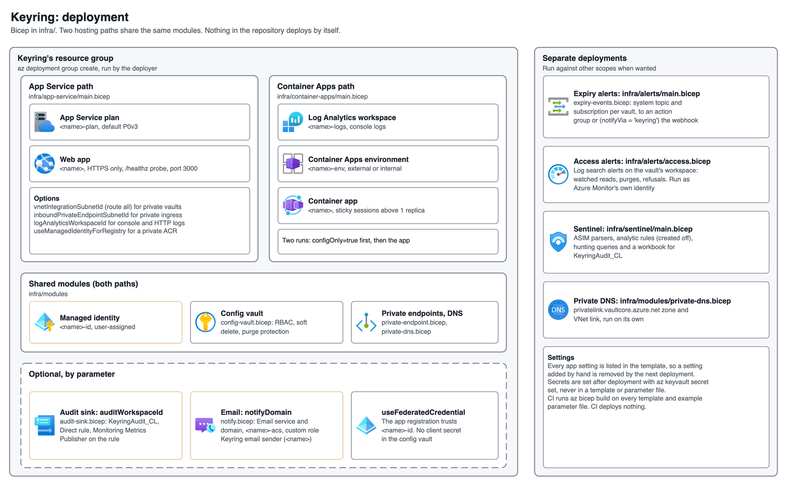
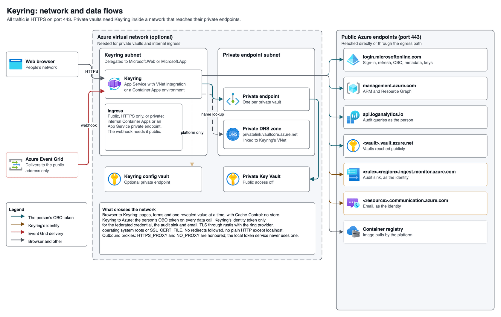

# Deployment

Keyring runs as one container on Azure App Service or Azure Container Apps, deployed with the Bicep in `infra/`. Both paths share the modules for the config vault, the managed identity and private networking. The audit sink, email and the federated credential are switched on by parameter. Expiry alerts, access alerts, Sentinel content and private DNS are separate deployments. Figure 5, on the next page, shows the whole set.

::: wide

:::

## Hosting paths

Nothing in the repository deploys anything by itself. A deployer runs each step (`docs/deploy.md`), and CI only runs `az bicep build` on every template and example parameter file.

| | App Service | Container Apps |
|---|---|---|
| Template | `infra/app-service/main.bicep` | `infra/container-apps/main.bicep` |
| Runs on | App Service plan `<name>-plan` (default `P0v3`) and web app `<name>` | Log Analytics workspace `<name>-logs`, environment `<name>-env`, container app `<name>` |
| Ingress | Public, HTTPS only; or a private endpoint (`inboundPrivateEndpointSubnetId`) | `external` or `internal` (private address in the VNet), with optional private DNS for the default domain |
| Outbound to private vaults | VNet integration with "route all" (`vnetIntegrationSubnetId`) | Environment in a VNet subnet (`infrastructureSubnetId`) |
| Logs | `logAnalyticsWorkspaceId`, or 7 days on the app's own storage | Always to the workspace it creates |
| Deploy runs | One; the app reports unhealthy until the secrets are set | Two: `configOnly=true`, set the secrets, then the app |
| Copies | One | `replicas`; above 1 turns on sticky sessions |

Both run the same image on port 3000 with `/healthz` probes. The image is used by digest. Each version tag's image is built by the release workflow from a commit on `main` whose CI passed, with signed build provenance and an SBOM; publishing to `ghcr.io` is off until the repository variable is set.

## Bicep modules

| Module | Creates | Switched on by |
|---|---|---|
| `config-vault.bicep` | User-assigned identity `<name>-id`; config vault (RBAC, soft delete, purge protection); Key Vault Secrets User for the identity on that vault only | Always |
| `private-endpoint.bicep` | A private endpoint and DNS zone group | The private endpoint parameters |
| `private-dns.bicep` | `privatelink.vaultcore.azure.net` zone and VNet link | Run on its own |
| `container-apps-dns.bicep` | Private DNS for an internal Container Apps environment | `privateDnsVnetId` |
| `audit-sink.bicep` | `KeyringAudit_CL` table (retention `auditRetentionInDays`, default 365), a `Direct` data collection rule with a transform, Monitoring Metrics Publisher for the identity on the rule | `auditWorkspaceId` |
| `notify.bicep` | Email Communication Service and one domain (Azure-managed or custom), Communication Services `<name>-acs`, the custom role and its direct assignment | `notifyDomain` |
| `expiry-events.bicep` | Event Grid system topic and subscription per vault, to an action group or Keyring's webhook | `infra/alerts/main.bicep` |

## Settings

Both templates list every app setting, so a setting added by hand in the portal is removed by the next deployment. Template parameters map to settings: `apiScope`, `logLevel`, `logFormat`, `trustedProxyHops` (default `1`), `stepUpAuthContext`, `stepUpMaxAge`, `requireReason`, `reasonTicketPattern`, `passwordPolicy`, `requireOwner`, `staleAfterDays`, `allowPurge`, `auditWorkspaceId`, `auditRequired`, `notifyTypes`, `notifyAdmins`, `notifyAllowedDomains`, `eventGridSubscriptions` (default the deployment's own subscription, set as `KEYRING_EVENTGRID_SUBSCRIPTIONS` when `expiry` is in `notifyTypes`) and `useFederatedCredential`. The templates have no parameter for `KEYRING_NOTIFY_OWNER_ON_READ`, `KEYRING_SHARING` or `KEYRING_SHARE_MAX_DAYS`; a deployment that wants them needs them added to the template, since a setting added by hand is removed by the next deployment. Sharing also needs the two delegated Graph permissions consented on the app registration (section 7.2). Appendix A lists every setting the code reads. Secrets are set after deployment with `az keyvault secret set`, never in a template, parameter file or deployment history, and filled-in parameter files are kept out of git.

## Alerts and Sentinel content

| Content | Where | What it does | Runs as |
|---|---|---|---|
| Expiry alerts | `infra/alerts/main.bicep` | Key Vault's near-expiry and expired events, to an action group or (`notifyVia = 'keyring'`) to `/hooks/eventgrid` | Event Grid |
| Access alerts | `infra/alerts/access.bicep` | Log search alert rules on the vault's workspace: a read of a watched secret, any purge, more than N refusals from one caller in 15 minutes | Each rule's own system-assigned identity with Log Analytics Reader; never used by Keyring |
| Sentinel content | `infra/sentinel/main.bicep` | ASIM Audit Event parsers (`vimAuditEventKeyring`, `ASimAuditEventKeyring`), eight analytic rules each created turned off (the eighth, `enableShares`, flags a share to a guest or a burst of shares), six hunting queries, a workbook, all over `KeyringAudit_CL` | Sentinel |

Two Sentinel rules compare Keyring's table with Key Vault's log and need Keyring's outbound addresses as a parameter; without it they aren't created. The "SecretGet with no audit event" rule should stay off until the real-tenant row confirming that Key Vault records `x-ms-client-request-id` as `CorrelationId` passes.

## Networking and private vaults

::: wide

:::

- Private vaults need Keyring inside a network that reaches their private endpoints, with `privatelink.vaultcore.azure.net` resolving for each vault. Keyring still calls each vault as the person; the network only decides whether the call can arrive.
- Outbound on port 443 to `login.microsoftonline.com`, `management.azure.com`, `api.loganalytics.io`, public `<vault>.vault.azure.net`, the ingestion endpoint (with the audit sink), the ACS endpoint (with email) and the container registry.
- Outbound proxies are honoured through `HTTPS_PROXY` and `NO_PROXY`; a private CA through `SSL_CERT_FILE`.
- The webhook needs Keyring reachable from Event Grid at its public address. A Keyring that only takes private traffic can't receive expiry events.
- On a network with no route to public Azure Monitor endpoints, an Azure Monitor Private Link Scope with a data collection endpoint is Microsoft's guidance for the Logs Ingestion API. The templates don't do this, and it hasn't been tried against a real tenant.
- The config vault can be made private too.

::: unconfirmed
No Bicep deployment has been confirmed against a real subscription. The templates build with `az bicep build` in CI. The real-tenant checklist's Deployment section lists what to confirm.
:::
