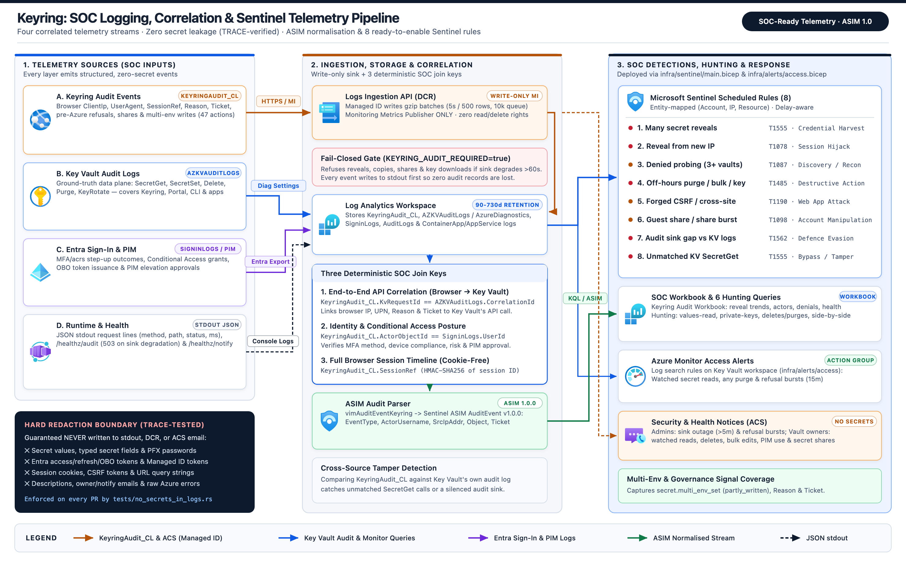

# Operations

## Health endpoints

None needs sign-in, and none shows an address, token or row.

| Endpoint | Answers | Use |
|---|---|---|
| `/healthz` | `ok` while the process serves requests | Liveness and readiness probes (the templates set it) |
| `/healthz/audit` | `status=ok`, `degraded` or `off`, with counts (`queued`, `sent`, `dropped_queue_full`, `dropped_rejected`, `dropped_at_shutdown`, `failed_attempts`); 503 while degraded | An availability test or alert on the audit sink. Degraded means a minute of failure with no success |
| `/healthz/notify` | `status=ok`, `degraded` or `off`, with counts (`queued`, `delivered`, `failed`, `unknown`, `dropped_queue_full`, `dropped_at_shutdown`, `rate_limited`, `not_allowed`, `invalid`, `failed_attempts`); 503 while degraded | An availability test on email. A failing sender is never emailed about |

## Logs

Keyring writes to standard output only, one line per entry, as `key=value` text or, with `KEYRING_LOG_FORMAT=json`, one JSON object per line.

- One request line per request: method, path (never the query string), status and time. A 5xx is logged at `warn`.
- One audit event per audited request (section 5.4 and appendix B), at every log level, so `warn` or `error` can't drop them.

| Host | Where | Table |
|---|---|---|
| Container Apps | The workspace the template creates | `ContainerAppConsoleLogs_CL` (or `ContainerAppConsoleLogs`) |
| App Service, with `logAnalyticsWorkspaceId` | That workspace | `AppServiceConsoleLogs`, `AppServiceHTTPLogs` |
| App Service, without it | The app's own file system, 7 days | None |
| Audit sink, when on | Any workspace (`auditWorkspaceId`) | `KeyringAudit_CL`, typed columns, its own retention |

Without a workspace, App Service's file log is the only record of who revealed what, and it is short. Use a workspace for anything to look back on.

## Alerts and Sentinel

- **Expiry alerts** (`infra/alerts/main.bicep`): Event Grid to an action group, or to Keyring's webhook which emails through ACS.
- **Access alerts** (`infra/alerts/access.bicep`): watched secret reads, purges and repeated refusals, as Azure Monitor log search rules on the vault's workspace. Logs arrive 5 to 15 minutes late.
- **Sentinel** (`infra/sentinel`): the ASIM parser `vimAuditEventKeyring`, analytic rules (many reveals by one person, reveal from a new address, one person denied in several vaults, sensitive action outside working hours, forged or cross-site requests, no audit events while Key Vault saw Keyring, SecretGet with no audit event, and a share to a guest or more than `shareThreshold` shares by one person), hunting queries for each audit report and a workbook. Every rule is created off and turned on by its own parameter. Rows can arrive late; each rule looks back `ingestionDelayMinutes` further than it runs.

## SOC logging, correlation and detection guidance

To give a Security Operations Centre (SOC) high-value, low-noise telemetry without risking credential exposure, deploy Keyring with structured JSON stdout (`KEYRING_LOG_FORMAT=json`), the Azure Monitor Logs Ingestion audit sink (`KeyringAudit_CL`), fail-closed reveal gating (`KEYRING_AUDIT_REQUIRED=true`), and Microsoft Sentinel (`infra/sentinel/main.bicep`).

::: wide

:::

### Recommended SOC logging configuration

| Setting | Production value | Why the SOC needs it |
|---|---|---|
| `KEYRING_LOG_FORMAT` | `json` | Machine-parseable JSON Lines on stdout for fallback forensics if the DCR is unreachable |
| `KEYRING_LOG_LEVEL` | `info` | Captures every request summary and every audit event without noisy debug chatter; audit events still write at every level |
| `KEYRING_TRUSTED_PROXY_HOPS` | Exact proxy hop count (for example `1` behind Front Door / Application Gateway) | Preserves the true browser `ClientIp` in `KeyringAudit_CL` so `reveal-new-ip` and `app-attack` detections fire accurately |
| `KEYRING_AUDIT_INGESTION_ENDPOINT`, `KEYRING_AUDIT_DCR_ID`, `KEYRING_AUDIT_STREAM` | Configured via `infra/modules/audit-sink.bicep` | Streams all 47 audit actions directly into typed `KeyringAudit_CL` columns via Managed Identity |
| `KEYRING_AUDIT_REQUIRED` | `true` | Fails closed on secret reveals, copies, shares and private key downloads if the audit sink is degraded for more than 60 seconds |
| `KEYRING_REQUIRE_REASON` | `reveal` (or `all` for strict change control) | Records free-text justification (`Reason`) and validated ticket (`Ticket`) on every sensitive audit row |
| `KEYRING_REASON_TICKET_PATTERN` | Organisation regex (for example `^(CHG\|INC)[0-9]{6,8}$`) | Enables automated Sentinel correlation against ITSM change/incident records |
| `KEYRING_NOTIFY_AUDIT_RECIPIENTS` | `false` (default) unless SOC explicitly requires recipient emails | Keeps personal email addresses out of audit logs unless required by policy |

### Four telemetry streams and retention tiers

| Stream | Azure table | What it adds for the SOC | Recommended retention |
|---|---|---|---|
| **A. Keyring Audit Events** | `KeyringAudit_CL` | Browser `ClientIp`, `UserAgent`, `SessionRef`, `Reason`, `Ticket`, pre-Azure refusals (`csrf`, `step_up_required`, `password_policy`, `reveal_limit`, `duplicate_value`), `secret.multi_env_set` and per-vault outcomes | 180–365 days interactive (Analytics tier), 2–7 years archive |
| **B. Key Vault Audit Logs** | `AZKVAuditLogs` (preferred) or `AzureDiagnostics` | Ground-truth data-plane log covering Keyring, Azure Portal, CLI, SDKs and workload identities to detect Keyring bypass | 180-365 days interactive, 2-7 years archive |
| **C. Entra ID Sign-In & PIM Logs** | `SigninLogs`, `AuditLogs` | MFA method, Conditional Access `acrs` step-up grant/deny, device compliance, risk level and PIM elevation approval chain | 90–180 days interactive |
| **D. Keyring Runtime & Health** | `ContainerAppConsoleLogs` / `AppServiceConsoleLogs` + `/healthz/audit` | HTTP request timings/status codes (no query strings), fallback JSON audit lines, sink queue drops and 503 health probe alerts | 30–90 days interactive |

### Three deterministic SOC join keys

1. **End-to-end call correlation (`KvRequestId == CorrelationId`)**: Joins Keyring's browser context (`ClientIp`, `UserAgent`, `Reason`, `Ticket`, `SessionRef`) to Azure Key Vault's `AZKVAuditLogs` row for the exact REST call.
2. **Identity and Conditional Access posture (`ActorObjectId == UserId`)**: Joins `KeyringAudit_CL` to Entra `SigninLogs` and `AuditLogs` to verify whether MFA, step-up authentication context, or PIM elevation preceded a sensitive action.
3. **Cookie-free session reconstruction (`SessionRef`)**: Reconstructs an entire user session across vaults and environments using an HMAC-SHA256 digest derived from `SESSION_SECRET`, without ever logging a session cookie.

### High-value SOC detection and triage matrix

| Detection / Signal | Source rule or query | MITRE ATT&CK | Recommended SOC triage |
|---|---|---|---|
| High-volume secret reveals (`>= 20` in 60 min) | `infra/sentinel/rules/many-reveals.kql` | T1555 (Credentials from Password Stores) | Pivot on `SessionRef`, verify `Ticket` and `SigninLogs` device/IP; revoke Entra refresh tokens if unauthorised |
| Reveal from a previously unseen IP | `infra/sentinel/rules/reveal-new-ip.kql` | T1078 (Valid Accounts) | Compare `ClientIp` geolocation/ASN with `SigninLogs`; check for token or cookie theft |
| Denied probing across 3+ vaults | `infra/sentinel/rules/denied-probing.kql` | T1087 / T1069 (Account & Permission Discovery) | Check whether a compromised account is enumerating vaults outside its normal workload group |
| Off-hours purge, private key download or bulk change | `infra/sentinel/rules/off-hours.kql` | T1485 (Data Destruction) | Confirm approved emergency `Ticket` in `KeyringAudit_CL`; validate vault purge protection |
| Forged CSRF or cross-site POST burst | `infra/sentinel/rules/app-attack.kql` | T1190 (Exploit Public-Facing Application) | Inspect `ClientIp` and `UserAgent`; block source at WAF / Front Door if external |
| Secret shared with guest or share burst | `infra/sentinel/rules/shares.kql` | T1098 (Account Manipulation) | Confirm business need with vault owners; revoke share in Keyring or Entra RBAC if unapproved |
| Audit sink gap while Key Vault sees Keyring | `infra/sentinel/rules/audit-gap.kql` | T1562 (Impair Defenses) | Check `/healthz/audit`, Managed Identity `Monitoring Metrics Publisher` role and DCR endpoint reachability |
| Key Vault `SecretGet` from Keyring with no `KeyringAudit_CL` row | `infra/sentinel/rules/unmatched-secret-get.kql` | T1555 / T1562 | Investigate possible audit sink bypass or misconfigured `keyringOutboundIps` after confirming `CorrelationId` join on tenant |
| Multi-environment partial write or production change | Custom KQL on `Action == "secret.multi_env_set"` | T1098 / Change Governance | Verify `Ticket`, check which vaults succeeded vs `denied` (`partly_written`), and confirm no unintended production overwrite |

### Ready-to-run SOC hunting queries

**Reconstruct a suspicious session across all vaults and environments:**

```kusto
KeyringAudit_CL
| where TimeGenerated > ago(24h) and SessionRef == "<session-ref>"
| project TimeGenerated, Action, Outcome, ReasonCode, Vault, ItemKind, ItemName,
          ClientIp, Reason, Ticket, KvRequestId
| order by TimeGenerated asc
```

**Audit multi-environment secret writes and partial RBAC failures:**

```kusto
let MultiRequests =
    KeyringAudit_CL
    | where TimeGenerated > ago(7d) and Action == "secret.multi_env_set"
    | project RequestTime=TimeGenerated, ActorUpn, SessionRef, ItemName,
              RequestOutcome=Outcome, RequestReasonCode=ReasonCode, Ticket;
KeyringAudit_CL
| where TimeGenerated > ago(7d) and Action in ("secret.create", "secret.set")
| join kind=inner MultiRequests on ActorUpn, SessionRef, ItemName
| where TimeGenerated between ((RequestTime - 2m) .. (RequestTime + 2m))
| project TimeGenerated, ActorUpn, SessionRef, ItemName, Vault, Action,
          VaultOutcome=Outcome, VaultReasonCode=ReasonCode, RequestOutcome, Ticket, KvRequestId
| order by TimeGenerated desc
```

**Correlate Keyring reveals with the preceding Entra ID sign-in risk and MFA posture:**

```kusto
KeyringAudit_CL
| where TimeGenerated > ago(24h) and Action in ("secret.reveal", "certificate.download_private_key")
| project RevealTime=TimeGenerated, ActorObjectId, ActorUpn, Vault, ItemName,
          ClientIp, Reason, Ticket, KvRequestId
| join kind=leftouter (
    SigninLogs
    | where TimeGenerated > ago(36h)
    | project SignInTime=TimeGenerated, UserId, SignInIp=IPAddress,
              ConditionalAccessStatus, RiskLevelAggregated, AuthenticationRequirement
) on $left.ActorObjectId == $right.UserId
| where isnull(SignInTime) or SignInTime <= RevealTime
| summarize arg_max(SignInTime, SignInIp, ConditionalAccessStatus,
                    RiskLevelAggregated, AuthenticationRequirement)
  by RevealTime, ActorObjectId, ActorUpn, Vault, ItemName, ClientIp, Reason, Ticket, KvRequestId
| order by RevealTime desc
```

### Hard redaction guarantee for SOC reviewers

Keyring is tested on every pull request at `TRACE` log level in both text and JSON formats (`tests/no_secrets_in_logs.rs`) to prove that secret values, typed secret fields, PFX passwords, Entra OBO/refresh/MI tokens, session cookies, CSRF tokens, URL query strings, secret descriptions, owner/notify email addresses (unless `KEYRING_NOTIFY_AUDIT_RECIPIENTS=true`), and raw Azure error text **never** enter stdout, `KeyringAudit_CL`, or outbound ACS emails. SOC teams can ingest 100% of `KeyringAudit_CL` into a shared security workspace without creating a secondary secret store.

## Notification health

With `health` in `KEYRING_NOTIFY_TYPES`, Keyring emails `KEYRING_NOTIFY_ADMINS` (and nobody else) when:

| Email | When | What to do |
|---|---|---|
| Audit sink failing | Degraded for over five minutes | Check the identity still has Monitoring Metrics Publisher on the rule and the endpoint can be reached |
| Audit sink recovered | Sending again after an emailed incident | Events dropped meanwhile are still on standard output |
| Many refused requests | More than `KEYRING_NOTIFY_BURST_THRESHOLD` (default 20) refused or denied events from one person, or one address with nobody signed in, in 15 minutes | Open the linked report and check whether it was them, a script, someone probing, a stolen session or a scanner |
| Client secret expires soon | 30, 14, 7 and 1 days before `KEYRING_CLIENT_SECRET_EXPIRES` | Rotate the secret, or move to the managed identity |
| Client secret has expired | The date has passed | As above; nobody can sign in until it is replaced |

When email itself can't be sent, Keyring logs one `warn` line and `/healthz/notify` answers 503. Point a probe at both health endpoints to hear about either without email.

## Rotation of Keyring's own secrets

| Secret | How | Effect |
|---|---|---|
| Entra client secret | Make a new one in the app registration, set it in the config vault with its expiry, restart, check sign-in, delete the old one. Set `KEYRING_CLIENT_SECRET_EXPIRES` to the same date | Everyone is signed out by the restart |
| Federated credential | Nothing to rotate. The identity's tokens are short-lived and renewed by the platform. When replacing the identity, add a credential for the new one first, then delete the old one's | None |
| Moving to the managed identity | Add the federated credential, redeploy with `useFederatedCredential=true` (Container Apps: two runs with `keepClientSecretEntry`), then delete the client secret | Removes the only long-lived credential |
| `SESSION_SECRET` | Set a new value in the config vault and restart | Everyone is signed out; sign-ins in progress restart. `session_ref` values change |

## Upgrade

Build and push a new image (or take a released one and verify its attestation with `gh attestation verify`), change `image` to the new digest, and run the same `az deployment group create`. Sessions are in memory, so people are signed out on each restart. The image's `org.opencontainers.image.revision` label says which commit is running. Read `CHANGELOG.md` for changes, especially audit schema changes and new settings.

## Removal

Delete Keyring's resource group, or the resources listed in `docs/deploy.md`. Then remove the app registration (or its federated credential and secrets), the Event Grid subscriptions that point at the webhook, the Sentinel content and the access alert rules if they were deployed. The config vault has purge protection, so its name stays reserved for 90 days.

## Backup

**There is no Keyring data to back up.** Keyring has no database and writes nothing to disk; everything it holds is in memory and rebuilt from Azure on demand. People's secrets, certificates, keys and their tags (including descriptions and owners) live in their own vaults, under those vaults' own soft delete and backup arrangements.

What to keep:

- the filled-in Bicep parameter files (they hold tenant IDs and names, not secrets) and the image digest in use;
- the app registration's settings: redirect URIs, exposed scope, API permissions, app role and federated credential;
- the config vault (soft delete and purge protection are on), which holds the client secret and session secret;
- `KeyringAudit_CL` and the console log tables, under the workspace's own retention;
- Event Grid subscriptions, alert rules and Sentinel content, which are redeployable from `infra/`.
