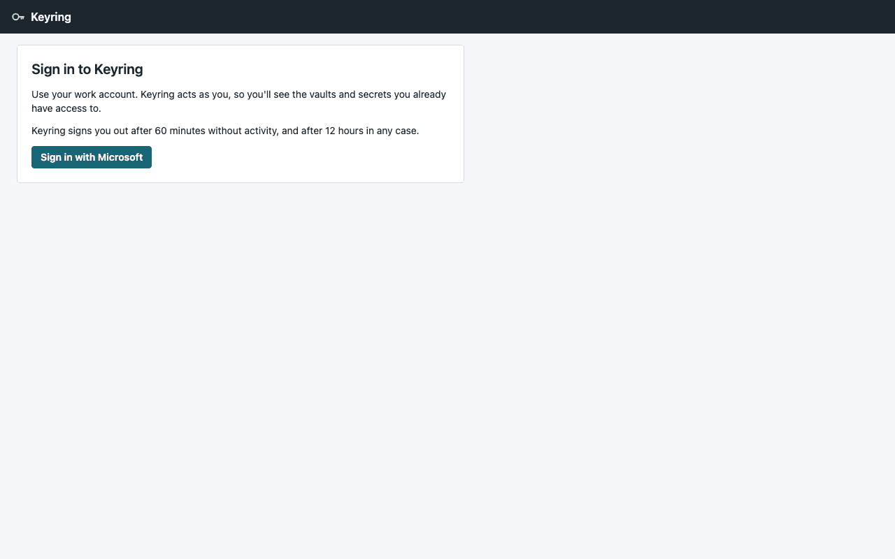
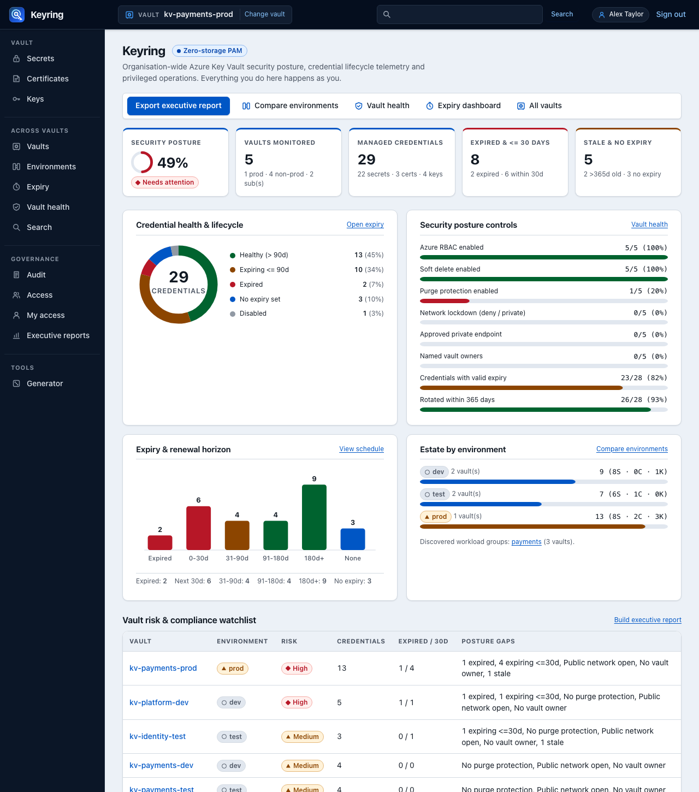
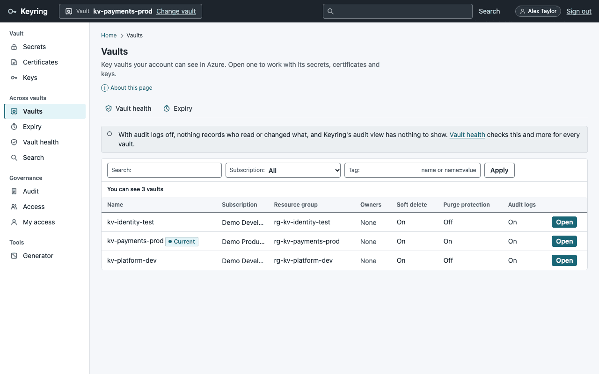
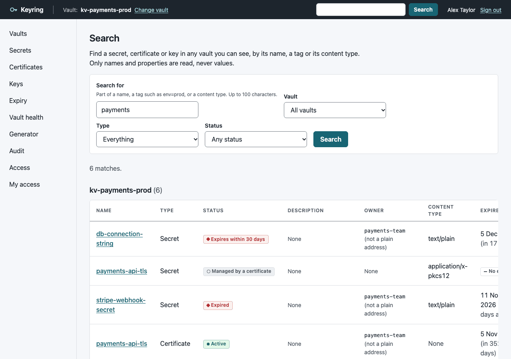

# Getting started

This walkthrough shows how to sign in to Keyring, find your way around, find a vault and an item, keep your favourites close with pins, and sign out.

## Who this is for

Everyone who uses Keyring.

| You need | Where | Why |
| --- | --- | --- |
| A work account in your organisation's Entra ID | Your tenant | Keyring signs you in with Microsoft. There is no separate Keyring password |
| Reader | The vault, its resource group or its subscription | To see the vault in Keyring's list |
| A Key Vault role, such as Key Vault Secrets User or Key Vault Reader | The vault | To see what is inside it |

## Before you start

- Have the address of your Keyring, such as `https://keyring.example.com`.
- Ask whoever looks after your vaults for the roles above if you don't have them yet.

## Steps

### Sign in

1. Open Keyring's address in your browser.

   You see **Sign in to Keyring**, which says Keyring acts as you, and how long you can stay signed in: it signs you out after 60 minutes without activity, and after 12 hours in any case.

   

2. Select **Sign in with Microsoft**, and sign in with your work account.

   Your organisation's usual sign-in rules apply, such as multi-factor authentication. You come back to Keyring's home page, with your name at the top right.

### Find your way around

3. Look at the home page, headed **Keyring**.

   It says "Everything you do here happens as you. If you can't do it in the Azure portal, you can't do it here." If your Keyring allows permanent deletes, it also says "Permanent deletes are turned on for this Keyring." Below that is one link per section.

   

4. Use the menu on the left. It has the same sections: **Vaults**, **Secrets**, **Certificates**, **Keys**, **Expiry**, **Vault health**, **Generator**, **Audit**, **Access** and **My access**.

   Secrets, Certificates, Keys, Audit, Access and My access are about one vault at a time. Expiry, Vault health and search cover every vault you can see.

### Choose a vault

5. Select **Vaults**.

   You see every vault your account can see in Azure, with its subscription, resource group, location, owners, access model, soft delete, purge protection and whether its audit logs are on. "Seeing a vault here doesn't always mean you can open its secrets": that needs a Key Vault role as well.

   

6. Narrow the list if it is long: type in **Search by name or resource group**, pick a **Subscription**, or type a **Tag** such as `env` or `env=prod`, then select **Filter**. **Clear** removes the filters.

7. Select **Open** on the vault you want.

   Keyring says "Now working in kv-payments-prod." and shows that vault's secrets. The top bar now shows **Vault:** and the vault's name, with **Change vault** to pick another.

   If you open a page such as **Secrets** before choosing a vault, Keyring shows "Choose a vault first." with a **Choose a vault** button.

### Search every vault

8. Type part of a name in the search box at the top of every page and select **Search**.

   The **Search** page finds secrets, certificates and keys in every vault you can see, by name, tag (such as `env=prod`), description, owner or content type. "Only names and properties are read, never values." Narrow it with **Vault**, **Type** and **Status**. Results are grouped by vault, and each name opens the item.

   

   A search is up to 100 characters. If you can see more vaults than Keyring searches at once, it says so and searches the first ones by name; pick a vault to search the others.

### Pin and come back

9. Open a vault's list or an item, and select **Pin** under its heading.

   The vault or item is added to **Pinned** on the home page and the vault list. **Recently opened** there lists the last 10 items you opened. **Clear** empties them.

   Pins live in your browser only (names and addresses, never values). They are cleared when you sign out. In a private window, or with site data blocked, there is no **Pin** button and Keyring works the same without it.

### Stay signed in, and sign out

10. Leave Keyring open if you like. A few minutes before the 60 minutes without activity run out, a notice offers **Stay signed in**. Select it to carry on.

11. Select **Sign out** at the top right when you are done.

    You see **You're signed out**, with "Close this tab if you're on a shared computer." and **Sign in again**.

## What Keyring checks

| Check | What you see |
| --- | --- |
| You've been inactive for 60 minutes, or signed in 12 hours ago | **Sign in to Keyring** with "You were signed out after a while without activity. Sign in again to carry on." |
| You were signed out while saving a form | "You were signed out before that was saved, so nothing changed. Sign in again, then enter it again." |
| You can't see any vaults | "You can't see any vaults yet." with what to ask for: the Reader role where your team's vaults live, plus a Key Vault role |
| A form came from somewhere other than Keyring, or an out-of-date tab | "This request didn't come from Keyring, so it was refused. Go back to Keyring and try again." or **That didn't go through** |
| You switched vault in another tab | **You switched vaults**: "Nothing was changed. Go back, refresh the page and try again." |

## What is recorded

Keyring writes `session.sign_in` when you sign in, `session.sign_in_failed` when a sign-in fails, `session.sign_out` when you sign out and `session.expired` when a session runs out. Browsing, choosing a vault and searching write nothing.

## Troubleshooting

| Problem | What to do |
| --- | --- |
| **Your organisation needs to approve Keyring** | An admin hasn't granted consent for Keyring's app registration. Ask whoever runs Keyring |
| **Please sign in again** | Your organisation wants a fresh sign-in, for example to check a second factor. Sign in again |
| **Microsoft sign-in said no** | Entra ID wouldn't let Keyring act for you. Ask whoever runs Keyring, with the code shown |
| A vault you expect isn't listed | You need Reader on it. Role changes can take a few minutes to apply |
| **Can't reach this vault** | The vault only accepts private network connections and Keyring isn't on that network. Ask whoever runs Keyring |

## Related walkthroughs

- [02 Secrets](02-secrets.md)
- [10 Access](10-access.md)
