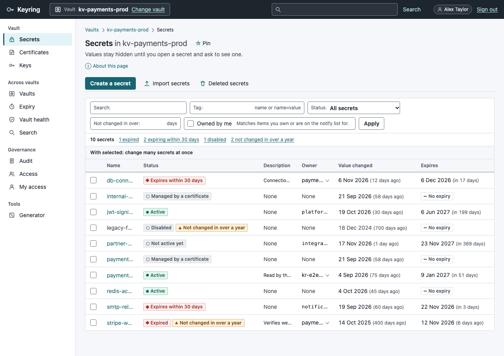
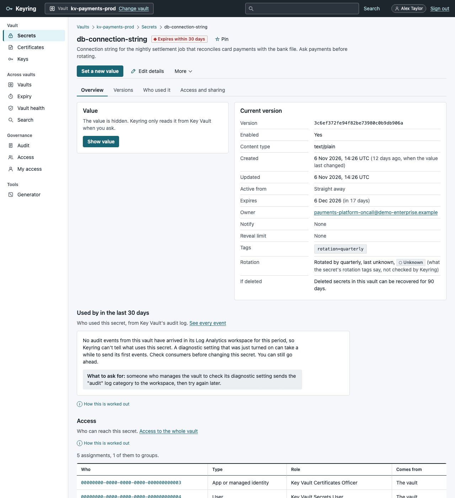
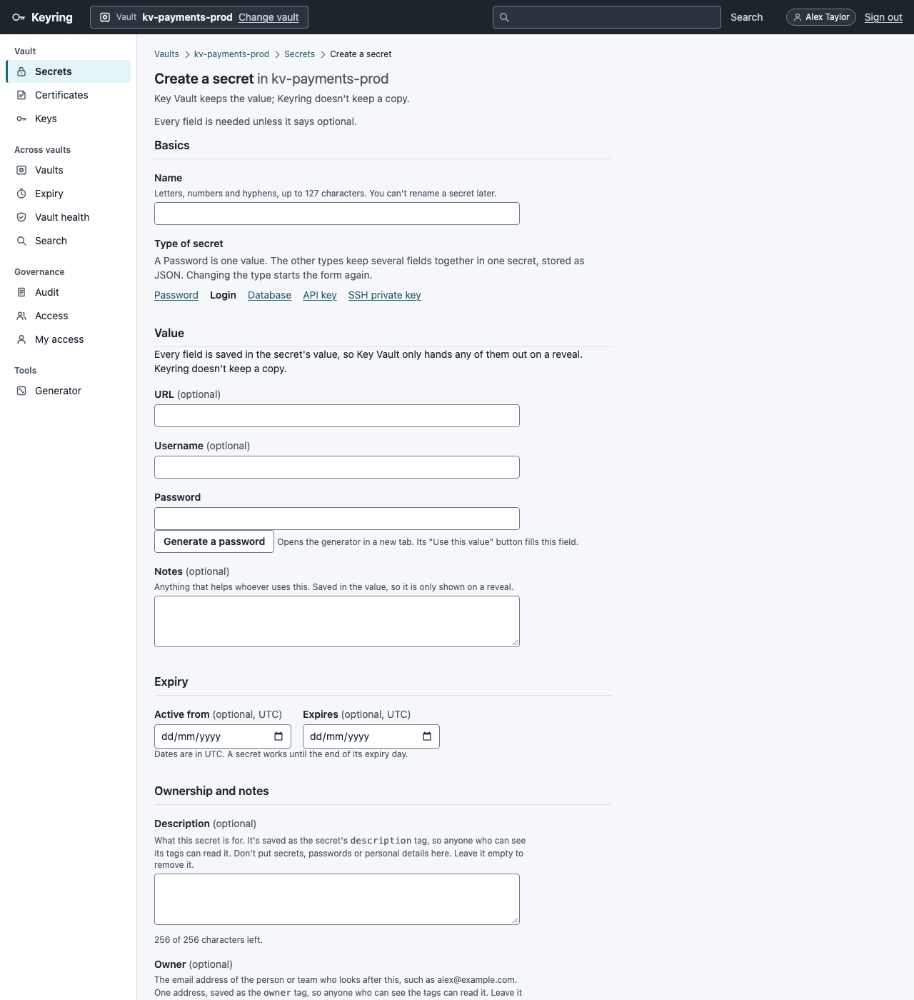
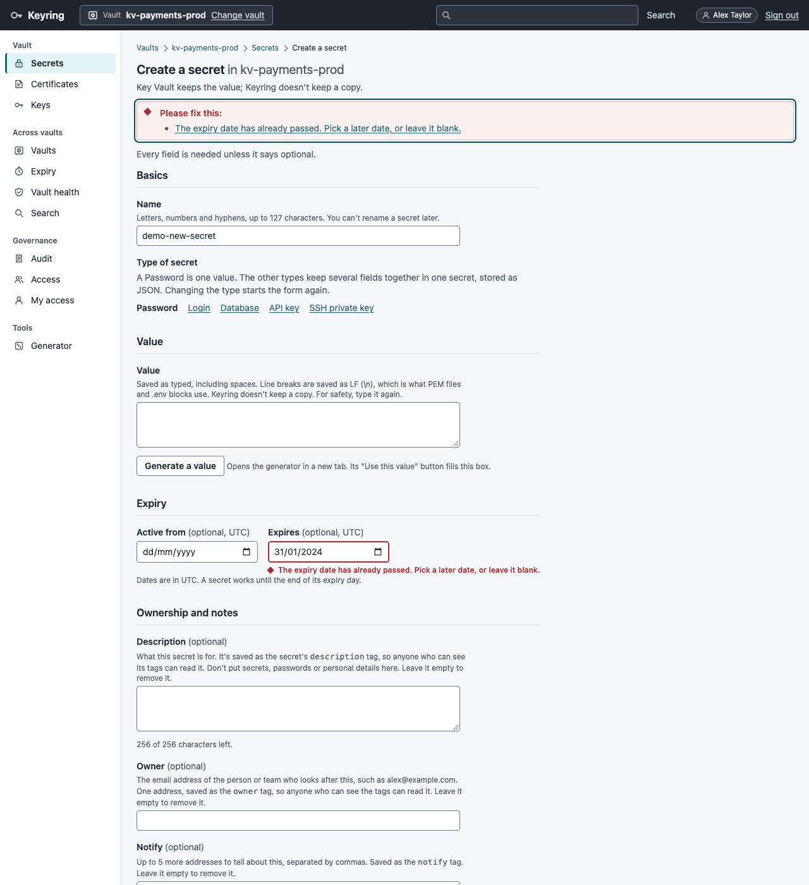
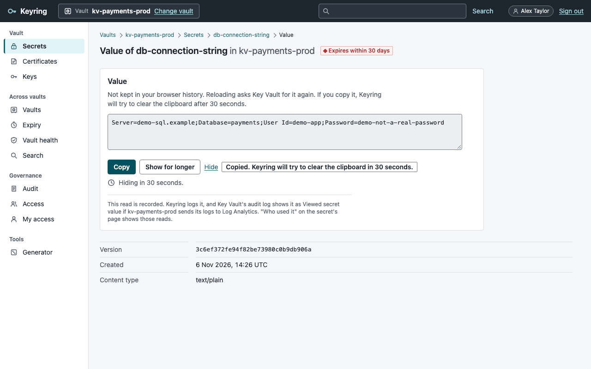
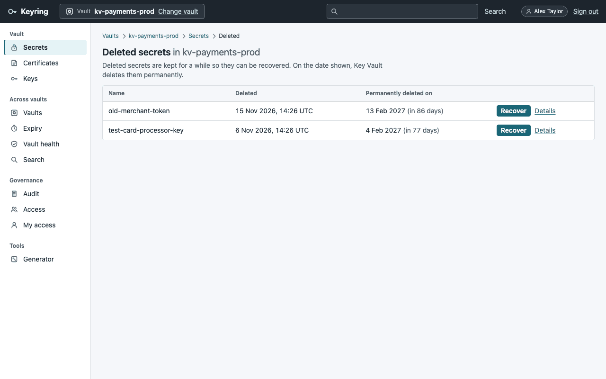

# Secrets

This walkthrough covers everything you do with one secret: create it (a plain value, or a Login, Database, API key or SSH private key), make a value with the generator, show and copy the value, change its details, set a new value, roll back to an older version, disable it, delete it, recover it, and permanently delete it where your Keyring allows that.

## Who this is for

| To do this | Key Vault role | Where |
| --- | --- | --- |
| See the list and a secret's details | Key Vault Secrets User, or Key Vault Reader for names and dates only | The vault |
| Show and copy a value | Key Vault Secrets User | The vault |
| Create, set a new value, edit details, roll back, enable or disable, delete, recover | Key Vault Secrets Officer | The vault |
| Permanently delete (only if your Keyring allows it) | Key Vault Secrets Officer | The vault |

## Before you start

- Choose the vault (see [01 Getting started](01-getting-started.md)).
- Know whether your Keyring asks for a reason, a ticket or a fresh sign-in before values are shown. The forms show the fields when it does.

## Steps

### Read the list

1. Select **Secrets**.

   The list shows each secret's status, description, owner, content type, when its value last changed and when it expires. Open a secret to see its tags. "Values stay hidden until you open a secret and ask to see one." Links above the list count the expired, expiring, disabled and long-unchanged secrets; select one to show just those.

   

2. Filter with **Search** (a name, tag or owner), **Tag**, **Status**, **Not changed in over** (a number of days) and **Owned by me**, then press Enter or select **Apply**.

3. Select a secret's name to open it.

   

   The page shows the status badges, the buttons, the **Value** panel, the **Current version** facts, **Used by in the last 30 days** and **Access**.

### Create a secret

4. On the list, select **Create a secret**.

5. Fill in **Name**: letters, numbers and hyphens, up to 127 characters. "You can't rename a secret later."

6. Under **Type of secret**, keep **Password** for one value, or pick **Login**, **Database**, **API key** or **SSH private key** to keep several fields together in one secret.

   "Changing the type starts the form again." A typed secret is stored as JSON in the one secret, with a Keyring content type, so Key Vault only hands any of its fields out on a reveal.

   

   | Type | Fields |
   | --- | --- |
   | Password | **Value** |
   | Login | **URL**, **Username**, **Password**, **Notes** |
   | Database | **Server**, **Database**, **Username**, **Password**, **Notes** |
   | API key | **Key**, **Endpoint**, **Notes** |
   | SSH private key | **Username**, **Host**, **Private key**, **Passphrase**, **Notes** |

7. Type the value, or select **Generate a value** (or the generate link beside a typed field) to open the generator in a new tab (see the next section).

8. Fill in the optional fields: **Content type** (plain secrets only), **Active from** and **Expires** (dates in UTC; "A secret works until the end of its expiry day."), **Description**, **Owner**, **Notify** and the **Tags** rows. [03 Tags, notes and owners](03-tags-notes-owners.md) explains the last four.

9. Leave **Enabled** ticked unless apps shouldn't read it yet.

10. Select **Create secret**.

    Keyring says "Created" and the name, and opens the secret. If something needs fixing, a box at the top says "Please fix" and lists each problem beside its field. For safety, the value box is empty again: type it again.

    

### Make a value with the generator

11. Select **Generator** in the menu, or a generate link on a form.

12. Under **What to make**, pick **Password**, **GUID** or **API key**. For a password, set **Length** (8 to 256) and the **Characters to use**. For an API key, set **Random bytes**, the **Format** and an optional **Prefix**.

13. Select **Generate**.

    The value shows with **Copy**, **Show for longer** and **Hide**. If you opened the generator from a form, **Use this value** fills the field on that form. Generated values aren't stored or logged.

### Show and copy the value

14. On the secret's page, in **Value**, fill in **Reason** (and **Ticket**) if your Keyring asks for them, then select **Show value**.

    The value page says the read is recorded. A typed secret shows each field with its own copy button, and a Database secret also offers **Connection strings** built from its fields.

    

15. Select **Copy**.

    Keyring says "Copied. Keyring will try to clear the clipboard in 30 seconds." The value hides itself after 30 seconds; **Show for longer** restarts the count. Select **Hide** when you're done. Reloading the page asks Key Vault for the value again.

### Change the details

16. On the secret's page, select **Edit details**.

    "Changes apply to the current version. The value doesn't change and no new version is made."

17. Change the dates, content type, description, owner, notify, tags or **Enabled**, and select **Save changes**.

    Keyring says "Saved changes to" and the name. Key Vault can't remove an expiry or start date from a version: to have none, set a new value and leave the date blank.

### Set a new value

18. Select **Set a new value**.

    The page is headed "New value for" and the name, and says "Saving makes a new version. The current value stays in the secret's versions, so you can roll back." **Used by in the last 30 days** below the form lists what read the secret lately, which may break when the value changes.

19. Type the new value (or generate one) and select **Save new version**.

    Keyring says "Saved a new version of" the name, and "The old value is still in its versions."

### Roll back to an older version

20. Select **Versions**.

    Every value the secret has had is listed, newest first, with **Show value** for each enabled version and **Roll back to this** for each older one.

21. Select **Roll back to this** on the version you want.

    The page explains that Keyring copies that version's value into a new version, which becomes current, and that nothing is deleted.

22. Select **Make a new version from** and the version.

    Keyring says "Rolled back", with the new version and the one it copied, and "Nothing was deleted."

### Disable and enable

23. Select **Disable**. The page says what stops working, and "Nothing is deleted. Enable it again from its page to undo this." Select the disable button to confirm.

24. To undo it, open the secret and select **Enable**.

### Delete and recover

25. Select **Delete**.

    The page says the secret will move to deleted secrets, apps using it will stop being able to read it straight away, and how long it can be recovered for.

26. Type the secret's name in the box labelled **Type** and the name **to confirm**, then select the delete button.

    Keyring says "Deleted" and the name, and that you can recover it from deleted secrets.

27. To get it back, on the list select **Deleted secrets**.

    

28. Select **Recover** on its row, or **Details** and then **Recover** and the name.

    Keyring says "Recovering" and the name: "It can take a few seconds to show". It comes back with every version and its value.

### Permanently delete

29. Only if your Keyring allows it and the vault has no purge protection: open the deleted secret with **Details** and select **Permanently delete**.

30. Type the name to confirm and select **Permanently delete**.

    "This permanently deletes" the secret "and every version of it". "It can't be recovered by you, Keyring or Microsoft." Keyring says "Permanently deleted" and the name.

## What Keyring checks

| Check | What you see |
| --- | --- |
| A deleted secret has the name you chose | "A deleted secret called" the name "is still being kept", with **Review and recover** the name |
| The name is taken | "There's already a secret called" the name. "Pick another name, or open it and set a new value." |
| The expiry date has passed | "The expiry date has already passed. Pick a later date, or leave it blank." |
| The start date is after the expiry | "The start date needs to be before the expiry date." |
| You cleared an expiry date on Edit details | "Key Vault can't remove the expiry date from a version. To have no expiry, set a new value and leave Expires blank. Or pick a later date." |
| Someone else saved the secret after you opened the form | **This secret changed since you opened it**, and nothing was saved |
| The value is over 25 KB | "Values can be up to 25 KB." |
| The secret is disabled | No **Show value**: "This secret is disabled, so Key Vault won't hand out its value. Enable it first." |
| It belongs to a certificate | "This secret belongs to the certificate" the name "and holds its private key." Manage it from the certificate |
| The typed name didn't match | **The name didn't match**: "Nothing was deleted. To confirm, type" the name "exactly as shown." |
| Permanent deletes are off | **Permanent delete is turned off**, saying deleted secrets can be recovered until Key Vault purges them on schedule |
| You tried to roll back to the current or a disabled version | **That's already the current version**, or **That version is disabled** |
| Your Keyring asks for a reason | **Reason** (5 to 200 characters) and maybe **Ticket** beside the button. Without one: "Give a reason of 5 to 200 characters." |
| Your Keyring asks you to confirm it's you | **Confirm it's you**: "Your organisation asks you to confirm it's you before showing values." Sign in again and you come back to the same step |
| Your Keyring needs its audit records before a reveal | **Auditing is unavailable**: "Nothing was read. Try again in a few minutes" |
| Your Keyring has a password policy | See [13 Password policy and reveal limits](13-password-policy-and-reveal-limits.md) |
| Your Keyring needs an owner | See [03 Tags, notes and owners](03-tags-notes-owners.md) |
| Azure says no | **You don't have access**, with "What to ask for:" and the role, such as Key Vault Secrets Officer |

## What is recorded

| Action | Keyring audit action |
| --- | --- |
| Create | `secret.create` |
| Set a new value | `secret.set` |
| Edit details | `secret.update` |
| Show value (each time, any version) | `secret.reveal` |
| Disable or enable | `secret.enabled.set` |
| Roll back | `secret.rollback` |
| Delete, recover, permanently delete | `secret.delete`, `secret.recover`, `secret.purge` |

Each event names you, the vault, the secret and, for a reveal or rollback, the version. Never the value. A refusal (a name that didn't match, purge turned off, no reason, step-up) is an event too, with `outcome` `refused` and a reason code such as `typed_name_mismatch`, `purge_disabled`, `reason_required` or `step_up_required`. Key Vault's own log shows the reveal as `SecretGet`, which **Who used it** reads.

## Troubleshooting

| Problem | What to do |
| --- | --- |
| A button is disabled with "Needs Key Vault Secrets Officer" | Your role doesn't allow it. Ask for the role, or use My access if you're eligible for it (see [10 Access](10-access.md)) |
| **Copy** isn't shown | Your browser blocks the clipboard or JavaScript is off. Select the value and copy it yourself |
| The clipboard wasn't cleared | Browsers only let a page clear the clipboard while its tab is in front. Clear it yourself |
| A recovered secret isn't in the list yet | Wait a few seconds and refresh. Key Vault takes a moment |
| **Key Vault couldn't do that right now** straight after a recover | The secret is still being recovered. Wait a few seconds and try again |

## Related walkthroughs

- [03 Tags, notes and owners](03-tags-notes-owners.md)
- [06 Copy a secret to another vault](06-copy-secret.md)
- [07 Bulk changes and secrets import](07-bulk-and-import.md)
- [11 Audit](11-audit.md)
