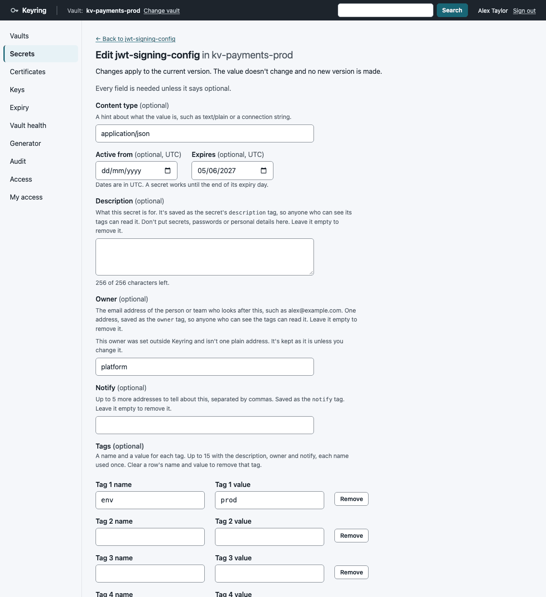

# Tags, notes and owners

This walkthrough shows how to label secrets, certificates and keys so people can find them and know who looks after them: the tag rows, the **Description** note, the **Owner** and **Notify** fields, **Owned by me**, and the tag filters on the lists. It also covers the vault's own owners.

Keyring stores nothing of its own, so all of this lives in the item's Key Vault tags. The portal and the Azure CLI see the same tags, and each counts towards Key Vault's limit of 15 tags per item.

## Who this is for

| To do this | Key Vault role | Where |
| --- | --- | --- |
| See tags, descriptions and owners | Key Vault Reader, or the matching User role | The vault |
| Change them on a secret | Key Vault Secrets Officer | The vault |
| Change them on a certificate | Key Vault Certificates Officer | The vault |
| Change them on a key | Key Vault Crypto Officer | The vault |
| Set a vault's owners | Tag Contributor, Contributor or Owner on the vault, in Azure (not in Keyring) | The vault resource |

## Before you start

- Know the email address of the person or team who looks after the item, such as `payments-team@example.com`. Use a team address where you can.
- Don't put secrets, passwords or personal details in a description or a tag. Anyone who can see the item's tags can read them.

## Steps

### Edit an item's details

1. Open the secret, certificate or key, and select **Edit details**.

   The form has **Description**, **Owner**, **Notify** and the **Tags** rows. A secret's form also has its dates, content type and **Enabled**; a certificate's or key's changes only these, with no new version.

   

### Write a description

2. Type a note in **Description**: what this item is for, in up to 256 characters. Line breaks are kept.

   It is saved as the item's `description` tag. It shows under the item's name, in the **Description** column on the lists and search, and in the expiry and age CSVs. Leave it empty to remove it.

### Set the owner and notify list

3. Type one address in **Owner**, such as `payments-team@example.com`. The box suggests owners already used in the vault.

   It is saved as the `owner` tag. "Leave it empty to remove it", unless your Keyring needs an owner on every item.

4. Type up to 5 more addresses in **Notify**, separated by commas.

   They are saved as the `notify` tag. These are the people to tell about the item. On main today, Keyring's own emails don't use them yet; see [12 Notifications people receive](12-notifications.md).

5. If the page says "This owner was set outside Keyring and isn't one plain address. It's kept as it is unless you change it.", leave the field alone to keep it, or replace it with one address.

### Add, change and remove tags

6. Under **Tags**, type a name in an empty row's name box (such as Tag 1 name) and its value in the value box beside it.

   The name box suggests tag names already used in the vault; the value box suggests that name's values. Each name can be used once.

7. To change a tag, change its value. To remove one, clear both its name and its value.

8. Select **Save changes**.

   Keyring says "Saved changes to" and the name. On the item's page, each tag under **Tags** is a link to the list filtered by that tag.

### Find things by tag and owner

9. On **Secrets**, **Certificates** or **Keys**, type a tag in **Tag**, such as `env` or `env=prod`, and select **Filter**.

10. Tick **Owned by me** and select **Filter** to see the items whose owner, or one of whose notify addresses, is the address you signed in with.

    The page's address only says `mine=1`, never your address.

11. Search for an owner from the search box (for example `owner=payments-team@example.com`), or type it into a **Tag** filter.

    This works, but the address then goes in the page's address, which your browser keeps in its history. **Owned by me** avoids that.

### Set a vault's owners

12. In the Azure portal, open the vault's **Tags** blade and add `keyring-owners` with the owners' addresses, separated by commas. Or run:

    ```sh
    az tag update --resource-id <vault ID> --operation merge \
      --tags keyring-owners=alex@example.com,ops@example.com
    ```

    Keyring never changes vault tags. After a minute or so, **Vaults** shows them in **Owners**, and **Vault health** passes its **Owners** check.

## What Keyring checks

| Check | What you see |
| --- | --- |
| The description is over 256 characters | "The description can be up to 256 characters." |
| The description has a tab or an invisible character | "The description has a hidden character in it, such as a tab, a control character or an invisible formatting mark. Remove it and try again." |
| The owner isn't one plain address | "The owner isn't one plain email address, such as alex@example.com. Use one address with no name, spaces or commas. To name more people, use Notify." |
| An address is outside the allowed domains | "The owner's address isn't in a domain Keyring is set to email", with the domains |
| Notify holds more than 5 addresses | "Notify can hold up to 5 addresses." and "For more people, use a team address." |
| Notify has an address that isn't plain | It names which one by place, such as "The second address in Notify isn't a plain email address", without quoting it |
| The item already has 15 tags | "This already has 15 tags, the most Key Vault allows". Remove a tag first |
| You typed `description`, `owner` or `notify` as a tag name | "The description tag is set with the Description field." or "The owner and notify tags are set with the Owner and Notify fields." |
| A tag holds a line break | "A tag name can't have a line break in it." Tags already set with a line break outside Keyring are listed, kept, and can only be changed in the portal or CLI |
| Your Keyring needs an owner and Owner is empty | "Enter an owner. Keyring is set to need one on every item it creates or edits: the address of the person or team who looks after it." |
| Someone changed the item after you opened the form | "This form changed since you opened it, so nothing was saved. Open it again, then make your change." |

With an owner required, Keyring refuses to create, upload, set a new value or edit details without one, skips import rows without an `owner`, refuses a copy that wouldn't bring one, and doesn't offer **Remove the owner** in a bulk change. Rotating, rolling back, enabling, disabling and renewal aren't checked. It is a Keyring rule: the Azure CLI and portal aren't limited by it.

## What is recorded

Edit details writes `secret.update`, `certificate.update` or `key.update`. The description, owner and notify addresses are never logged or put in an audit event. A refusal for a missing owner is an event with `outcome` `refused` and `reason_code` `owner_required`.

## Troubleshooting

| Problem | What to do |
| --- | --- |
| A vault's owners don't show | Check the tag is called `keyring-owners` on the vault resource (not a Key Vault tag). Resource Graph can take a minute |
| **Owned by me** shows nothing | The owner or notify address must be the one you sign in with. Check the spelling; case doesn't matter |
| Tag suggestions are missing | Suggestions come from the vault's own lists, read as you. With no role on certificates or keys, only secrets' tags are suggested |

## Related walkthroughs

- [02 Secrets](02-secrets.md)
- [07 Bulk changes and secrets import](07-bulk-and-import.md)
- [09 Vault health](09-vault-health.md)
