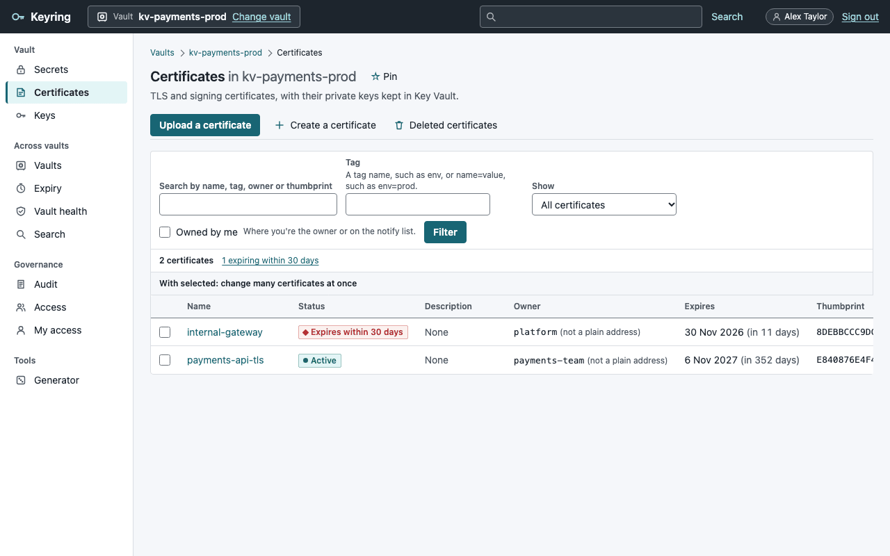
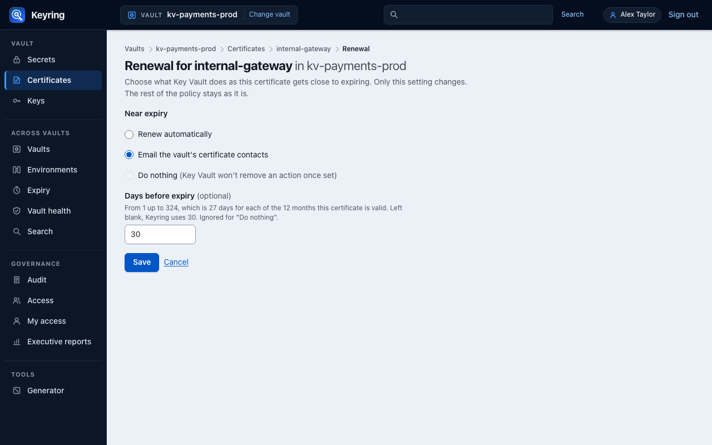
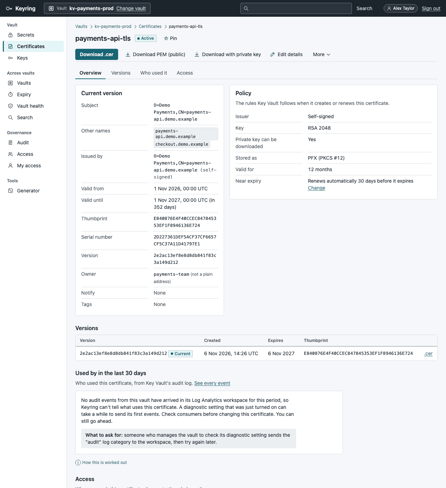

# Certificates

This walkthrough covers certificates: create one in Key Vault, upload one you already have (after a preview of what is in the file), change what happens near expiry, download the public certificate and, where allowed, the private key, and edit its details.

## Who this is for

| To do this | Key Vault role | Where |
| --- | --- | --- |
| List and view certificates, download `.cer` and PEM | Key Vault Reader | The vault |
| Download with the private key | Key Vault Certificate User (it can also read secret values, so give it on the one certificate where you can) | The vault, or the one certificate |
| Create, upload, change renewal, edit details, enable or disable, delete and recover | Key Vault Certificates Officer | The vault |
| See the vault's issuers when creating | Key Vault Certificates Officer. Without it, only self-signed is offered | The vault |

## Before you start

- For a certificate from a certificate authority, an issuer must already be set up on the vault in the Azure portal. Keyring doesn't manage issuers.
- For an upload, have the `.pfx` or `.p12` file and its password, or a `.pem` file holding the certificate and an unencrypted PKCS #8 key (`BEGIN PRIVATE KEY`). Up to 256 KB.

## Steps

### Read the list

1. Select **Certificates**.

   The list shows each certificate's status, description, owner, expiry, thumbprint and tags. Links above it count the expired ones and those expiring within 30 and 90 days.

   

2. Filter with **Search by name, tag, owner or thumbprint**, **Tag**, **Show** and **Owned by me**, then select **Filter**.

### Create a certificate

3. Select **Create a certificate**.

4. Fill in **Name**, **Main name (common name)** (such as `app.example.com`), any **Other names**, one per line, and **Valid for** in months (1 to 120).

5. Pick the **Issuer**: **Self (self-signed)**, or an issuer already set up on the vault.

6. Fill in **Description**, **Owner** and **Notify** if you like.

7. Open **Key, format and renewal options** to change the defaults:

   - **Key type**: RSA 2048 works with almost everything.
   - **Allow the private key to be downloaded**: needed if the certificate will be installed outside Azure. Untick to keep the key in Key Vault for good.
   - **Stored as**: PFX or PEM.
   - **Near expiry**: **Renew automatically**, **Email the vault's certificate contacts** or **Do nothing**, and **Days before expiry**.
   - The **Tags** rows.

8. Select **Create certificate**.

   A self-signed certificate is usually ready in a few seconds: Keyring says "Creating" and the name, "This usually takes a few seconds." One from an issuer says "It appears once the issuer signs it." Its page shows **Certificate request:** and the status, with **Check again** and **Cancel this request**.

### Upload a certificate

9. Select **Upload a certificate**.

10. Choose the **Certificate file**, type the **Password** if the `.pfx` has one, and fill in **Name** and the optional fields. Untick **Allow the private key to be downloaded later** to keep the key in Key Vault.

11. Select **Check the file**.

    The preview, headed **Upload** the name **to** the vault, shows the subject, other names, issuer and validity, and any other certificates in the file. "Nothing has been saved yet." If a certificate with that name exists, it says the file becomes its new current version and shows the current subject, thumbprint and expiry.

12. Select **Upload to** the vault, or **Upload as a new version**. Or select **Start again**.

    Keyring says "Uploaded" and the name. Keyring keeps the file in memory only, until you upload it, start again, or 10 minutes pass.

### Change what happens near expiry

13. Open the certificate. Under **Policy**, beside **Near expiry**, select **Change**.

    

14. Pick **Renew automatically**, **Email the vault's certificate contacts** or **Do nothing**, set **Days before expiry** if you like, and select **Save**.

    Keyring says "Saved what happens near expiry for" the name. Only this setting changes.

### Download

15. On the certificate's page:

    - **Download .cer** or **Download PEM (public)** for the public certificate. Each version in **Versions** also has a `.cer` link.
    - **Download with private key**, shown only when the policy allows the key to be downloaded.

    

16. For the private key, read the confirmation, type the certificate's name, fill in **Reason** if asked, and select **Download with private key**.

### Edit details, disable, delete

17. Select **Edit details** to change the description, owner, notify and tags of the current version, then **Save changes**. Nothing else about the certificate changes and no new version is made.

18. **Disable**, **Enable**, **Delete**, **Deleted certificates** and **Recover** work as for secrets (see [02 Secrets](02-secrets.md)). Deleting a certificate takes its key and backing secret with it.

## What Keyring checks

| Check | What you see |
| --- | --- |
| Key Vault refused the create | "Key Vault didn't create the certificate. Check the details and try again." with "Key Vault said:" and its message |
| Too many days before expiry | Up to 27 days for each month the certificate is valid |
| The certificate was signed outside Key Vault | "This certificate was signed outside Key Vault, so Key Vault can only remind the vault's contacts. It can't renew it." **Renew automatically** isn't available |
| A renewal action is already set | **Do nothing** is disabled: "Key Vault won't remove an action once set" |
| The file can't be read | "Keyring can't show what's in this file, but Key Vault may still accept it." Key Vault checks it on upload |
| The `.pfx` has a password | "This .pfx is protected by its password, so Keyring can't show what's inside without opening it." Key Vault says if the password is wrong |
| The certificate has already expired | "This certificate has already expired." on the preview |
| The key stays in Key Vault | **The private key can't be downloaded**: "You can still download the public certificate." |
| Not issued yet | **No certificate yet**: "Check the pending request on its page." |
| A deleted certificate has the name | "A deleted certificate called" the name "is still being kept. Recover it from deleted certificates, or pick another name." |
| Your Keyring asks for a reason or a fresh sign-in before a private key download | As for a secret's value, see [02 Secrets](02-secrets.md) |

## What is recorded

| Action | Keyring audit action |
| --- | --- |
| Create, cancel a pending request | `certificate.create`, `certificate.pending.cancel` |
| Upload | `certificate.upload` |
| Change renewal | `certificate.renewal.set` |
| Download with private key | `certificate.download_private_key` |
| Edit details | `certificate.update` |
| Disable or enable, delete, recover, permanently delete | `certificate.enabled.set`, `certificate.delete`, `certificate.recover`, `certificate.purge` |

Downloading the public certificate writes no event. A private key download shows in Key Vault's log as a read of the certificate's backing secret.

## Troubleshooting

| Problem | What to do |
| --- | --- |
| Only **Self (self-signed)** is offered | You need Key Vault Certificates Officer to list issuers, or the vault has none |
| A self-signed certificate stays "Being created" | Select **Check again**. If it failed, the notice says so; select **Cancel this request** and try again |
| Upload refused: password probably wrong | Start again and type the password. Key Vault's own message shows after "Key Vault said:" |
| A PEM upload is refused | The key must be unencrypted PKCS #8 (`BEGIN PRIVATE KEY`), not PKCS #1 (`BEGIN RSA PRIVATE KEY`) |

## Related walkthroughs

- [03 Tags, notes and owners](03-tags-notes-owners.md)
- [05 Keys](05-keys.md)
- [08 Expiry dashboard, age view and expiry emails](08-expiry.md)
