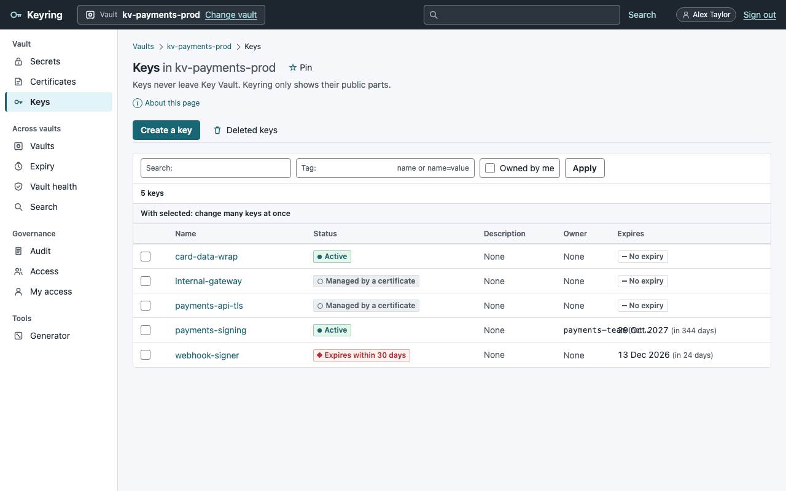
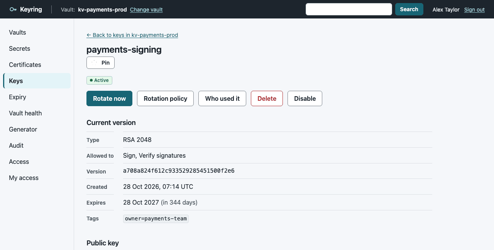
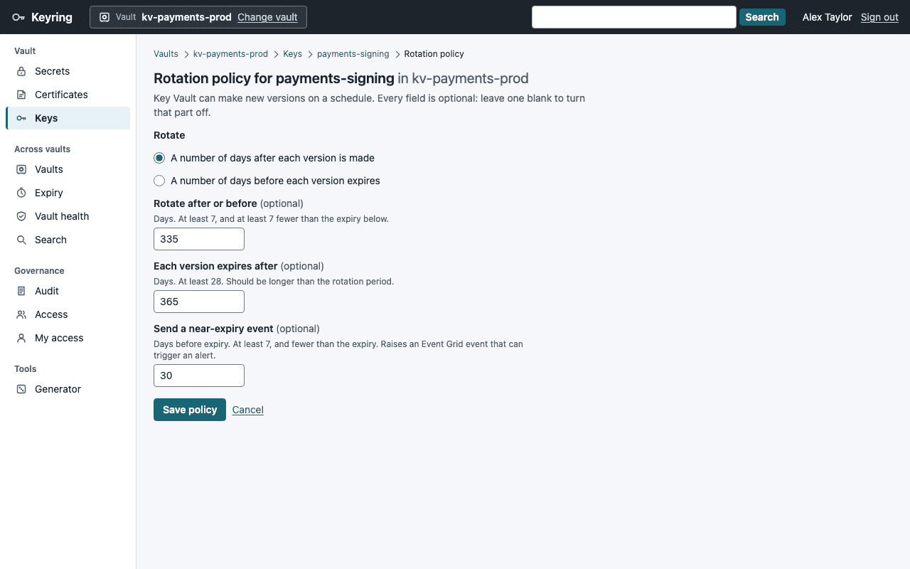

# Keys

This walkthrough covers keys: create one, set a rotation policy so Key Vault makes new versions on a schedule, rotate one now, read its versions and public key, and what Keyring deliberately doesn't do with keys.

## Who this is for

| To do this | Key Vault role | Where |
| --- | --- | --- |
| List and view keys, copy public keys | Key Vault Reader, or Key Vault Crypto User | The vault |
| Create, rotate, set the rotation policy, edit details, enable or disable, delete and recover | Key Vault Crypto Officer | The vault |

## Before you start

- Know what the key is for (encrypt, sign or wrap other keys), so you can pick the type.
- An HSM-protected key needs a Premium tier vault.

## Steps

### Read the list

1. Select **Keys**.

   "Keys never leave Key Vault. Keyring only shows their public parts." The list shows each key's status, description, owner, when it was created, when it expires and its tags.

   

### Create a key

2. Select **Create a key**.

3. Fill in **Name**, and **Description**, **Owner** and **Notify** if you like.

4. To change the defaults, open **Key type, operations, expiry and tags**:

   - **Key type**: RSA 3072 is the recommended default. "EC keys are smaller and faster but can only sign."
   - **Protect with a hardware security module (HSM)**: needs a Premium tier vault.
   - **Allowed to**: leave all unticked for the usual set for the key type.
   - **Expires**: a date in UTC, or blank for no expiry.
   - The **Tags** rows.

5. Select **Create key**.

   Keyring says "Created" and the name, and opens the key.

### Read a key

6. Open the key.

   The page shows its type and allowed operations, the **Public key** as PEM and JWK with **Copy PEM** and **Copy JWK**, the **Rotation policy** and **Versions**. "Safe to share. The private key never leaves Key Vault."

   

### Set a rotation policy

7. Select **Rotation policy**.

   

8. Under **Rotate**, pick **A number of days after each version is made** or **A number of days before each version expires**, and fill in **Rotate after or before** (days, at least 7).

9. Fill in **Each version expires after** (days, at least 28, longer than the rotation period) and **Send a near-expiry event** (days before expiry, at least 7). "Every field is optional: leave one blank to turn that part off."

10. Select **Save policy**.

    Keyring says "Saved the rotation policy for" the name. If the current policy has parts this form can't show, the page lists them first and asks you to tick **Replace the whole policy with what's on this page** before it saves over them.

### Rotate now

11. On the key's page, select **Rotate now**.

    "Key Vault will make a new version of the key, and it becomes current." "Older versions stay, so data encrypted or signed with them can still be decrypted or verified." **Used by in the last 30 days** below lists what used the key lately.

12. Select **Make a new version**.

    Keyring says "Rotated" and the name, the new version, and "Older versions still work for decrypting and verifying."

### Edit details, disable, delete

13. **Edit details** changes the description, owner, notify and tags of the current version, with no new version. **Disable**, **Enable**, **Delete**, **Deleted keys** and **Recover** work as for secrets (see [02 Secrets](02-secrets.md)).

## What Keyring deliberately can't do with keys

- Export or download a private key. Keyring shows only the public part, and Key Vault keeps the private part.
- Encrypt, decrypt, sign, verify, wrap or unwrap. Apps do that with Key Vault directly, with their own identity.
- Import a key you made elsewhere. Use the Azure CLI.
- Change a key that belongs to a certificate. "This key belongs to the certificate" and its name. "Change it from the certificate."
- Managed HSM. Keyring works with Key Vault vaults only.

## What Keyring checks

| Check | What you see |
| --- | --- |
| EC key with encrypt or wrap ticked | "EC keys can only sign and verify. Pick an RSA key to encrypt or wrap keys." |
| HSM on a Standard vault | "This vault can't make HSM-protected keys. It needs the Premium tier. Untick HSM, or use a Premium vault." |
| The name is taken | "There's already a key called" the name. "Pick another name, or open it and rotate it." |
| A deleted key has the name | "A deleted key called" the name "is still being kept. Recover it from deleted keys, or pick another name." |
| Rotate before expiry with no expiry set | "Rotating before expiry counts back from expiry, so set an expiry too." |
| Rotation too close to expiry | Key Vault needs at least 7 days between a rotation and the version's expiry, and the message says how many days to pick |
| Key Vault refused the policy | "Key Vault didn't save the policy. Nothing was changed." with "Key Vault said:" and its message |
| Permanently deleting a key | The confirmation adds "Anything encrypted with this key can never be decrypted again. Only do this if you're sure." |

## What is recorded

| Action | Keyring audit action |
| --- | --- |
| Create | `key.create` |
| Rotate now | `key.rotate` |
| Save the rotation policy | `key.rotation_policy.set` |
| Edit details | `key.update` |
| Disable or enable, delete, recover, permanently delete | `key.enabled.set`, `key.delete`, `key.recover`, `key.purge` |

Copying the public key writes nothing.

## Troubleshooting

| Problem | What to do |
| --- | --- |
| The rotation policy shows a near-expiry event you didn't set | Key Vault gives every new key a default policy (a notice 30 days before expiry). Keyring treats that as no policy set |
| **Rotate now** is missing | The key belongs to a certificate. Renew the certificate instead |
| Rotated, but an app still uses the old version | Apps that name a version keep using it. Apps that ask for the key by name get the new one |

## Related walkthroughs

- [04 Certificates](04-certificates.md)
- [08 Expiry dashboard, age view and expiry emails](08-expiry.md)
- [09 Vault health](09-vault-health.md)
