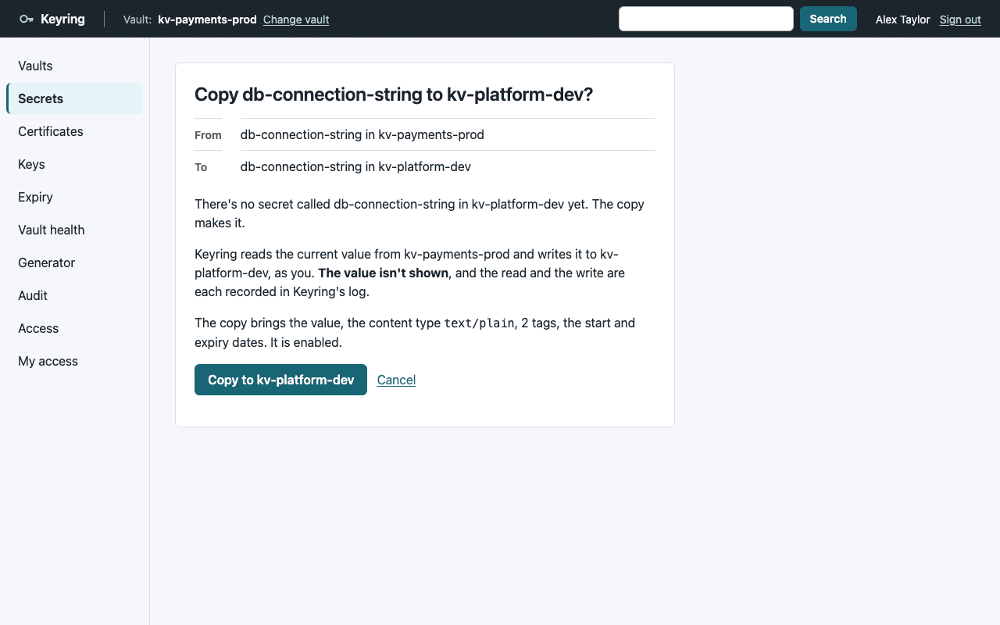

# Copy a secret to another vault

This walkthrough shows how to copy a secret's value from one vault to another without anyone seeing it, for example to give a new environment the same credential. Keyring reads the value and writes it to the other vault as you. The value is never shown on any page.

## Who this is for

| To do this | Key Vault role | Where |
| --- | --- | --- |
| Read the value | Key Vault Secrets User | The vault you copy from |
| Write the copy | Key Vault Secrets Officer, or a role that can set secrets | The vault you copy to |
| See the target vault in the list | Reader | The target vault, its resource group or subscription |

## Before you start

- Know which vault the copy goes to and the name it should have there.
- Copying is treated like showing the value: if your Keyring asks for a reason or a fresh sign-in before a value is shown, it asks before a copy too.

## Steps

1. Open the secret, and select **Copy to another vault**.

   "Keyring reads the value from" this vault "and writes it to the vault you pick, as you. The value is never shown."

2. Pick the vault in **Copy to vault**.

3. Check **Name in that vault**. It is the same name to start with. "If a secret has this name there already, the copy becomes its new version."

4. Under **What to bring**, untick anything the copy shouldn't have: **Content type**, **Tags**, **Start and expiry dates**, and **Enabled (untick to make the copy disabled)**. "The value always comes."

5. Select **Review the copy**.

   The review names both vaults and says what happens at the target: a new secret, a new version of an existing one, or why it can't go ahead. It lists what the copy brings.

   

6. Fill in **Reason** (and **Ticket**) if your Keyring asks for them, and select **Copy to** and the vault's name.

   Keyring says "Copied" the secret to the vault, the version that is now current there, and "The value wasn't shown."

## What Keyring checks

| Check | What you see |
| --- | --- |
| A deleted secret with that name is kept in the target | "A deleted secret called" the name "is still kept in" the vault, "so Key Vault won't take a new one with that name. Recover it in" the vault "first, or pick another name. Nothing has been copied." |
| The target name holds a certificate's private key | "Keyring won't write over it. Pick another name. Nothing has been copied." |
| The name exists in the target | "already exists in" the vault. "The copy becomes its new version, and anything that reads it gets the new value. Its older versions are kept." |
| Keyring couldn't check the target | "Keyring couldn't check whether" the name "exists in" the vault. "If it does, the copy becomes its new version." |
| Your Keyring needs an owner and the copy wouldn't have one | "Keyring is set to need an owner on every secret it writes, and this copy wouldn't have one". Give the source an owner with **Edit details**, or tick **Tags** |
| The source belongs to a certificate | No **Copy to another vault** button. Certificates' backing secrets can't be copied |
| The expiry date has passed | The copy brings the dates "except the expiry date, which has passed" |
| Reason, step-up and audit checks | As for **Show value** (see [02 Secrets](02-secrets.md)) |
| Azure refuses the write | "Not copied", naming Key Vault Secrets Officer. Nothing appears in the target |

The password policy doesn't apply to a copy: it moves a value Keyring already holds, with its type.

## What is recorded

A copy writes two Keyring audit events:

- `secret.copy.read`, on the source vault and name, with the version read. It is `success` once the value was read, even if the write then failed.
- `secret.copy.write`, on the target vault and name, with the new version, or `denied` or `failed` with Key Vault's code.

A refusal before the read (form token, step-up, reason, audit unavailable, a target you can't see, a deleted target name) is a `secret.copy.read` event only, and nothing reached Key Vault. Key Vault's log shows `SecretGet` on the source and `SecretSet` on the target, both as you.

## Troubleshooting

| Problem | What to do |
| --- | --- |
| The target vault isn't in **Copy to vault** | You need Reader on it to see it |
| The copy is refused naming Key Vault Secrets Officer | You can read the source but not write the target. Ask for the role on the target vault |
| The copy has no expiry date | The source's expiry had passed, so it wasn't brought. Set one with **Edit details** on the copy |

## Related walkthroughs

- [02 Secrets](02-secrets.md)
- [11 Audit](11-audit.md)
