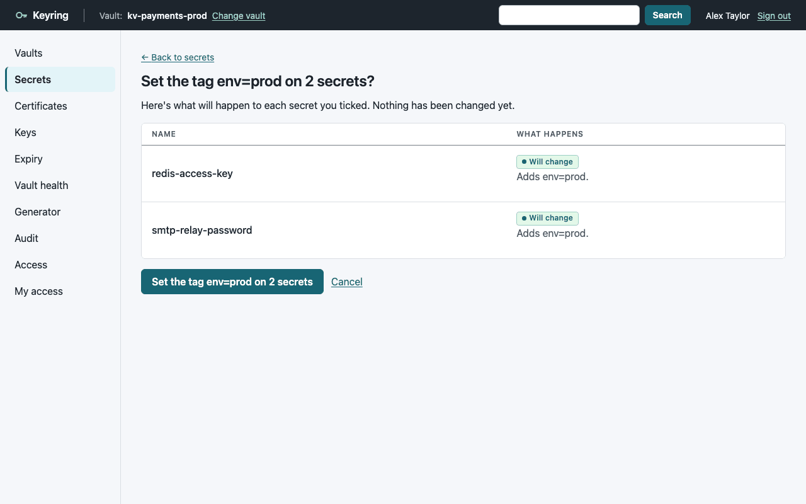

# Bulk changes and secrets import

This walkthrough covers two ways to change many items at once: a bulk change on up to 100 ticked secrets, certificates or keys, and importing secrets from a `.env` or CSV file. Both show you every change on a review page before anything is saved, and neither shows a value.

## Who this is for

| To do this | Key Vault role | Where |
| --- | --- | --- |
| Bulk change secrets, or import secrets | Key Vault Secrets Officer | The vault |
| Bulk change certificates | Key Vault Certificates Officer | The vault |
| Bulk change keys | Key Vault Crypto Officer | The vault |

## Before you start

- For a bulk change, know the change: a tag, the description, the owner, the notify list, an expiry date, or enable or disable.
- For an import, have the file: up to 500 secrets and 1024 KB. A `.csv` file is read as CSV; anything else as `.env`.

## Steps

### Change many at once

1. On **Secrets**, **Certificates** or **Keys**, tick the items you want, up to 100.

2. In **With selected**, pick the change:

   | Change | Fill in |
   | --- | --- |
   | **Add or change a tag**, **Remove a tag** | **Tag name**, and **Tag value (optional)** |
   | **Set the description**, **Remove the description** | **Description (for Set the description)** |
   | **Set the owner**, **Remove the owner** | **Owner (for Set the owner)** |
   | **Set the notify list**, **Remove the notify list** | **Notify (for Set the notify list)** |
   | **Set expiry date** (secrets and keys) | **Expiry date**. "Sets or changes the date. Key Vault can't remove one." |
   | **Enable**, **Disable** | Nothing |

3. Select **Review changes**.

   The review page lists each ticked item with **Will change**, **No change**, **Can't change** or **Not found**, and why. "Nothing has been changed yet."

   

4. For **Disable**, type the number of items to disable in the box, as the page asks. Fill in **Reason** if your Keyring asks for one.

5. Select the button that names the change, such as "Set the tag env=prod on 2 secrets".

   The results page lists each item with **Done**, **No change needed**, **Refused by Keyring**, **Not found**, **Refused by Azure**, **Failed**, **Not sent** or **Unknown**, and why. "Every secret was changed." when all went through.

### Import secrets from a file

6. On **Secrets**, select **Import secrets**.

7. Choose the **File of secrets**:

   - `.env`: one `NAME=value` per line. Values can be in quotes, and lines starting with `#` are skipped.
   - CSV: a first line naming the columns `name,value`, and optionally `content_type`, `expires` (YYYY-MM-DD), `tags` (`env=prod;team=ops`), `description`, `owner` and `notify`.

   Names are changed to fit Key Vault: `DB_PASSWORD` becomes `DB-PASSWORD`.

8. Select **Check the file**.

   The preview, headed **Import** and the count **to** the vault, counts **New secrets**, **New versions of existing secrets** and **Won't be imported**, then lists each row with its name in Key Vault, its name in the file and **What happens**: **New**, **New version**, **Blocked by a deleted secret**, **Managed by a certificate** or **Can't import**, with why. "Nothing has been saved yet, and values aren't shown."

9. Fill in **Reason** if asked, and select **Import** and the count. Or select **Start again** to forget the file.

   The results page, headed **Imported** and the count, lists each row with **Created**, **New version**, **Not imported**, **Blocked by a deleted secret**, **Refused by Azure**, **Failed**, **Not sent** or **Unknown**.

   Keyring keeps the file in memory only, until you import it, start again, or 10 minutes pass. After that, choose the file again.

## What Keyring checks

| Check | What you see |
| --- | --- |
| Nothing ticked | "Tick at least one secret in the list first." |
| More than 100 ticked | "You can change up to 100 secrets at a time." |
| A certificate's backing secret or key is ticked | **Can't change**: it belongs to the certificate. The others change |
| An item already has 15 tags | **Can't change** for that item |
| An expiry date on certificates | Not offered: "A certificate's expiry date comes from the certificate. Renew it to change it." |
| The typed number for Disable didn't match | **The number didn't match**, and nothing was disabled |
| Your Keyring needs an owner | **Remove the owner** isn't offered. An import row without an owner: "It has no owner, and Keyring is set to need one. Add an owner column with an address for each row." |
| Your Keyring has a password policy | A row whose value misses it: "Its value doesn't meet Keyring's password policy." The rest is imported |
| A row has a Keyring content type | **Can't import**. Typed secrets (Login and the others) are made on the create form only |
| A deleted secret has the name | **Blocked by a deleted secret**: "A deleted secret with this name can still be recovered. Recover or purge it first, or rename this one." |
| The file is too big | "That file is over 1024 KB. Split it into smaller files." |
| The import was started more than 10 minutes ago | **That import has expired**: "Choose the file again." |

Importing a name that's already in the vault makes the file's value its new current version, and drops a typed secret's content type: the new version is a plain secret.

## What is recorded

- A bulk change writes `secret.bulk_update`, `certificate.bulk_update` or `key.bulk_update` once for the request, and once more for each item Keyring reached Key Vault for, with its own outcome. The review page writes nothing.
- An import writes `secret.import` once for the import, and once more for each secret, including each row refused for the password policy or a missing owner. The preview writes nothing.

## Troubleshooting

| Problem | What to do |
| --- | --- |
| **Review changes** is disabled with "Needs" and a role | The hint reads your role on the whole vault. If your role is on some items only, the change may still work: Key Vault decides each one |
| Some rows say **Refused by Azure** | You lack the role on those items. The others went through |
| Rows say **Not sent** | The request ran out of time. Import or change the rest again |
| A `.env` import skips every row | Your Keyring needs an owner, and a `.env` file has no owner column. Use a CSV with an `owner` column |

## Related walkthroughs

- [02 Secrets](02-secrets.md)
- [03 Tags, notes and owners](03-tags-notes-owners.md)
- [13 Password policy and reveal limits](13-password-policy-and-reveal-limits.md)
