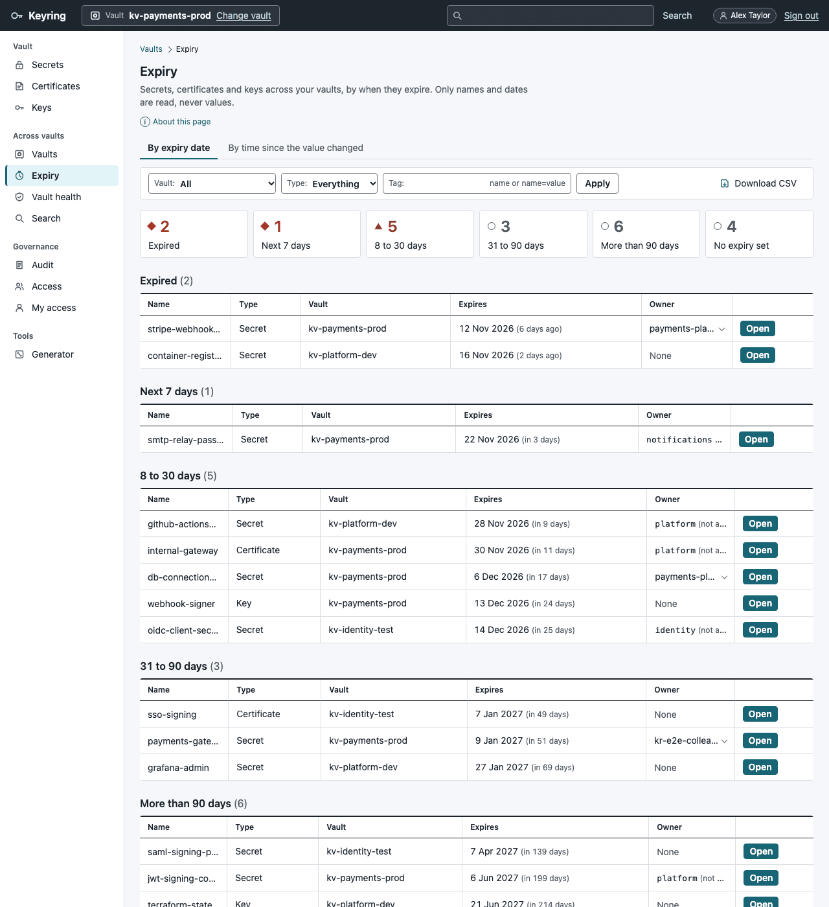
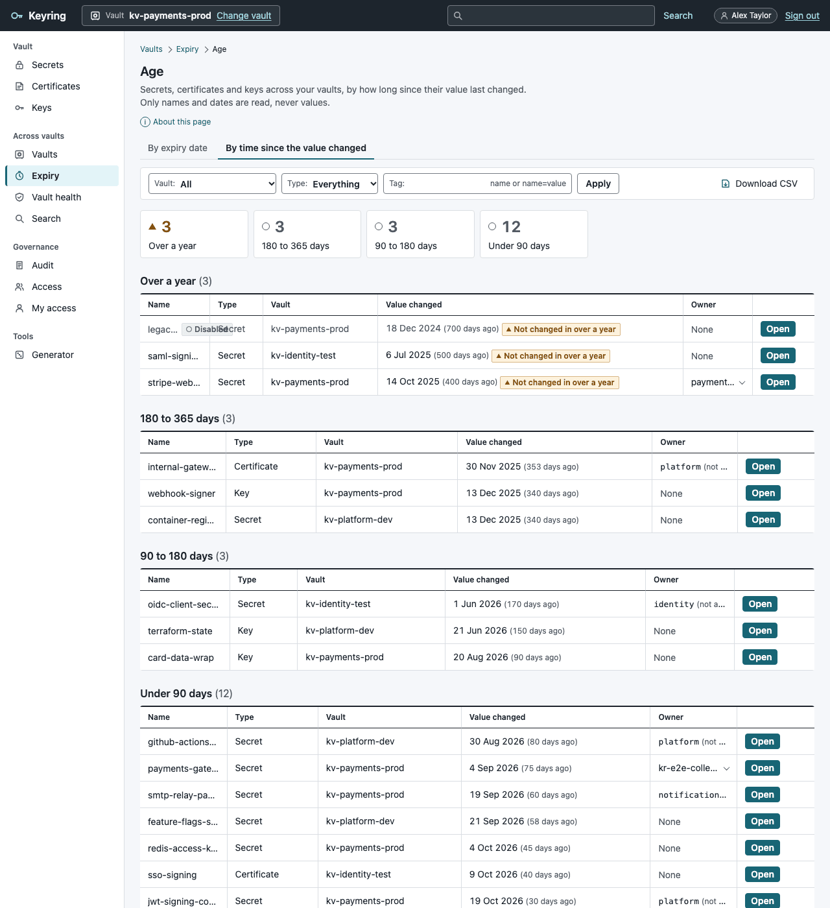

# Expiry dashboard, age view and expiry emails

This walkthrough shows how to see what is about to expire across every vault you can see, what hasn't been changed in a long time, and how expiry emails reach people.

## Who this is for

| To do this | Azure role | Where |
| --- | --- | --- |
| See a vault's items on the dashboard and the age view | Key Vault Reader on each vault (names and dates only), and Reader to see the vault | Each vault |
| Receive expiry emails | Nothing in Keyring. Whoever runs Keyring sets up who gets them | None |

## Before you start

Nothing. Both pages read names and dates only, never values.

## Steps

### Read the expiry dashboard

1. Select **Expiry**.

   Secrets, certificates and keys across your vaults are grouped by when they expire: **Expired**, **Next 7 days**, **8 to 30 days**, **31 to 90 days**, **More than 90 days** and **No expiry set**. The counts at the top link to each group.

   

2. Narrow it with **Vault**, **Type** and **Tag**, then press Enter or select **Apply**.

3. Select **Open** on a row to go to the item. Set a new value, renew, or rotate it there.

4. If any secret's `rotation-status` tag says `failed`, a **Rotation failed** section comes first, with who rotated it and when. "This is what the tags say, not something Keyring checked."

5. Select **Download CSV** for a spreadsheet of what is shown.

### Read the age view

6. On **Expiry**, select **By time since the value changed**.

   The **Age** page groups items by how long since their value last changed: **Under 90 days**, **90 to 180 days**, **180 to 365 days** and **Over a year**. "Secrets and keys that belong to a certificate change with it, so only the certificate is listed, by its own current version."

   

7. Filter and download it the same way as the dashboard.

   Items past your Keyring's threshold (a year unless it is set otherwise) also get a "Not changed in over a year" badge on their list and page, and the secrets list has a **Not changed in over** filter.

### Expiry emails

Keyring's expiry dashboard is something you look at. To be told without looking, whoever runs Keyring can set up email:

- Azure Monitor alerts (an action group) email the addresses they choose when Key Vault raises a near-expiry or expired event. Keyring isn't involved.
- Expiry emails from Keyring, where Key Vault's events go to Keyring and Keyring sends the email itself. The subject is like `[Keyring] Expiry: secret db-password in kv-prod`, with a line saying when it expires, the version, the expiry time, **Open it in Keyring** and **Expiry dashboard** links, and "Keyring never puts a secret value in an email."

Who gets Keyring's expiry email is set by whoever runs Keyring, for each vault's event subscription, or the Keyring admins. The item's own **Owner** and **Notify** tags aren't used for it: reading them needs vault access, which Keyring's own identity doesn't have. See [12 Notifications people receive](12-notifications.md).

## What Keyring checks

| Check | What you see |
| --- | --- |
| A vault couldn't be read | "Some of what you can see couldn't be read, so it isn't included", with each vault and why |
| You can see more vaults than it reads at once | It shows the first ones by name and says so. Pick a vault to see others |
| The vault you picked isn't one you can see | "It may have been deleted or renamed, or you may have lost access." |

## What is recorded

Nothing. Reading the dashboard, the age view and the CSVs writes no audit event. Each expiry email Keyring sends writes `notify.sent` or `notify.failed`, and each delivery from Event Grid writes `notify.webhook`.

## Troubleshooting

| Problem | What to do |
| --- | --- |
| A vault is missing | You need Key Vault Reader on it, and Reader to see it |
| An app registration's secret isn't listed | The dashboard covers Key Vault only, not secrets and certificates on app registrations |
| No email arrived | Ask whoever runs Keyring whether expiry emails are set up for that vault |

## Related walkthroughs

- [09 Vault health](09-vault-health.md)
- [12 Notifications people receive](12-notifications.md)
