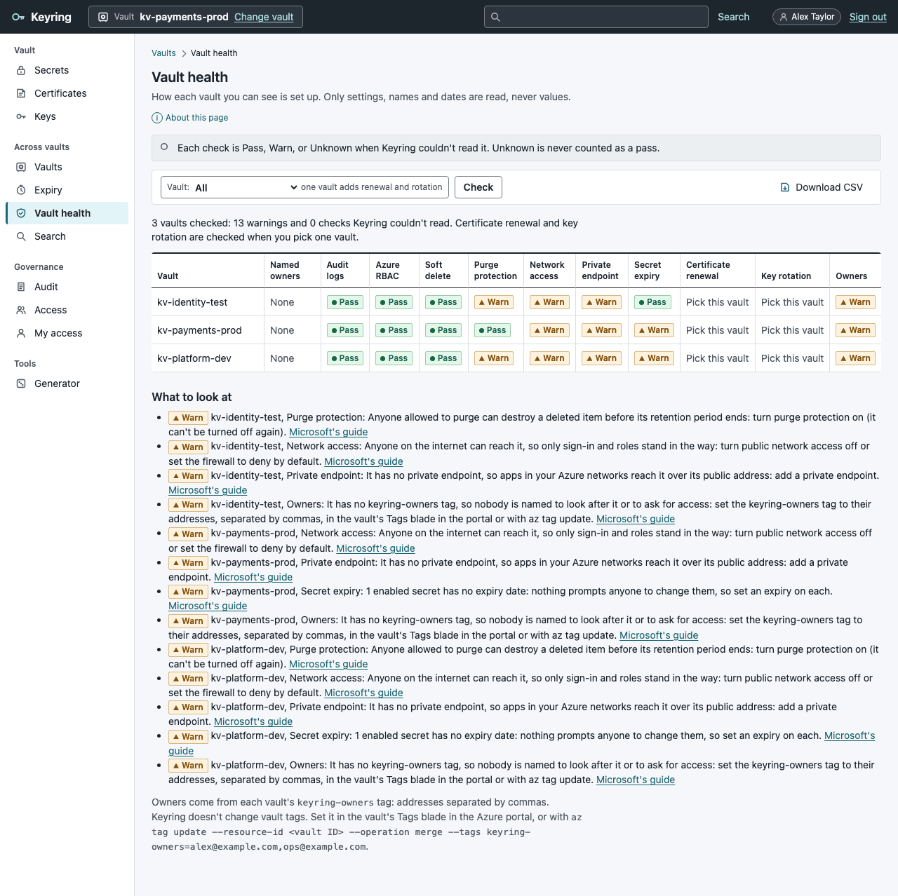

# Vault health

This walkthrough shows how to check how each vault you can see is set up: whether it keeps audit logs, who can reach it, whether deletes can be undone, whether it has named owners, how well its contents are looked after, what is about to expire or hasn't been changed in a while, and whether Microsoft Defender for Key Vault is watching it.

## Who this is for

| To do this | Azure role | Where |
| --- | --- | --- |
| The settings checks | Reader | The vault or its resource group |
| Secret expiry, certificate renewal, key rotation, expiring soon and not cycled checks | Key Vault Reader | The vault |
| The Defender for Key Vault check | Security Reader (or Reader) | The vault's subscription |

## Before you start

Nothing. Only settings, names and dates are read, never values.

## Steps

1. Select **Vault health**.

   Each vault you can see has one row, with **Named owners** and a column for each check. "Each check is Pass, Warn, or Unknown when Keyring couldn't read it. Unknown is never counted as a pass."

   

   | Check | Passes when |
   | --- | --- |
   | **Audit logs** | A diagnostic setting sends the vault's audit logs somewhere |
   | **Azure RBAC** | The vault uses Azure RBAC, not access policies |
   | **Soft delete** | Deleted items can be recovered |
   | **Purge protection** | Nobody can permanently delete before the retention period ends |
   | **Network access** | Public network access is off, or limited to chosen networks |
   | **Private endpoint** | The vault has an approved private endpoint |
   | **Secret expiry** | Secrets have expiry dates |
   | **Certificate renewal** | Certificates renew or email before they expire |
   | **Key rotation** | Keys have a rotation policy |
   | **Owners** | The vault has a `keyring-owners` tag with at least one address |
   | **Expiring soon** | No enabled secret, certificate or key has expired or expires within 30 days (whoever runs Keyring can change the number of days) |
   | **Not cycled** | Every enabled secret, certificate and key has had a new value within the last year (whoever runs Keyring can change this too) |
   | **Defender for Key Vault** | Defender for Key Vault is on for the vault's subscription, and has no open alerts on the vault |

2. Pick one vault in **Vault** and select **Check** to run the certificate renewal and key rotation checks too, which need a call per item. Until then those cells say "Pick this vault".

3. Read **What to look at**. Each warning names the vault, the check, what is wrong and a link to Microsoft's guide on fixing it.

4. Select **Download CSV** for a spreadsheet of the checks.

5. Fix a warning in the Azure portal or with the Azure CLI, or ask whoever owns the vault. For the **Owners** check, see [03 Tags, notes and owners](03-tags-notes-owners.md). Keyring doesn't change vault settings or vault tags.

## What Keyring checks

| Check | What you see |
| --- | --- |
| You can't see any vaults | "You can't see any vaults yet." You'll need at least Reader on a vault, its resource group or its subscription |
| You have Reader but no Key Vault role | The settings checks pass or warn; **Secret expiry**, **Expiring soon** and **Not cycled** show Unknown |
| Keyring can read some of a vault's lists but not all, for example its secrets but not its keys | **Expiring soon** and **Not cycled** count what could be read and say which list is missing. With nothing to warn about they show Unknown, not Pass |
| You don't have Security Reader or Reader on the subscription | **Defender for Key Vault** shows Unknown with the reason, never Pass |
| You can see more vaults than it reads at once | It shows the first ones by name and says so |

## What is recorded

Nothing. Vault health writes no audit event.

## Troubleshooting

| Problem | What to do |
| --- | --- |
| **Audit logs** warns but **Vaults** says "On, not in Log Analytics" | The vault sends its logs to storage only. That passes here, but Keyring's audit pages can't read it |
| A check says Unknown | Keyring couldn't read it as you. You may need Key Vault Reader on that vault |
| **Defender for Key Vault** warns that it is off | Ask whoever looks after Microsoft Defender for Cloud to turn on the Key Vault plan for that subscription |
| **Defender for Key Vault** warns about open alerts | Open **Defender alerts** to see them, then look into them in Defender for Cloud |
| **Not cycled** warns about an item that never changes on purpose | Set a new value, or move whatever uses it to a managed identity. Keyring counts from when the current value was set |

## Related walkthroughs

- [08 Expiry dashboard, age view and expiry emails](08-expiry.md)
- [18 Defender alerts](18-defender-alerts.md)
- [11 Audit](11-audit.md)
