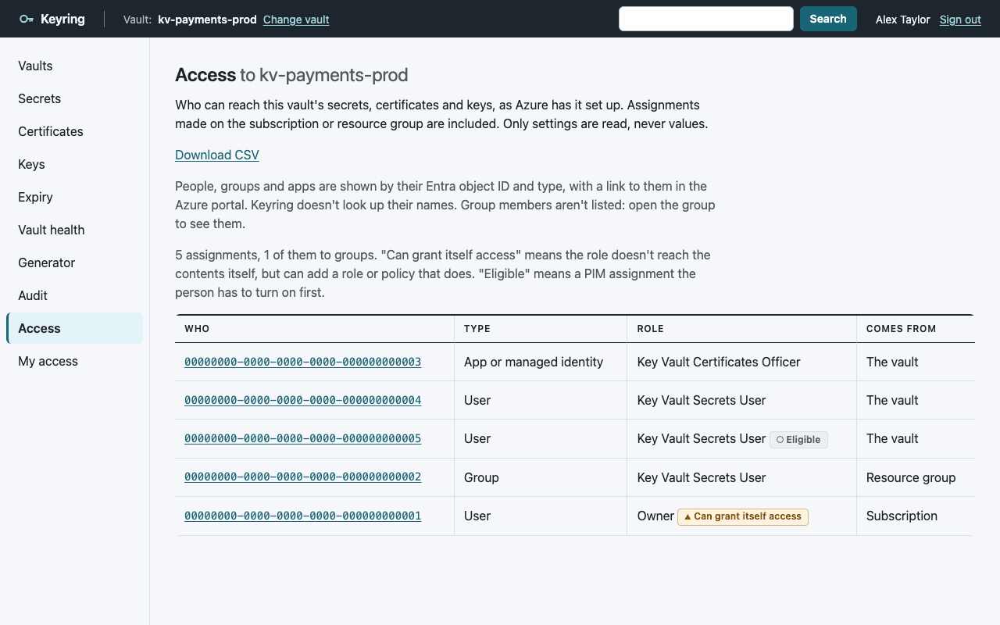
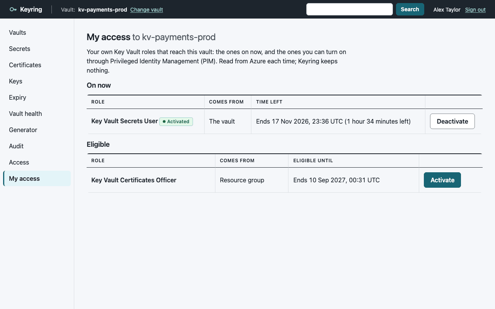

# Access

This walkthrough shows how to see who can reach a vault and each item in it, what the disabled buttons tell you, how to turn on a role you are eligible for through Privileged Identity Management (PIM) from the "You don't have access" page, and how to read and switch off your own roles on **My access**.

## Who this is for

| To do this | Azure role | Where |
| --- | --- | --- |
| See the **Access** page and each item's **Access** section | Reader | The vault |
| Turn on a role through PIM, see **My access**, turn a role off | An eligible PIM assignment of a Key Vault role (Entra ID P2 or Governance), and Reader on the vault to see role names | The vault, or above it |

## Before you start

- Choose the vault.
- For PIM, know whether your organisation has made you eligible for a role, and whether it needs a reason, a ticket or an approver.

## Steps

### See who can reach a vault

1. Select **Access**.

   Every role assignment that reaches the vault's contents is listed, including ones made on the resource group or subscription, with **Who**, **Type**, **Role** and **Comes from**. "People, groups and apps are shown by their Entra object ID and type, with a link to them in the Azure portal. Keyring doesn't look up their names."

   

2. Read the badges:

   - **Eligible**: "a PIM assignment the person has to turn on first".
   - **Can grant itself access**: "the role doesn't reach the contents itself, but can add a role or policy that does", such as Owner.

3. Select **Download CSV** for a spreadsheet of the list.

4. Open a secret, certificate or key to see its own **Access** section, which adds roles given on that one item.

   On a vault that uses **access policies**, the page lists each policy by object ID with what it allows, and marks those that read secret values. It also lists the role assignments that can change the vault, and so add a policy.

### Read the permission hints

5. Look for buttons that are disabled with "Needs" and a role beside them, such as "Needs Key Vault Secrets Officer".

   Keyring reads your permissions from Azure and keeps them for five minutes, so a new role can take that long to show. It is only a hint: Key Vault still decides when you use the button.

### Turn on an eligible role through PIM

6. Try what you need, such as **Show value**. If Azure says no, you see **You don't have access**, with "What to ask for:" and the role.

7. If you're eligible for that role, the page also says so, with **Activate** and the role's name. Select it.

   The **Activate** page says the role, where it applies, and whether PIM needs someone to approve it.

8. Pick **How long**, up to what PIM allows for the role. Fill in **Why you need it** (5 to 200 characters), and **Ticket system** and **Ticket number** if PIM asks for them.

9. Select **Activate** and the role's name.

   One of three things happens:

   - **Role turned on**: the role is on for the time you picked. "Key Vault can take a few minutes to see it." Select **Try again** to go back to what you were doing.
   - **Waiting for approval**: PIM turns it on once an approver says yes. **My access** shows it waiting, and **Open PIM in the Azure portal** lets you follow it.
   - PIM refused it, and nothing was turned on, with Azure's code under "Details:".

### Read and change your own roles

10. Select **My access**.

    It lists your own Key Vault roles that reach this vault: **On now** with **Time left**, **Starting later**, **Eligible** with **Activate**, and **Waiting for approval**. "Read from Azure each time; Keyring keeps nothing."

    

11. Select **Deactivate** beside a role you turned on, to switch it off before its time runs out.

    Keyring says "Role turned off. Key Vault can take a few minutes to see the change."

### Coming with #258: requesting access without PIM

When PIM isn't available, or you aren't eligible, a later change (#258) is to add a way to ask for access from the "You don't have access" page. This section will be filled in when that change is on main. Until then, ask whoever looks after the vault for the role named under "What to ask for:".

## What Keyring checks

| Check | What you see |
| --- | --- |
| You can't read role assignments | A message and "What to ask for:" with the role (usually Reader), not an empty table |
| No PIM in your tenant, or no eligible role | The "You don't have access" page with no **Activate** |
| PIM couldn't be read for the role's settings | "Keyring couldn't read this role's PIM settings, so it asks for a reason and offers up to" 8 hours. PIM checks the request either way |
| You asked for longer than PIM allows | "PIM allows this role for up to" the maximum. "Pick a shorter time." Nothing is sent to Azure |
| PIM wants you to confirm it's you | Keyring sends you to sign in with the challenge and back to the form |
| The role is already on | The role "was already on", "so nothing was changed" |
| An eligibility starts later | **Eligible** shows when it starts, with no **Activate** |

## What is recorded

`role.activate` when you turn a role on (with the role, where, how long, and your reason and ticket), and `role.deactivate` when you turn it off. The **Access** and **My access** pages write nothing.

## Troubleshooting

| Problem | What to do |
| --- | --- |
| Turned on, but still "You don't have access" | Key Vault can take a few minutes to see a new role. Wait a minute and select **Try again** |
| A button stays disabled after the role is on | The hint is kept for five minutes. Wait, or post the form anyway: Key Vault decides |
| Object IDs instead of names | Keyring doesn't look up names. Select the ID to open it in the Azure portal |

## Related walkthroughs

- [00 About these walkthroughs](00-about.md)
- [14 Access review report](14-access-review.md)
