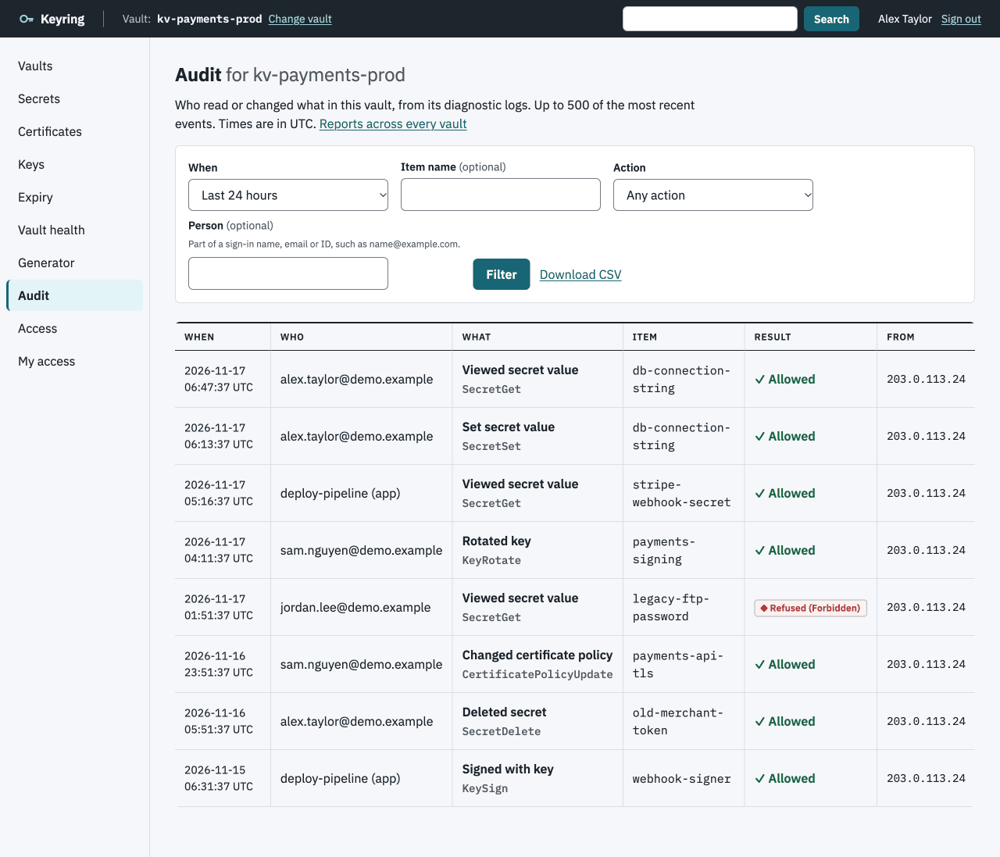

# Audit

This walkthrough shows how to find out who read or changed what: a vault's events from Key Vault's own log, one item's history with **Who used it**, the **Used by in the last 30 days** panel, the fixed reports across every vault, Keyring's own activity, CSV export, and how to read an audit row and check it against Key Vault's log.

## Who this is for

| To do this | Azure role | Where |
| --- | --- | --- |
| See where a vault sends its logs | Reader | The vault or its resource group |
| Read audit events, **Who used it** and **Used by** | Log Analytics Reader | The workspace the vault's diagnostic setting uses |
| See **Keyring activity** | Log Analytics Reader | The workspace that holds Keyring's own audit table |

## Before you start

- The vault must send its audit logs to a Log Analytics workspace. **Vaults** and **Vault health** show whether it does.
- Events take a few minutes to arrive in Log Analytics.

## Steps

### Read one vault's events

1. Choose the vault and select **Audit**.

   "Who read or changed what in this vault, from its diagnostic logs. Up to 500 of the most recent events. Times are in UTC."

   

2. Narrow it with **When** (**Last hour**, **Last 24 hours**, **Last 7 days** or **Last 30 days**), **Item name**, **Action** and **Person**, then select **Filter**.

3. Select **Download CSV** for the events shown.

### See who used one item

4. On a secret, certificate or key, select **Who used it**.

   The audit page opens filtered to that item for the last 30 days, headed **Who used** and the name.

5. Read **Used by in the last 30 days** on the item's page, and before you set a new value, roll back, disable, rotate or delete.

   It lists the people, apps and managed identities that read or used the item, with their object ID, when they last did, how many times and from where. "Anything listed may break if the" item "changes, is disabled or is deleted." It's advice: whatever it says, the form below it works. An empty list never means the change is safe: the panel says what it looked at and what the log can't show.

### Run a report across every vault

6. Select **Audit** with no vault chosen, or **Reports across every vault** on a vault's audit page.

7. Pick a report:

   | Report | What it lists |
   | --- | --- |
   | **Secret values read** | Every allowed read of a secret's value |
   | **Private keys downloaded** | Reads of a certificate's backing secret, which holds its private key |
   | **Deletes, purges and recoveries** | Every delete, permanent delete and recovery, allowed or refused |
   | **Refused requests** | Requests Key Vault refused, counted by person and vault |
   | **Activity by one person** | Everything one person did. Fill in **Person** |

8. Pick **When** and select **Run report**. Select **Download CSV** to save it.

   A report reads every vault you can see, so it can take up to a minute. Vaults and workspaces you can't read are listed, not hidden.

### Read Keyring's own activity

9. On a vault's audit page, select **Keyring activity** (shown only when your Keyring is set up with its own audit table).

   "What people did in this vault through Keyring, from Keyring's own audit table, including what Keyring refused before Key Vault was asked." The **Result** column says **Done**, **Denied by Azure**, **Refused by Keyring** or **Failed**, with a reason code; **Why** shows the reason and ticket a person gave.

### Read an audit row and check it against Key Vault's log

10. On **Key Vault's log**, read a row: **When** (UTC), **Who** (sign-in name, or an app's ID), **What** (with Key Vault's operation name under it, such as `SecretGet`), **Item**, **Result** (**Allowed**, **Accepted**, **Refused**, **Failed** or **Unknown**, with Azure's status) and **From** (the caller's IP address).

11. To check a Keyring action against Key Vault, find the action's Keyring event (in **Keyring activity**, or Keyring's log) and note its `kv_request_id`. Key Vault records the same ID as the `CorrelationId` of its own row. Whoever runs Keyring can run the join query in `docs/deploy.md` (Example queries).

    Not yet confirmed on a real tenant: that the ID lands in `CorrelationId` on both log tables. See the "Request ID joins to Key Vault's log" rows in [real-vault-checklist.md](../real-vault-checklist.md).

## What Keyring checks

| Check | What you see |
| --- | --- |
| The vault sends no audit logs to Log Analytics | "This vault isn't sending its audit logs anywhere Keyring can read." with what to ask for: a diagnostic setting for the "audit" category |
| You can't see the vault's diagnostic settings | "You can't see where this vault sends its logs." Ask for Reader on the vault |
| You can't read the workspace | "This vault's logs go to a Log Analytics workspace you can't read." Ask for Log Analytics Reader on it |
| You can't read Keyring's own table | "Keyring's own audit events go to a Log Analytics workspace you can't read." |
| Log Analytics consent is missing | **Your organisation needs to approve Keyring** on the audit page only |
| More than 500 events | "Showing the 500 most recent events. Narrow the filters to see older ones." |

## What is recorded

Nothing. Reading audit pages, reports and CSVs writes no Keyring audit event.

## Troubleshooting

| Problem | What to do |
| --- | --- |
| A reveal you just did isn't shown | Key Vault's events take a few minutes to arrive. Try again shortly |
| A certificate create shows **Accepted** | Key Vault answered 202 Accepted. That is a success |
| **Keyring activity** is missing | Your Keyring isn't set up with its own audit table, or it is in another workspace |

## Related walkthroughs

- [14 Access review report](14-access-review.md)
- [15 For auditors](15-auditors.md)
