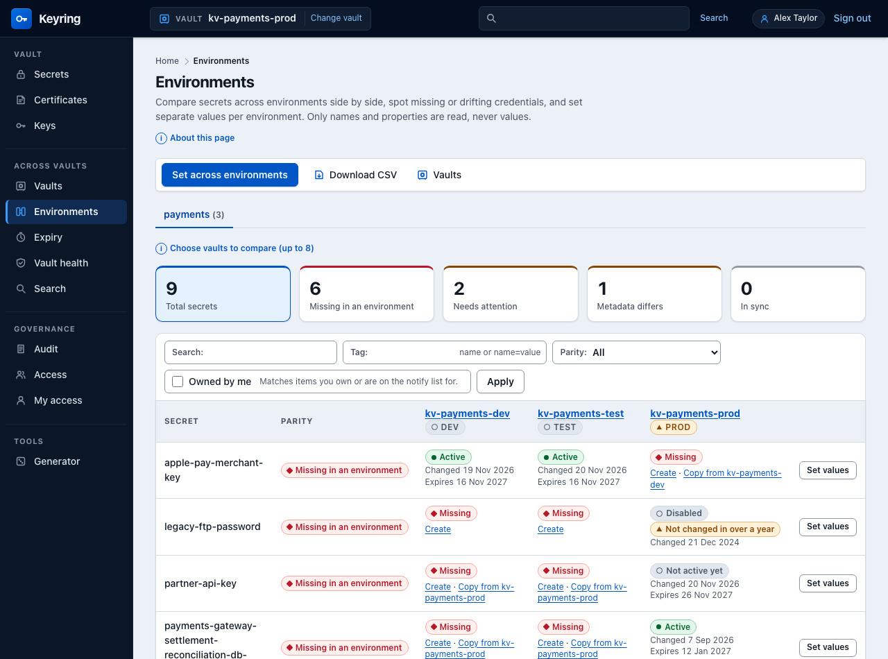
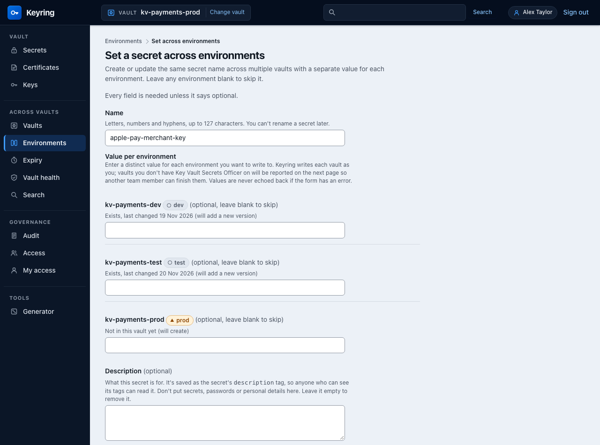

# Collaborate across environments

This walkthrough shows how to compare secrets side by side across environments (such as `dev`, `test` and `prod`), spot missing or drifting secrets without reading values, export a parity CSV for release sign-off, jump between environments from a secret's own page, and set separate values per environment in one workflow.

## Who this is for

| To do this | Azure role | Where |
| --- | --- | --- |
| See vaults and environment groups | Reader | Each vault, its resource group or subscription |
| See secret names, status, dates, owners and drift in the matrix | Key Vault Reader (or Key Vault Secrets User) | Each vault you compare |
| Write a secret's value in an environment | Key Vault Secrets Officer | Each vault you write to (vaults you can't write to are reported cleanly so another team member can finish them) |
| Copy a secret's value to another environment without showing it | Key Vault Secrets User on the source, Key Vault Secrets Officer on the target | Source and target vaults |

## Before you start

- Keyring automatically groups vaults that share an Azure ARM tag (`keyring-group`, `app`, `service`, `workload` or `system`) or a standard naming prefix with an environment suffix such as `-dev`, `-test`, `-uat`, `-staging` or `-prod`.
- Environment badges come from each vault's `keyring-env`, `env`, `environment` or `stage` ARM tag, or from the suffix.
- Even without tags or standard names, you can pick any 2 to 8 vaults you can see.

## Steps

### Compare secrets across environments

1. Select **Environments** in the left menu (or **Compare environments** on the **Vaults** page).

   Keyring opens the first environment group it found, ordered left to right from lower environments (`dev`, `test`) to higher environments (`prod`), and lists every non-certificate secret across those vaults. "Only names and properties are read, never values."

   

2. Switch to another workload group using the tabs at the top, or open **Choose vaults to compare** (up to 8), tick the vaults you want, and select **Compare selected**.

3. Look at the summary tiles across the top: **Total secrets**, **Missing in an environment**, **Needs attention**, **Metadata differs** and **In sync**. Select any tile to filter the table to those rows.

   Rows with problems sit at the top: missing secrets first, then expired, expiring, disabled or stale secrets, then metadata differences (such as a different owner, content type, reveal limit or enabled state between environments), then secrets that are in sync.

4. Narrow the table with **Search**, **Tag**, **Parity** or **Owned by me**, then select **Apply** (or **Clear** to reset).

5. Select **Download CSV** to save a parity report (`keyring-environments.csv`) for change approval or release readiness. Any vault you couldn't read is marked `NOT READ` in the file so a partial export isn't mistaken for a complete check.

### Fill in a missing secret or promote across environments

6. On a cell marked **Missing**, choose how to add it:

   - Select **Create** to open **Create a secret** in that target vault with the secret's **Name** (and Keyring type, if typed) already filled in, ready for you to type that environment's own value.
   - Select **Copy from** (shown when another environment has an active, copyable secret) to open **Copy to another vault** with the target vault and name already picked, so you can promote the value without showing it.

7. You can also jump between environments from any secret's own page: when a vault belongs to an environment group, the secret's page shows an **Across environments** panel listing every sibling vault, its status, dates and owner, with **Open**, **Create**, **Copy here**, **Set across environments** and **Compare all**.

### Set separate values across environments in one workflow

8. Select **Set across environments** from the **Environments** command bar (or **Set values** on one secret's row).

   Keyring shows **Set a secret across environments** with one masked input per selected vault, labelled with its environment badge.

   

9. Enter the secret's **Name** (already filled in if you came from a row), then type each environment's own distinct value. Leave any environment blank to skip it.

10. Fill in any shared details (**Description**, **Owner**, **Notify**, **Reveal limit**, **Content type**, **Active from**, **Expires**, **Enabled**, **Tags**) and **Reason** / **Ticket** if your Keyring asks for them.

11. Select **Save across environments**.

    Keyring writes each non-blank vault as you and shows **Results for** the secret: **Created** or **New version** with an **Open** link, **Skipped** for blank vaults, or **Refused** with **Check my access** if you don't hold Key Vault Secrets Officer on one of the vaults (for example, `prod`). Another team member with access to `prod` can then open **Environments**, see `prod` still marked **Missing**, and finish that environment.

## What Keyring checks

| Check | What you see |
| --- | --- |
| The same value is typed for more than one environment (especially production and non-production) | Refused inline before anything is written, naming the vaults (never the value), and showing **Allow the same value in more than one environment** if the credential is intentionally shared |
| A vault can't be read in the matrix (missing Key Vault Reader, firewall or timeout) | A notice names the vault and its column shows **Not read**, never **Missing** |
| A value misses `KEYRING_PASSWORD_POLICY` | Refused inline beside that vault's input, naming the rule missed; no values are echoed back |
| `KEYRING_REQUIRE_OWNER` is on and **Owner** is blank | Refused inline on **Owner**; nothing is written |
| A target vault already has a stricter `keyring-reveal` limit (`copy-only` or `none`) | Keyring automatically carries the stricter limit onto the new version; **Set across environments** never weakens an existing reveal limit |
| A target vault has a certificate's backing secret or a soft-deleted secret of that name | That vault is marked **Managed** or **Deleted** without overwriting; the other environments still write |
| `KEYRING_REQUIRE_REASON=all` is on | Asks for a reason (and ticket if configured) before writing; values are never written back into the reason page |

## What is recorded

- Browsing **Environments** and downloading the CSV read only names and properties and write no audit event.
- **Set across environments** writes one `secret.multi_env_set` event for the request (with `partly_written` or `none_written` if any environment was refused or failed) plus one `secret.create` or `secret.set` event per vault attempted, each carrying that vault's name, `kv_request_id`, version, reason and ticket. No secret values are ever logged.

## Troubleshooting

| Problem | What to do |
| --- | --- |
| Vaults aren't grouped automatically | Tag each vault in Azure with `app=<workload>` (or `keyring-group=<workload>`) and `env=<dev\|test\|prod>`, or use **Choose vaults to compare** |
| A column shows **Not read** | Ask for Key Vault Reader on that vault (or check its firewall in **Vault health**) |
| One environment shows **Refused** after **Save across environments** | Select **Check my access** on that row to activate an eligible PIM role or request access from the vault's owners, or share the **Environments** link with a colleague who owns that environment |

## Related walkthroughs

- [02 Secrets](02-secrets.md)
- [06 Copy a secret to another vault](06-copy-secret.md)
- [10 Access](10-access.md)
- [13 Password policy and reveal limits](13-password-policy-and-reveal-limits.md)
