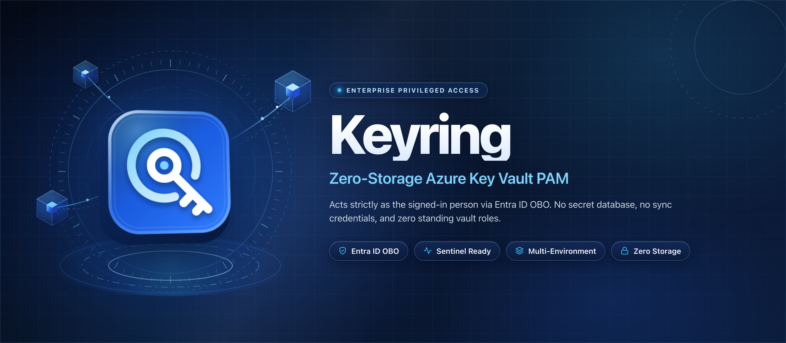

# Introduction

Keyring is a small web app that sits in front of Azure Key Vault. It lets people who don't use the Azure portal find a vault, look up a secret, add a certificate or rotate a key, in plain English.

It is a thin layer. Keyring stores nothing. Every call to Key Vault is made as the person who is signed in, so Key Vault's own Entra RBAC decides what they can see and change. If you can't do it in the portal, you can't do it in Keyring.

## Who it is for

- **People who use secrets, certificates and keys** but don't work in the Azure portal: developers, support staff and service owners. Start with the [walkthroughs](guides/00-about.md).
- **Administrators** who deploy and run Keyring for their organisation. Start with [Deploy](deploy.md) and the [administrator SOPs](admin/admin-sops.md).
- **Security and audit staff** who need to know what Keyring can do and what it records. Start with [For auditors](guides/15-auditors.md) and the [threat model](architecture.md#threat-model).

## What it does

Secrets, certificates and keys in every vault you can see, with search across vaults, an expiry dashboard and age view, vault health checks, who has access to a vault and an access review, audit views and reports, owners and descriptions in tags, and optional email for expiry and other events. The full list, with what each part does, is in the [README](https://github.com/jusso-dev/keyring#what-it-does).

## What it doesn't do

- It doesn't store anything, and it has no access of its own to any vault.
- It doesn't rotate credentials on the system they belong to. See [Rotation](rotation.md).
- It doesn't manage app registration secrets and certificates in Entra ID. See [App registration credentials](app-credentials.md).
- It works with the Azure public cloud and one Entra tenant only, not Managed HSM, and it must run at the root of its host.

The full list is in the README under [What Keyring doesn't support](https://github.com/jusso-dev/keyring#what-keyring-doesnt-support).

## How this site is organised

1. **Introduction**: this page.
2. **[Get started](get-started.md)**: try the demo, run against a real tenant, first sign-in.
3. **[Deploy](deploy.md)**: the app registration, App Service or Container Apps, private vaults, settings, upgrade and removal.
4. **[Walkthroughs](guides/00-about.md)**: one guide per page or task.
5. **[Administer](admin/admin-sops.md)**: standard operating procedures.
6. **Security and audit**: the threat model, the audit log and sink, Sentinel, alerts, step-up and the reason gate.
7. **Notifications**: email set-up, Event Grid expiry events and each notification type.
8. **[Troubleshooting](troubleshooting.md)** and the [real-tenant checklist](real-vault-checklist.md).
9. **[Design](design-overview.md)**: the design document and the architecture.
10. **[Reference](reference.md)**: settings, audit actions, reserved tags and roles.

Every page here is a Markdown file in the repository's `docs/` folder, so the site and the repository say the same thing.
