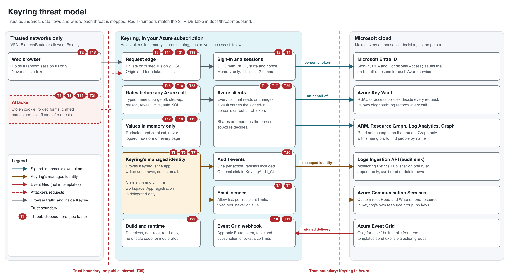
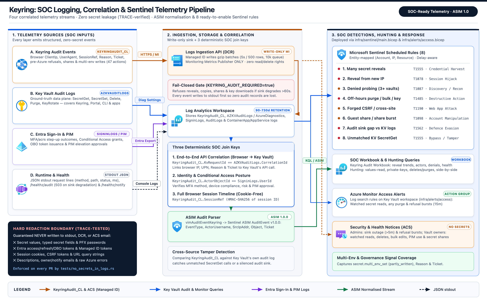

# Purpose and scope

Each Keyring deployment serves **one Microsoft Entra ID tenant** in the Azure public cloud. It provides a plain-English web console over Azure Key Vault without storing secrets, holding a database or possessing any Key Vault permissions of its own.

This document explains every security check Keyring performs, where it runs, how it fails closed, which source files implement it and which automated tests prove it. It is written for the CISO office, IRAP, SOC 2 and ISO 27001 assessors, Entra ID and Azure administrators, and engineers reviewing or modifying the code.

Out of scope: Microsoft's underlying platform controls (Entra ID, Azure Key Vault, Azure Resource Manager, Azure Monitor, Azure Communication Services and Event Grid) beyond how Keyring configures and calls them. Those services are covered by Microsoft's own compliance and IRAP assessments.

## Security principles

| Principle | What it means in Keyring |
|---|---|
| Act strictly as the person | Every Key Vault, Resource Graph, ARM, Log Analytics and Microsoft Graph (sharing) call carries an on-behalf-of (OBO) token for the signed-in person. Keyring's managed identity has zero roles on any vault |
| Store nothing | No database and no disk writes. Sessions, OBO tokens and short-lived metadata caches exist only in server memory; restarting Keyring clears them |
| Fail closed | Malformed startup settings stop the process; unknown `keyring-reveal` values act as `none`; degraded audit sink blocks reveals when `KEYRING_AUDIT_REQUIRED=true`; missing or invalid form tokens, origins, reasons or webhook JWTs are refused before any downstream call |
| Never log or echo secrets | Secret values, private keys, tokens, cookies, query strings, headers and Azure error messages are never logged (tested at `TRACE` in text and JSON) and never written back into forms on validation failure |
| Complete audit coverage | Every mutating or reveal POST route goes through `audited(...)` and emits exactly one schema-versioned audit event regardless of outcome (`tests/audit_events.rs`) |
| Minimal, verified supply chain | Single static Rust binary (~8 MB distroless image), `forbid(unsafe_code)`, no Node.js or npm in the product, `cargo deny` and `cargo audit` on every change, CycloneDX SBOMs and signed release provenance |
| Honest control boundaries | Keyring controls (step-up, reason gate, password policy, owner rule, reveal limits, duplicate-value guard) protect the Keyring path and audit trail; every page and document states plainly that Azure CLI and portal users are governed by Azure RBAC and Conditional Access |

# Trust boundaries and identities

| Boundary | From | To | Authentication | Authorisation |
|---|---|---|---|---|
| B1 | Browser | Keyring | Random 256-bit session ID in `HttpOnly`, `SameSite=Lax`, `__Host-` (HTTPS) cookie; OIDC Auth Code + PKCE (S256) + state + nonce | Session validity (1 hour idle, 12 hours absolute); per-vault CSRF token and Origin check on every non-GET |
| B2 | Keyring | Entra ID token endpoint | Federated managed identity assertion (`api://AzureADTokenExchange`) or client secret | Delegated-only app registration; OBO exchange requires a live user token |
| B3 | Keyring | Azure Key Vault (`*.vault.azure.net`) | User's OBO token for `https://vault.azure.net` | Azure RBAC or Key Vault access policies on the vault or item |
| B4 | Keyring | Azure Resource Manager & Resource Graph | User's OBO token for `https://management.azure.com` | User's Azure Reader / PIM / Role Assignment permissions; Security Reader (or Reader) for Defender for Key Vault plans and alerts in `securityresources`, which Keyring reads and never changes. Alert text is untrusted: cleaned, escaped and formula-guarded, with only Azure portal links kept |
| B5 | Keyring | Log Analytics Query API | User's OBO token for `https://api.loganalytics.io` | User's Log Analytics Reader role on each workspace |
| B6 | Keyring | Microsoft Graph (only when `KEYRING_SHARING=true`) | User's OBO token for `https://graph.microsoft.com` | Delegated `User.ReadBasic.All` and `GroupMember.Read.All` (never reads group members) |
| B7 | Keyring | Azure Monitor Logs Ingestion API (audit sink) | Keyring's user-assigned managed identity (`https://monitor.azure.com`) | **Monitoring Metrics Publisher** on the single `KeyringAudit_CL` data collection rule only |
| B8 | Keyring | Azure Communication Services (email) | Keyring's user-assigned managed identity (`https://communication.azure.com`) | Custom role with only `CommunicationServices/Read` and `/Write` on the single ACS resource |
| B9 | Azure Event Grid | Keyring `/hooks/eventgrid` | App-only Entra JWT (RS256, tenant JWKS, issuer, audience, Event Grid app ID, subscriber app role) | `topic` must be a Key Vault resource ID; subscription checked against `KEYRING_EVENTGRID_SUBSCRIPTIONS` |

## Managed identity least privilege

Keyring's one user-assigned managed identity (`<name>-id`) is strictly prohibited from holding any role on user Key Vaults or Log Analytics workspaces. Its permitted roles are:

1. **Key Vault Secrets User** on Keyring's own config vault (`config-vault.bicep`, holding only `session-secret` and optionally `entra-client-secret`).
2. **Monitoring Metrics Publisher** on Keyring's single audit data collection rule (`audit-sink.bicep`), allowing append-only ingestion into `KeyringAudit_CL` with no read or delete rights.
3. **Keyring email sender** custom role (`notify.bicep`) scoped to Keyring's single ACS resource, holding only `Microsoft.Communication/CommunicationServices/Read` and `/Write` (cannot read or regenerate ACS keys).
4. **AcrPull** on a private Azure Container Registry when configured.

# Security controls and test proof

Each control below maps directly to its implementation in `src/` and automated verification in `tests/`.

::: {.compact .landscape}
| ID | Control | Implementation | Automated proof |
|---|---|---|---|
| C1 | Act strictly as the signed-in person (OBO) | `src/azure/token.rs`, `src/azure/client.rs` | `tests/obo.rs`, `tests/vaults.rs`, `tests/secrets_list.rs` |
| C2 | Least-privilege managed identity & delegated-only app | `src/auth/assertion.rs`, `infra/modules/*.bicep` | `tests/federated.rs`, `tests/federated_logs.rs`, CI Bicep build |
| C3 | OIDC sign-in with PKCE (S256), state, nonce & JWKS rollover | `src/auth/oidc.rs`, `src/routes/auth.rs` | `tests/auth.rs` |
| C4 | Session hardening (256-bit ID, `__Host-`, timeouts, memory-only) | `src/auth/session.rs`, `src/auth/cookies.rs`, `src/auth/crypto.rs` | `tests/auth.rs`, `tests/hardening.rs` |
| C5 | CSRF tokens (constant-time, vault-bound) & Origin check | `src/routes/origin.rs`, `src/routes/vault_ctx.rs` | `tests/audit_events.rs`, `tests/vault_urls.rs`, `tests/hardening.rs` |
| C6 | Strict CSP (`default-src 'none'`), security headers, Askama escaping, `no-store` | `src/routes/headers.rs`, `templates/`, `static/*.js` | `tests/hardening.rs`, `tests/accessibility.rs`, `tests/js/*.test.mjs` |
| C7 | Input validation, same-host paging, KQL `let` escaping, CSV formula guard | `src/azure/vaults.rs`, `src/azure/audit.rs`, `src/expiry.rs` | `tests/vault_urls.rs`, `tests/audit.rs`, `tests/used_by.rs`, `tests/expiry.rs` |
| C8 | Secret redaction (`[redacted]`), `zeroize`, zero secret logging at TRACE | `src/secret.rs`, `src/telemetry.rs` | `tests/no_secrets_in_logs.rs`, `tests/secrets_reveal_log.rs`, `tests/reason_log.rs` |
| C9 | Safe destructive actions (typed name, purge off by default, no bulk delete) | `src/routes/confirm.rs`, `src/routes/lifecycle.rs` | `tests/secrets_delete.rs`, `tests/certs_lifecycle.rs`, `tests/keys.rs` |
| C10 | Conditional Access step-up (`acrs` or max sign-in age) | `src/auth/step_up.rs`, `src/routes/step_up.rs` | `tests/step_up.rs` |
| C11 | Reason and ticket regex gate before reveals or changes | `src/reason.rs`, `src/routes/reason.rs` | `tests/reason.rs`, `tests/reason_log.rs` |
| C12 | Mandatory audit event on every POST action & refusal | `src/audit/mod.rs`, `src/routes/mod.rs` | `tests/audit_events.rs` |
| C13 | Audit sink to `KeyringAudit_CL` + fail-closed `KEYRING_AUDIT_REQUIRED` | `src/audit/sink.rs`, `src/routes/audit_gate.rs` | `tests/audit_sink.rs`, `tests/sentinel.rs` |
| C14 | Email safety (allow-list, rate limits, fixed templates, no values/reasons) | `src/notify/` | `tests/notify.rs`, `tests/activity_emails.rs`, `tests/access_request.rs` |
| C15 | Event Grid webhook JWT auth, `topic` check & subscription allow-list | `src/auth/eventgrid.rs`, `src/notify/expiry.rs` | `tests/eventgrid_webhook.rs` |
| C16 | Password policy & mandatory owner rules | `src/password_policy.rs`, `src/owner.rs` | `tests/password_policy.rs`, `tests/owner_tags.rs` |
| C17 | TLS (rustls + ring), HTTPS-only outbound, fixed public cloud hosts, no redirects | `src/http.rs`, `src/config.rs` | `tests/hardening.rs`, `tests/federated.rs` |
| C18 | Server & memory limits (512 connections, header/request timeouts, bounded queues) | `src/serve.rs`, `src/routes/mod.rs`, `src/azure/fanout.rs` | `tests/serve.rs`, `tests/hardening.rs` |
| C19 | Supply-chain controls (`Cargo.lock`, `deny.toml`, SBOMs, pinned actions/digests) | `deny.toml`, `Dockerfile`, `.github/workflows/*.yml` | CI `cargo deny`, `cargo audit`, `cargo cyclonedx` |
| C20 | Runtime hardening (`forbid(unsafe_code)`, distroless, non-root, read-only FS, unwind) | `Cargo.toml`, `Dockerfile`, `src/routes/mod.rs` | CI container checks, `src/routes/mod.rs` panic test |
| C21 | Browser data limits (30 s auto-hide, clipboard clear, safe pins cleared on sign-out) | `static/app.js`, `static/pins.js` | `tests/js/*.test.mjs`, `tests/pins.rs` |
| C22 | Store nothing (no database, no disk writes, short-lived memory caches) | Whole codebase | `Dockerfile` (`--read-only`), `tests/no_secrets_in_logs.rs` |
| C23 | Per-item reveal limits (`keyring-reveal`: `copy-only` or `none`, fail-closed) | `src/reveal_limit.rs`, `src/routes/reveal_limit.rs` | `tests/reveal_limits.rs`, `tests/reveal_limits_log.rs` |
| C24 | Access request rate limits, owner-only routing and anti-phishing quoting | `src/routes/access_request.rs`, `src/notify/access.rs` | `tests/access_request.rs` |
| C25 | Activity email allow-list gating, IP redaction and per-item rate cap | `src/notify/activity.rs` | `tests/activity_emails.rs` |
| C26 | Secret sharing scope pinning, PIM enforcement (no silent fallback) & revoke bounds | `src/routes/share.rs`, `src/azure/share.rs` | `tests/share.rs` |
| C27 | Narrow delegated Graph use (sharing only, never group members, never logged) | `src/azure/graph.rs`, `static/share.js` | `tests/share.rs`, `tests/no_secrets_in_logs.rs` |
| C28 | Multi-environment safety (value-blind matrix, duplicate-value guard across prod/non-prod, stricter reveal-limit carry-forward, per-vault audit events) | `src/environments.rs`, `src/routes/environments.rs` | `tests/environments.rs`, `tests/audit_events.rs`, `tests/accessibility.rs` |
:::

# Fail-closed and refusal behaviour

| Condition | Result | Audit event |
|---|---|---|
| Invalid or missing startup variable (including unresolved `@Microsoft.KeyVault(...)` or weak `SESSION_SECRET`) | Process refuses to start with explicit variable name | Startup error on stderr |
| Forged, missing or cross-vault CSRF token | HTTP 403 / stale form page; zero Azure calls | `outcome=refused`, `reason_code=csrf` |
| Cross-site `Origin` / `Sec-Fetch-Site` on any non-GET (except `/hooks/eventgrid`) | HTTP 403; zero Azure calls | `outcome=refused`, `reason_code=cross_site` |
| Audit sink degraded for > 60 s with `KEYRING_AUDIT_REQUIRED=true` | Reveals, copies and private key downloads refused (HTTP 503) | `outcome=refused`, `reason_code=audit_unavailable` |
| Unknown `keyring-reveal` tag value or case variant | Treated as `none` (refuses reveal, copy and private key download) | `outcome=refused`, `reason_code=reveal_limited` |
| Duplicate secret value entered across prod and non-prod in `/environments/set` without explicit confirmation | HTTP 422 inline refusal; zero vaults written; values never echoed | `secret.multi_env_set`, `outcome=refused`, `reason_code=invalid_request` |
| Event Grid delivery from unlisted subscription (`KEYRING_EVENTGRID_SUBSCRIPTIONS`) | HTTP 403; no dedupe or email queued | `notify.webhook`, `outcome=refused`, `reason_code=subscription_not_allowed` |
| Unhandled panic in a request handler | HTTP 500 plain page with security headers; panic message never logged; other sessions survive | Request error line (location only) |

# Threat model summary (STRIDE)

The full STRIDE register (T1 to T39) is maintained in the Solution Design Document (Chapter 8) and summarised, with every threat, in the [threat model](../threat-model.md). The diagram shows the trust boundaries and where each threat is stopped.

The highest-impact threats and residual risks for security reviewers are summarised below:

| ID | Category | Threat | Primary controls | Residual risk |
|---|---|---|---|---|
| T1 | Elevation | Keyring used to reach vaults a person cannot access | C1, C2 (OBO only, zero vault role on managed identity) | None beyond the person's own Azure RBAC |
| T2 | Spoofing | Stolen session cookie | C4, C10 (`HttpOnly`, `__Host-`, 1 h idle / 12 h max, step-up max age) | Valid until idle/max timeout or sign-out; set `KEYRING_STEP_UP_MAX_AGE` |
| T3 | Elevation | Managed identity abused as an app-only client | C2 (delegated-only app registration) | Holds while no application permissions are added to the registration |
| T12 | Info disclosure | Secret values or tokens written to logs | C8 (`Secret` redaction, zeroise, TRACE log tests) | Copies inside upstream HTTP/OIDC crates are not zeroised |
| T28 | Info disclosure | Bypassing Keyring UI controls via Azure CLI or portal | C23, C10, C11, C16 | Keyring controls apply only to Keyring; enforce Conditional Access on Key Vault for all paths |
| T29 | Elevation | Stolen session used to share secrets (`KEYRING_SHARING=true`) | C26, C10, C11, C13, Sentinel shares rule | Step-up and reason gate are opt-in; enable both when sharing is on |
| T35 | Info disclosure | Reusing a dev/test secret value in production via `/environments/set` | C28 (in-memory duplicate check blocks prod/non-prod reuse unless confirmed; never logs values) | An operator can still tick confirmation for genuinely shared credentials; Sentinel and audit events record every vault written |
| T36 | Tampering | Multi-environment write attempting to weaken an existing vault's `keyring-reveal` limit | C23, C28 (fail-closed preflight metadata verification refuses writes if existing metadata cannot be checked; `reveal_limit::carry` preserves stricter limit on every target vault) | Azure Key Vault `SetSecret` lacks server-side version preconditions, so a concurrent admin tightening `keyring-reveal` between preflight and `PUT` is a narrow race; loosening intentionally requires the item's Edit details flow with step-up and reason |
| T39 | Spoofing, DoS | Keyring reachable by anyone on the internet | Templates deploy privately or with trusted IP ranges only (deny by default, SCM too) and accept only single IPv4 ranges of /16 or narrower; the inbound Event Grid route is refused | A hand-built front end can still open it; pair trusted ranges with Conditional Access |

# Compliance framework mapping

| Control area | Australian ISM / PSPF | Essential Eight | NIST SP 800-53 Rev 5 | Keyring control IDs |
|---|---|---|---|---|
| Strong authentication & step-up | ISM-1401, ISM-1173 | Multi-factor authentication | IA-2(1), IA-2(6), AC-12 | C3, C4, C10 |
| Least privilege & JIT access | ISM-0445, ISM-1507 | Restrict administrative privileges | AC-6(1), AC-6(2), AC-6(5) | C1, C2, C26, C27 |
| Cryptographic storage & key protection | ISM-0459, ISM-0465 | N/A | SC-12, SC-13, SC-28 | C1, C9, C17, C22 |
| Event logging, correlation & SIEM | ISM-0580, ISM-0585, ISM-0988 | N/A | AU-2, AU-3, AU-6, AU-9, AU-12 | C11, C12, C13 |
| Input validation & web hardening | ISM-1238, ISM-1240 | N/A | SI-10, SC-8, SC-23 | C5, C6, C7, C17, C18 |
| Supply chain & container hardening | ISM-1693, ISM-1870 | Patch applications | SA-12, SR-3, SR-4, CM-7 | C19, C20 |
| Credential hygiene & environment isolation | ISM-0421, ISM-1557 | Restrict administrative privileges | IA-5(1), CM-2, CM-3 | C16, C23, C28 |

# SOC logging, telemetry and detection readiness

Keyring gives Security Operations Centres (SOCs) four correlated, zero-secret telemetry streams converging in Azure Monitor Log Analytics and Microsoft Sentinel:

1. **Keyring audit events (`KeyringAudit_CL`)** via the write-only Azure Monitor Logs Ingestion DCR: captures browser `ClientIp`, `UserAgent`, `SessionRef`, `Reason`, `Ticket`, pre-Azure refusals (`csrf`, `step_up_required`, `password_policy`, `reveal_limit`, `duplicate_value`), `secret.multi_env_set` and per-vault `secret.create`/`secret.set` outcomes.
2. **Azure Key Vault diagnostic audit logs (`AZKVAuditLogs` / `AzureDiagnostics`)**: provides the ground-truth data-plane log across Keyring, Azure Portal, CLI and workload identities.
3. **Microsoft Entra ID sign-in, Conditional Access and PIM logs (`SigninLogs`, `AuditLogs`)**: verifies MFA/step-up (`acrs`), device compliance and JIT role approval.
4. **Keyring runtime health and HTTP signals** (`KEYRING_LOG_FORMAT=json` stdout, `/healthz/audit`, `/healthz/notify`): detects audit sink outages and refusal bursts.

::: wide

:::

SOC analysts join these streams deterministically via three keys: `KvRequestId == AZKVAuditLogs.CorrelationId`, `ActorObjectId == SigninLogs.UserId`, and `SessionRef` (an HMAC-SHA256 session handle that never exposes cookies). Enable `KEYRING_AUDIT_REQUIRED=true` in production so reveals, copies, shares and private key downloads fail closed if the audit sink degrades for more than 60 seconds, and deploy `infra/sentinel/main.bicep` for the ASIM Audit Event parser (`vimAuditEventKeyring`), eight scheduled analytic rules, six hunting queries and the Keyring Audit workbook. See `docs/sentinel.md` and Section 10 of the Design Document for full KQL playbooks, MITRE ATT&CK mappings and triage runbooks.

# Verification boundaries

::: unconfirmed
**Confirmed on a real tenant:** Key Vault REST calls for secrets, certificates and keys (11–13 November 2026) and an interactive browser run against a real Entra tenant (17 November 2026).

**Verified against comprehensive mock services only:** Production App Service and Container Apps deployments, Entra PIM activation and approval flows, Conditional Access `acrs` step-up, the Logs Ingestion audit sink and Microsoft Sentinel rules, Azure Communication Services email delivery, Event Grid webhook validation, secret sharing (Graph + PIM `AdminAssign`), and multi-environment comparison and writes.

Before production go-live, execute and sign off every applicable row of `docs/real-vault-checklist.md` in a non-production Azure subscription.
:::
