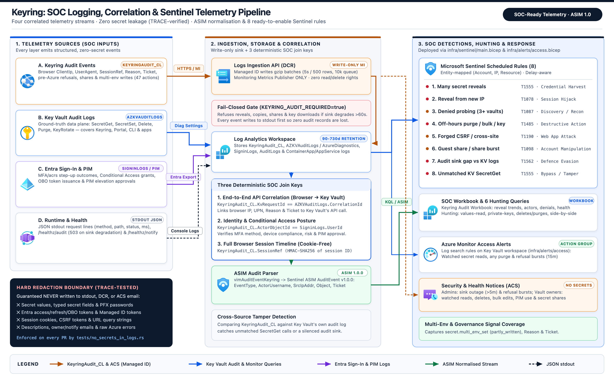

# Microsoft Sentinel

Optional content for Keyring's own audit table, `KeyringAudit_CL`: an ASIM parser, analytic rules, hunting queries and a workbook, all in `infra/sentinel`. You deploy it yourself, into the workspace that holds the table. Keyring runs nothing for it, and every rule is created turned off.

Three things are easy to mix up:

- **Keyring's own audit events**: one per thing a person does through Keyring, including what Keyring refused (`src/audit/mod.rs`).
- **`KeyringAudit_CL`**: the same events, sent by the audit sink to a Log Analytics table. This page is about this table. See [deploy.md](deploy.md#audit-sink) to turn it on.
- **Key Vault's audit log** (`AzureDiagnostics` or `AZKVAuditLogs`): every call Key Vault receives, from Keyring or anything else. Two rules compare with it.



## SOC onboarding checklist

Before enabling Sentinel rules in production, confirm these six baseline settings so the SOC receives high-value, low-noise events:

1. **Structured logs & sink on**: set `KEYRING_LOG_FORMAT=json` and configure `KEYRING_AUDIT_INGESTION_ENDPOINT`, `KEYRING_AUDIT_DCR_ID` and `KEYRING_AUDIT_STREAM` (`infra/modules/audit-sink.bicep`).
2. **Fail-closed reveals**: set `KEYRING_AUDIT_REQUIRED=true` so reveals, copies, shares and private key downloads pause if the audit sink degrades for more than 60 seconds.
3. **True client IPs**: set `KEYRING_TRUSTED_PROXY_HOPS` to match your reverse proxy / Front Door / Application Gateway hop count so `reveal-new-ip` and `app-attack` see real browser IPs.
4. **Reason & ticket enrichment**: set `KEYRING_REQUIRE_REASON=reveal` (or `all`) and `KEYRING_REASON_TICKET_PATTERN` so every sensitive audit row carries change/incident context.
5. **Diagnostic settings on every vault**: verify all production Key Vaults send `AuditEvent` to Log Analytics (`AZKVAuditLogs` preferred) using Keyring's **Vault health** view.
6. **Health probe monitoring**: point an Azure Monitor availability test at `/healthz/audit` and `/healthz/notify` (both return HTTP 503 when degraded) and enable `health` in `KEYRING_NOTIFY_TYPES`.

## What is in the table

One row per event. The columns are `COLUMNS` in `src/audit/sink.rs`, listed with what each holds in [deploy.md](deploy.md#audit-event-fields):

| Column | Holds |
| --- | --- |
| `TimeGenerated` | When, UTC |
| `EventId` | A random ID for the event |
| `SchemaVersion` | `1` |
| `Action` | What was done: `secret.reveal`, `secret.import`, `certificate.download_private_key`, `secret.purge`, `session.sign_in` and the rest in deploy.md |
| `Outcome` | `success`, `denied` (Azure said 401 or 403), `refused` (Keyring's own check said no) or `failed` |
| `ReasonCode` | Azure's error code, or Keyring's reason, such as `csrf`, `cross_site`, `typed_name_mismatch`, `purge_disabled`, `audit_unavailable` |
| `ActorObjectId`, `ActorTenantId`, `ActorUpn` | The person, from the verified ID token |
| `SessionRef` | A keyed hash of the session, so one session's events join up |
| `ClientIp`, `UserAgent` | The browser |
| `Vault`, `ItemKind`, `ItemName`, `ItemVersion` | What was acted on |
| `KvRequestId` | The `x-ms-client-request-id` Keyring sent on its last Key Vault call for the request |
| `Reason`, `Ticket` | Free text a person typed (#205). Empty until that change ships |
| `WriterIdentityClientId`, `KeyringInstance`, `KeyringVersion` | The writer |

No row holds a secret value, a token or Azure's error message.

## What is in `infra/sentinel`

| File | What it is |
| --- | --- |
| `main.bicep` | Deploys the parsers, hunting queries, workbook and rules. Every rule is off until its `enable...` parameter is `true` |
| `main.example.bicepparam` | Example parameters. Copy to `main.bicepparam` next to it and fill in |
| `parsers/vimAuditEventKeyring.kql` | The ASIM Audit Event filtering parser |
| `parsers/ASimAuditEventKeyring.kql` | The parameter-less parser: every row of the filtering one |
| `rules/*.kql` | One query per analytic rule. `main.bicep` puts the parameters in front as `let` lines |
| `hunting/*.kql` | Hunting queries, saved in the workspace under "Hunting Queries" |
| `workbook.json` | The workbook |

A test (`tests/sentinel.rs`) fails if any of these reads a column that isn't in `COLUMNS`, compares `Action`, `Outcome` or `ReasonCode` with a value Keyring never writes, turns a rule on by default, or has a rule without a sample-row case.

## Roles

To deploy: **Microsoft Sentinel Contributor** and **Log Analytics Contributor** on the workspace (or its resource group), and **Workbook Contributor** for the workbook. Microsoft Sentinel must already be turned on for the workspace.

To read: **Microsoft Sentinel Reader** or **Log Analytics Reader** on the workspace. The rules run as Sentinel, not as Keyring or any person.

Keyring's managed identity gets nothing here. It can only write rows through the one data collection rule, and can't read the table.

## Deploy

### One-click deploy (Azure portal)

Deploy [infra/sentinel/azuredeploy.json](../infra/sentinel/azuredeploy.json) (compiled directly from `infra/sentinel/main.bicep`) into the resource group that holds your existing Log Analytics workspace:

[](https://portal.azure.com/#create/Microsoft.Template/uri/https%3A%2F%2Fraw.githubusercontent.com%2Fjusso-dev%2Fkeyring%2Fmain%2Finfra%2Fsentinel%2Fazuredeploy.json)

Supply `workspaceName` and `location` (defaulting to the resource group's region). Every analytic rule defaults to disabled until you switch its `enable...` parameter to `true` or enable it in Sentinel's **Analytics** blade.

### Azure CLI (Bicep)

```sh
cp infra/sentinel/main.example.bicepparam infra/sentinel/main.bicepparam
# Edit: workspaceName, keyVaultTable, keyringOutboundIps, and the enable... switches you want.
az deployment group create -g <workspace resource group> \
  -f infra/sentinel/main.bicep -p infra/sentinel/main.bicepparam
```

With only `workspaceName` set (or the example file as it is), it adds the parsers, the hunting queries and the workbook, and six rules, all turned off. Nothing raises an alert or an incident until you turn a rule on, either with its parameter or in Sentinel's **Analytics** blade.

To remove it, delete the rules (named by a GUID; their display names start with "Keyring:"), the saved searches `vimAuditEventKeyring`, `ASimAuditEventKeyring` and `keyring-*`, and the "Keyring audit" workbook.

## Content Hub solution

A Microsoft Sentinel Content Hub V3 solution package lives under [Solutions/Keyring/](../Solutions/Keyring/README.md), following the [Azure/Azure-Sentinel Solutions](https://github.com/Azure/Azure-Sentinel/tree/master/Solutions) directory layout:

- `Solutions/Keyring/Data/Solution_Keyring.json` and `Solutions/Keyring/SolutionMetadata.json`: solution manifest and publisher metadata
- `Solutions/Keyring/Analytic Rules/*.yaml`: all eight scheduled analytic rules in Azure-Sentinel YAML format (with GUIDs, `requiredDataConnectors`, `queryFrequency`, `queryPeriod`, MITRE tactics/techniques and `entityMappings`)
- `Solutions/Keyring/Hunting Queries/*.yaml`: all six hunting queries in Azure-Sentinel YAML format
- `Solutions/Keyring/Parsers/*.yaml`: ASIM Audit Event parser definitions (`vimAuditEventKeyring` and `ASimAuditEventKeyring`)
- `Solutions/Keyring/Workbooks/KeyringAudit.json`: the Keyring audit workbook
- `Solutions/Keyring/Package/mainTemplate.json` and `Solutions/Keyring/Package/createUiDefinition.json`: Content Hub V3 ARM package (`contentPackages` and `contentTemplates`) and portal UI definition

Deploy the Content Hub V3 package into an existing workspace with:

```sh
az deployment group create -g <workspace resource group> \
  --template-file Solutions/Keyring/Package/mainTemplate.json \
  --parameters workspace=<workspace name> workspace-location=<workspace region>
```

No Logic App playbooks are included; Keyring uses Azure Monitor action groups and Event Grid for expiry and access notifications (`infra/alerts/`).

## Defender XDR

All Keyring detections query `KeyringAudit_CL` and Key Vault's Log Analytics diagnostic tables (`AzureDiagnostics` or `AZKVAuditLogs`). None of the detections run on native Microsoft Defender XDR Advanced Hunting tables (`DeviceEvents`, `EmailEvents`, `IdentityLogonEvents`, `CloudAppEvents` or `EntraIdSignInEvents`), so no separate `defender-xdr/` custom detection rules are shipped. Workspaces onboarded to the unified Microsoft Defender portal can run the Sentinel rules and hunting queries directly.

## The ASIM parser

`vimAuditEventKeyring` maps `KeyringAudit_CL` to the [Audit Event schema](https://learn.microsoft.com/azure/sentinel/normalization-schema-audit), version 1.0.0, so Keyring's events work with Sentinel's ASIM content and entity pages. It takes the schema's filtering parameters (`starttime`, `endtime`, `srcipaddr_has_any_prefix`, `eventtype_in`, `eventresult`, `actorusername_has_any`, `operation_has_any`, `object_has_any`, `newvalue_has_any`, `disabled`, `pack`).

| ASIM field | From |
| --- | --- |
| `EventType` | `Read` for `secret.reveal`, `secret.copy.read` and `certificate.download_private_key`; `Create` for create, upload, import and rotate; `Delete` for delete, purge and cancel; `Set` for set, update, rollback, bulk update and the write of a copy (`secret.copy.write`); `Enable` for `role.activate` and `Disable` for `role.deactivate`; `Other` for the rest (enable and disable settings, recover, `request.refused`, `access.request`) |
| `EventSubType` | `Recover` for the recover actions |
| `EventResult` | `Success` for `success`, otherwise `Failure` |
| `EventResultDetails` | "Denied by Azure", "Refused by Keyring" or "Failed" |
| `EventOriginalResultDetails` | `ReasonCode` |
| `EventSeverity` | `Medium` for a `csrf` or `cross_site` refusal, `Informational` for a success, otherwise `Low` |
| `Operation`, `EventOriginalType` | `Action` |
| `Object` | `vault/item`, or the vault, or `Keyring` for an event with neither |
| `ObjectType` | `Cloud Resource` when there is a vault, otherwise `Other` |
| `OriginalObjectType` | `ItemKind`, or `vault` |
| `ActorUserId`, `ActorUserAadId` | `ActorObjectId`, with `ActorUserIdType` `AADID` |
| `ActorScopeId` | `ActorTenantId` |
| `ActorUsername` (and `User`) | `ActorUpn`, with `ActorUsernameType` `UPN` |
| `ActorSessionId` | `SessionRef` |
| `SrcIpAddr` (and `IpAddr`, `Src`) | `ClientIp` |
| `HttpUserAgent` | `UserAgent` |
| `TargetAppName` (and `Application`) | `Keyring`, with `TargetAppType` `Service` |
| `EventProduct`, `EventVendor`, `Dvc` | `Keyring` |
| `EventProductVersion` | `KeyringVersion` |
| `EventOriginalUid`, `EventUid` | `EventId`, and Log Analytics' `_ItemId` |
| `AdditionalFields` | `ReasonCode`, `ItemVersion`, `KvRequestId`, `Reason`, `Ticket`, `Role`, `RoleScope`, `RoleDuration`, `WriterIdentityClientId`, `KeyringInstance` |

The parser reads the `Role`, `RoleScope` and `RoleDuration` columns with `column_ifexists`, so it keeps working on a `KeyringAudit_CL` table made before those columns were added. Run the audit sink template again to add them.

`session.*` events (sign-in, failed sign-in, sign-out, expiry) are left out: they belong to ASIM's Authentication schema, which has no Keyring parser yet. `NewValue` is always empty, because Keyring never logs a value.

`Keyring` isn't one of ASIM's registered vendor and product names, so the ASIM data tester may note it. That is expected.

To have `imAuditEvent` include Keyring, add this line to your workspace's custom unifying parser `Im_AuditEventCustom` ([Microsoft's guide](https://learn.microsoft.com/azure/sentinel/normalization-manage-parsers)):

```kusto
vimAuditEventKeyring(starttime=starttime, endtime=endtime, srcipaddr_has_any_prefix=srcipaddr_has_any_prefix, actorusername_has_any=actorusername_has_any, operation_has_any=operation_has_any, eventtype_in=eventtype_in, eventresult=eventresult, object_has_any=object_has_any, newvalue_has_any=newvalue_has_any, disabled=false, pack=pack)
```

Check it with Microsoft's testers: `vimAuditEventKeyring | getschema | invoke ASimSchemaTester('AuditEvent')` and `vimAuditEventKeyring | take 1000 | invoke ASimDataTester('AuditEvent')`.

## Analytic rules

Each is a Sentinel Scheduled rule, created with `enabled` set to its parameter (default `false`). Each maps the person to an Account entity (Entra object ID and sign-in name) and the address to an IP entity; the two Key Vault rules also map the vault as an Azure resource. Thresholds and windows are parameters. `severity` sets all of them (default `Medium`).

| Rule | File | Turned on by | Parameters |
| --- | --- | --- | --- |
| Many secret reveals by one person | `rules/many-reveals.kql` | `enableManyReveals` | `revealThreshold` (20), `revealWindowMinutes` (60). Counts `secret.reveal` and `certificate.download_private_key` |
| Secret revealed from a new address | `rules/reveal-new-ip.kql` | `enableRevealNewIp` | `newIpWindowHours` (1). Looks back 14 days, and only for people seen before, so a first use doesn't alert |
| One person denied in several vaults | `rules/denied-probing.kql` | `enableDeniedProbing` | `probingVaults` (3), `probingDenied` (5), `probingWindowMinutes` (60). Counts `Outcome == "denied"` |
| Sensitive action outside working hours | `rules/off-hours.kql` | `enableOffHours` | `offHoursActions` (the three purges and `certificate.download_private_key`), `offHoursTerms` (`bulk`), `utcOffsetMinutes` (600), `workStartHour` (8), `workEndHour` (18), `workDays` (Monday to Friday), `offHoursWindowMinutes` (15) |
| Forged or cross-site requests | `rules/app-attack.kql` | `enableAppAttack` | `attackThreshold` (5), `attackWindowMinutes` (15). Counts `refused` with `csrf` or `cross_site` by address |
| Secret shared with a guest, or many shares | `rules/shares.kql` | `enableShares` | `shareThreshold` (5), `shareWindowMinutes` (60). Counts successful `share.grant` by person: any share whose `SharePrincipalType` is `guest`, or more than the threshold in the window |
| No audit events while Key Vault saw Keyring | `rules/audit-gap.kql` | `enableAuditGap` | `auditGapHours` (6), and needs `keyringOutboundIps` |
| SecretGet from Keyring with no audit event | `rules/unmatched-secret-get.kql` | `enableUnmatchedSecretGet` | Needs `keyringOutboundIps`. Leave off for now (below) |

**Bulk changes.** The working hours rule matches any action with `bulk` as a part of its name (split at `.` and `_`): today `secret.bulk_update`, `certificate.bulk_update` and `key.bulk_update` (#244), one event per item changed, and any bulk action added later.

**Late rows.** Rows can reach the table some minutes after they happen. Each rule looks back `ingestionDelayMinutes` (default 10) further than it runs, and counts a row in the run after it arrives (by `ingestion_time()`), so a late row is neither missed nor raised twice. Measure the delay in your workspace with the checklist's "Sentinel: ingestion delay" row and set the parameter above it.

**Working hours** may run past midnight (`workStartHour` 22, `workEndHour` 6). They use a fixed offset from UTC, so they don't follow daylight saving. Set `utcOffsetMinutes` for the half of the year that matters more, or widen the hours.

**Keyring's outbound addresses.** The last two rules compare with Key Vault's log, which sees Keyring's outbound address, not the browser's. Keyring can't know that address, so give it in `keyringOutboundIps`: the App Service app's outbound IP addresses (`az webapp show --query outboundIpAddresses`), or the Container Apps environment's static outbound IP or NAT gateway. With the list empty, those two rules aren't created at all. Set `keyVaultTable` to the table your vaults' diagnostic settings write to.

**The unmatched SecretGet rule** joins Key Vault's `CorrelationId` to Keyring's `KvRequestId`. That Key Vault records Keyring's `x-ms-client-request-id` as `CorrelationId` hasn't been confirmed on a real vault yet (see the [checklist](real-vault-checklist.md), "Sentinel: kv_request_id is CorrelationId"). Until it has, the rule would alert on every read Keyring makes. Leave `enableUnmatchedSecretGet` off until that row passes. A rollback reads the old value and then writes it, so its event carries the write's request ID; the rule counts a read as matched if the same person has a reveal, rollback or private key download on the same item within two minutes.

**Checking a rule.** Log Analytics can't run offline, so the rules are checked against sample rows in a workspace. `tests/fixtures/sentinel/sample-rows.kql` has the rows, and `tests/fixtures/sentinel/cases.json` the `let` lines and the expected count for each rule. Paste the sample rows, then a case's `lets`, then the rule's file, into **Logs** and run it. Nothing is written to the workspace.

## Hunting queries

Saved under "Hunting Queries", one for each fixed report on Keyring's audit page, so Key Vault's log and Keyring's can be read side by side:

| Query | File |
| --- | --- |
| Secret values read | `hunting/secret-values-read.kql` |
| Private keys downloaded | `hunting/private-keys-downloaded.kql` |
| Deletes, purges and recoveries | `hunting/deletes-purges-recoveries.kql` |
| Refused and denied, by person | `hunting/refused-and-denied.kql` |
| One person's activity | `hunting/person-activity.kql` |
| Key Vault's log beside Keyring's, for one vault | `hunting/side-by-side.kql` |

The first five take an optional `who` at the top. The last relies on the `CorrelationId` match above.

## Workbook

"Keyring audit", under the workspace's workbooks: reveals and private key downloads over time, top people by reveals, top vaults, what was denied and refused, sink health (events per hour by Keyring instance, and each instance's version, writer identity and last row), and one person's activity (type a sign-in name or object ID in **Person**).

The table can only show that rows stopped arriving. For the sink's live state, use `/healthz/audit` (see [deploy.md](deploy.md#audit-sink)).

## Example KQL

Who revealed what in the last day, through the parser:

```kusto
vimAuditEventKeyring(starttime = ago(1d), eventtype_in = dynamic(["Read"]))
| project TimeGenerated, ActorUsername, Object, EventResult, SrcIpAddr
```

Everything Keyring refused in the last week, by reason:

```kusto
KeyringAudit_CL
| where TimeGenerated > ago(7d) and Outcome == "refused"
| summarize count() by ReasonCode, Action
```

One Keyring event and Key Vault's own row for it (the `CorrelationId` match is still to be confirmed):

```kusto
KeyringAudit_CL
| where TimeGenerated > ago(1d) and Action == "secret.reveal"
| join kind=inner (AZKVAuditLogs | where TimeGenerated > ago(1d)) on $left.KvRequestId == $right.CorrelationId
| project TimeGenerated, ActorUpn, ItemName, ClientIp, CallerIpAddress, ResultSignature
```

## Keyring activity on the audit page

With `KEYRING_AUDIT_WORKSPACE_ID` set (the templates set it from `auditWorkspaceId`), each vault's audit page gains a **Keyring activity** view of this table's rows for that vault, read as the signed-in person with their own Log Analytics token. Each person needs Log Analytics Reader on the workspace. See [deploy.md](deploy.md#keyring-activity).

## Later

Showing the reason and ticket from #205 next to Key Vault's row in an item's "Who used it" needs the `kv_request_id` to `CorrelationId` join confirmed on a real vault first. It isn't done yet.
