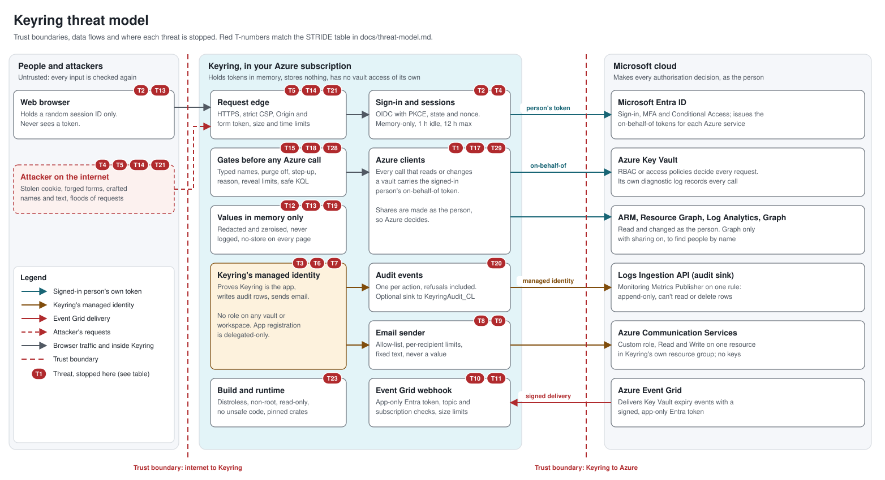

# Threat model

What Keyring protects, who from, where the trust boundaries are, and what stops each threat. This page is the overview for reviewers. The full register, with the mitigation and residual risk for every threat in detail, is in the [design document](Keyring-Design-Document.pdf) (chapter 8, "STRIDE threat model"), and the engineering notes are in [architecture.md](architecture.md#threat-model). The C-numbers are controls: [Security architecture and controls](security/01-security.md) gives each one's source files and tests, and the design document's chapter 8 lists them all, C29 (Defender alerts) included.

This is a summary of what is built and tested, not a guarantee. Some controls are still to be confirmed on a real tenant: see [real-vault-checklist.md](real-vault-checklist.md).

The diagram is drawn by `tools/docs/build-threat-model.py`. Run it again after changing a threat or a control.

## What's worth protecting

| Asset | Where it lives | Why it matters |
| --- | --- | --- |
| Secret values, private keys and certificates | In Key Vault. Values pass through Keyring's memory on the way to the browser and are never stored, cached or logged | The reason Keyring exists |
| People's Entra tokens | In Keyring's server memory, per session. Never in the browser | Each one can act as that person against Key Vault, ARM, Log Analytics and, with sharing on, Graph |
| Keyring's own secrets | The session secret, and the Entra client secret where a managed identity isn't used, in Keyring's own config vault | They seal sign-in state and prove Keyring is the app |
| Keyring's managed identity | Azure | It can act as the app registration, add audit rows and send email. It has no role on any vault or workspace |
| The audit trail | Standard output, and optionally `KeyringAudit_CL`. Key Vault keeps its own diagnostic log | Shows who did what, including what Keyring refused |

## Trust boundaries

| Boundary | Crossed by | What is trusted | What isn't |
| --- | --- | --- | --- |
| Internet to Keyring | The browser, and anyone else who can reach the address | A random session ID in an http-only cookie, checked on every request | Anything a request carries: every form field, name, header and path is checked again on the server |
| Keyring to Azure | Keyring's calls out, with the person's on-behalf-of token or the managed identity's token | Azure's answers: Entra ID, Key Vault and ARM make every authorisation decision, as the person | Keyring has no access of its own to any vault, so a fault in Keyring can't reach further than the signed-in person can |
| Azure to Keyring | Event Grid's delivery to `/hooks/eventgrid` | That Event Grid delivered it, proved by an app-only Entra token | The event's contents beyond fixed fields, checked names and the topic |

## Who Keyring defends against

- **Someone on the internet** with no account, sending crafted requests, forms and floods.
- **Someone with a stolen session cookie**, acting as the person who signed in.
- **A signed-in person** trying to reach more than their own Azure access, or to misuse emails and shares.
- **Someone holding the managed identity's token**, or able to change Keyring's Event Grid subscription.
- **A tampered dependency or image** in the supply chain.

Out of scope: a compromised Entra tenant or Key Vault, and an attacker who already controls the server or a signed-in person's browser ([SECURITY.md](../SECURITY.md)).

## Threats and what stops them

STRIDE categories: **S** spoofing, **T** tampering, **R** repudiation, **I** information disclosure, **D** denial of service, **E** elevation of privilege. IDs match the design document's register.

| ID | STRIDE | Threat | What stops it | What is left |
| --- | --- | --- | --- | --- |
| T1 | E | Keyring used to reach vaults a person can't | C1, C2: every data call carries the person's own on-behalf-of token; Keyring has no app-only token with vault access | Nothing beyond the person's own access |
| T2 | S, E | Stolen session cookie | C4, C10: random 256-bit ID, http-only, `__Host-`, 1 hour idle and 12 hours absolute, server-side sign-out; optional step-up with a maximum sign-in age | Works until the session ends. Set `KEYRING_STEP_UP_MAX_AGE` |
| T3 | E | Managed identity used to act as the app with nobody signed in | C2: delegated-only app registration; on-behalf-of needs a person's token | Holds only while the registration has no application permissions |
| T4 | S | Forged or replayed sign-in | C3: PKCE, state, nonce, full ID token checks, sealed state cookie | None known |
| T5 | T | Cross-site request forgery | C5: vault-bound form token and Origin check on every mutating route | The webhook is exempt and checks a token instead (C15) |
| T6 | T, R | Made-up audit rows with a stolen identity token | C13: append-only role on one rule; can't read, change or delete rows | Check a row that matters against Key Vault's own log |
| T7 | S, I | Stolen identity token used to send email | C2, C14: two-action role on one ACS resource, no keys | Mail from Keyring's domain outside Keyring's own allow-list and rate limit; ACS limits, ACS logs and the Activity Log remain |
| T8 | I | Email used to leak values | C14: fixed text and checked names only, tested at TRACE | None known |
| T9 | D, S | Email used to mail-bomb or phish | C14, C24, C25: strict addresses, allow-list, per-recipient limits | Repeated notices within the limits |
| T10 | S | Webhook used without a session | C15: app-only token checked first, subscriber role, size and event limits | Whoever can change the subscription can trigger notices, within limits |
| T11 | S, T | Made-up expiry events through Event Grid | C15: `topic` check, subscription allow-list, recipient limits, dedupe | Role holders can subscribe a vault they control in a listed subscription |
| T12 | I | Values or tokens in logs | C8: redacting wrappers, zeroised, tested at TRACE in text and JSON | Copies inside upstream HTTP and JSON crates aren't zeroised |
| T13 | I | Values cached, left on screen or on the clipboard | C6, C21: `no-store`; hidden until asked, wiped after 30 seconds; clipboard cleared | A browser can refuse the clipboard clear |
| T14 | T, I | Cross-site scripting | C6: escaping, `default-src 'none'` CSP, no inline code, no `innerHTML` | None known |
| T15 | T | Query injection in the audit views | C7: strict patterns, escaped `let` literals, fixed KQL | None known |
| T16 | T | CSV injection in exports | C7: formula guard on every text field | None known |
| T17 | T, E | Path tricks in names or links | C7: names checked against Key Vault's rules; paging links same host only | None known |
| T18 | T | Accidental or malicious deletes | C9: typed name, purge off by default, no bulk delete | The CLI and portal can still delete |
| T19 | I | Private key leaks | C9, C1: no key export calls; certificate download only when exportable, after a typed name | Certificate User at vault scope can read every secret |
| T20 | R | Actions with no trace | C12: one event per audited request, refusals included, coverage tested | Read-only pages log a request line, not an event |
| T21 | D | Large, slow or many requests | C18: header and request timeouts, body limits, connection cap and age | A front-end proxy covers the rest |
| T22 | T | Tampered pinned list or a shared browser | C21: entries rebuilt from checked names; cleared on sign-out | Names stay if the browser closes without sign-out |
| T23 | T, E | Supply chain or container tampering | C19, C20: pinned toolchain, crates, actions and digests; `cargo deny` and `cargo audit`; distroless, non-root, read-only | Trust in crates and base images that pass the checks |
| T24 | I | Description or owner text exposing sensitive data | C8, C16: never logged; invisible characters refused; the form warns | Tags are readable by anyone who can read the item |
| T25 | S, D | Access requests used to phish or flood owners | C24, C14: fixed roles, owners or admins only, per-person limits | Owners can get fixed-form requests within the limits |
| T26 | I | Watched-read emails telling the wrong people | C25, C14: allow-list, IP only with the allow-list set, per-item cap | Set the allow-list before turning watched reads on |
| T27 | D | Activity emails used to mail-bomb | C25, C14: one email per request, per-item and per-mailbox caps | One email per delete, purge or role use |
| T28 | I | A value shown that its owner meant to limit | C23: reveal limit checked before and after the read; stricter wins | Keyring's own control: the CLI and portal aren't limited |
| T29 | E, S | Stolen session used to share secrets | C26, C1, C5, C12: shares made with the person's own token; `share.grant` event; Sentinel rule | Step-up and the reason gate are off by default. Turn them on with sharing |
| T30 | E | A share without PIM that never ends | C26: marked Overdue, with Revoke | Azure keeps it until someone removes it |
| T31 | I | The Graph token read from memory | C27: used only to search users and groups; never logged | Only consent to Graph where sharing is wanted |
| T32 | R | A guest share recorded as a member | C26, C12: guests told by `#EXT#` in the sign-in name | A renamed guest isn't caught |
| T33 | S | Share emails used to phish | C14, C26: only to the recipient's Graph mail and the sharer; fixed text | Within the per-mailbox limit |
| T34 | E | Sharing used to step round PIM settings | C26: a PIM refusal refuses the share | Nothing beyond what the sharer can do in Azure |
| T35 | I | A non-production value reused in production | C28: in-memory duplicate check, never logged | An operator can confirm a shared credential on purpose |
| T36 | T | A multi-environment write weakening a reveal limit | C23, C28: the stricter limit is carried to every target | A narrow race with a concurrent admin change |
| T37 | T | Script, links or formulas in a Defender alert's text | C29: cleaned, escaped, formula-guarded; Azure portal links only | The text still reads as the attacker wrote it |
| T38 | R | A real Defender alert hidden by a cap or failed read | C29: open alerts first; a cap or failure shows Unknown | Without Security Reader, the check shows Unknown |

## The limits that matter most

- **Keyring's controls are Keyring's own.** Step-up, reasons, reveal limits and the password policy don't stop anyone using the Azure CLI, the portal or an SDK. A Conditional Access policy on Key Vault itself applies everywhere.
- **Sessions are in memory.** Anyone who can read the server's memory can read active tokens. A restart signs everyone out.
- **Keyring trusts Azure's answers.** A compromised Entra tenant or Key Vault is out of scope.
- **Keep the app registration delegated-only.** Adding an application permission would let the managed identity use it with nobody signed in.

The full list is in [architecture.md](architecture.md#known-limits).

## Reporting a problem

See [SECURITY.md](../SECURITY.md) for private reporting.
